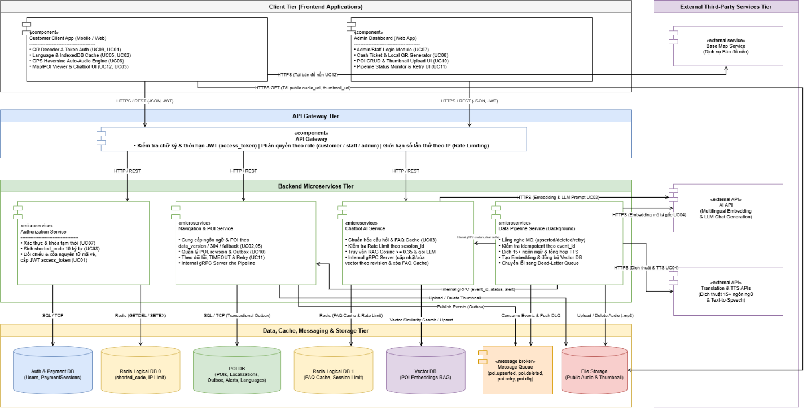
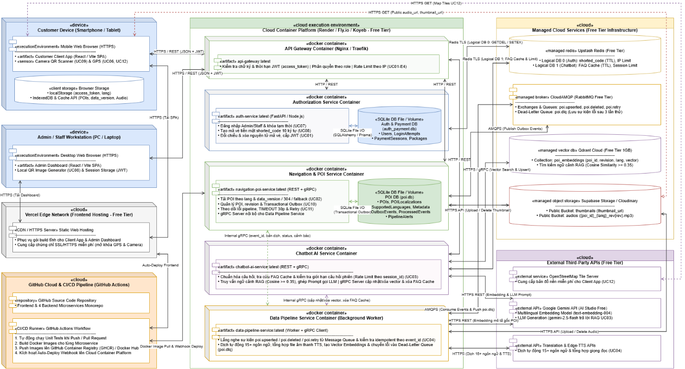

# KIẾN TRÚC HỆ THỐNG VÀ CÔNG NGHỆ (SYSTEM ARCHITECTURE SPECIFICATION)

> [!NOTE]
> Tài liệu này mô tả chi tiết kiến trúc tầng, các Microservices, kênh giao tiếp, công nghệ sử dụng và đường ống CI/CD của dự án theo đúng Lược đồ Component và Lược đồ Triển khai trong PRD.

---

## 1. PHÂN TẦNG KIẾN TRÚC TỔNG THỂ

### 1.1. Tầng Client (Frontend Applications)
Bao gồm 2 ứng dụng Single Page Application (SPA) xây dựng bằng **React + Vite / TypeScript**:
1. **Customer Client App (Mobile Web App):**
   - Tối ưu cho thiết bị di động của du khách tại Chùa Linh Ứng.
   - Chức năng: Quét mã QR (`shorted_code`), xác thực lấy JWT lưu `localStorage`, bộ nhớ đệm `IndexedDB`/`Cache API` lưu danh sách POIs và audio, định vị GPS chạy ngầm tính khoảng cách Haversine tự động phát thuyết minh, màn hình Bản đồ/Danh sách POI và giao diện Chatbot AI.
2. **Admin Dashboard (Desktop Web App):**
   - Dành cho Staff và Admin quản trị.
   - Chức năng: Đăng nhập phân quyền (Admin/Staff), tạo mã vé tiền mặt (`shorted_code`) và sinh mã QR tại quầy cho Staff, CRUD thông tin điểm tham quan POI kèm upload ảnh thumbnail, giám sát tiến độ xử lý ngôn ngữ/audio và trigger Retry cho Admin.

### 1.2. Tầng API Gateway
- **Công nghệ đề xuất:** Nginx / Traefik / FastAPI Gateway.
- **Nhiệm vụ:**
  - Điểm tiếp nhận HTTPS Request duy nhất từ bên ngoài.
  - Kiểm tra tính hợp lệ và thời hạn của JWT (`access_token`).
  - Phân quyền theo vai trò (`customer` / `staff` / `admin`).
  - Giới hạn tốc độ gọi (Rate Limiting) theo IP nhằm chống tấn công DoS/Brute-force.
  - Định tuyến (Reverse Proxy) đến các microservice tương ứng trong mạng nội bộ.

### 1.3. Tầng Backend Microservices
Hệ thống gồm 4 Microservices độc lập:

#### 1. Authorization Service
- **Nhiệm vụ:**
  - Xác thực đăng nhập Admin/Staff, khóa tạm thời tài khoản khi nhập sai quá số lần (`LoginAttempts`).
  - Staff tạo mã vé tiền mặt `shorted_code` (10 ký tự ngẫu nhiên), ghi nhận `PaymentSessions` với trạng thái `Pending` và lưu vào Redis Logical DB 0 với TTL.
  - Du khách gửi mã vé -> Đối chiếu mã, xóa nguyên tử khỏi Redis (`GETDEL`), cập nhật `PaymentSessions` thành `Success`, sinh JWT `access_token` có hạn gửi về Client.
- **Giao tiếp:** HTTP/REST, kết nối Auth & Payment DB và Redis DB 0.

#### 2. Navigation & POI Service
- **Nhiệm vụ:**
  - Cung cấp danh sách POIs, tọa độ, bản địa hóa theo ngôn ngữ yêu cầu.
  - Hỗ trợ cơ chế kiểm tra `data_version`: nếu Client truyền `since_version` trùng với `data_version` hiện tại thì trả lời HTTP `304 Not Modified` ngay lập tức để tiết kiệm băng thông.
  - Admin tạo/sửa POI: Lưu POI DB, tăng `revision`, ghi sự kiện `poi.upserted` vào bảng `OutboxEvents`.
  - Giám sát trạng thái pipeline ngôn ngữ (Pending, Done, Failed), hỗ trợ Admin yêu cầu xử lý lại (Retry).
  - Cung cấp **Internal gRPC Server** để Background Worker cập nhật trạng thái bản dịch/audio và ghi nhận cảnh báo.
- **Giao tiếp:** HTTP/REST (với Gateway), gRPC (với Data Pipeline), SQL (với POI DB), AMQP (Publish sự kiện Outbox lên Message Queue).

#### 3. Chatbot AI Service
- **Nhiệm vụ:**
  - Tiếp nhận câu hỏi ngôn ngữ tự nhiên từ du khách qua giao diện Chatbot.
  - Chuẩn hóa câu hỏi, kiểm tra FAQ Cache trên Redis Logical DB 1 (trả ngay kết quả nếu trùng lặp).
  - Kiểm tra Rate Limit phiên chat theo `session_id`.
  - Gọi mô hình Embedding đa ngôn ngữ (`text-embedding-004`) để chuyển câu hỏi thành vector.
  - Truy vấn Vector DB (Qdrant) tìm kiếm ngữ cảnh liên quan (ngưỡng Cosine Similarity $\ge 0.35$).
  - Ghép prompt ngữ cảnh và gửi tới LLM (`gemini-2.5-flash`) tạo câu trả lời chính xác, sát thực tế Chùa Linh Ứng.
  - Lưu cặp câu hỏi - câu trả lời mới vào Redis Cache và trả về cho du khách.
  - Cung cấp **Internal gRPC Server** cho Background Worker để cập nhật/xóa vector khi POI thay đổi hoặc xóa cache khi câu trả lời lỗi thời.
- **Giao tiếp:** HTTP/REST, gRPC, HTTPS ra ngoài tới Google Gemini AI API, kết nối Redis DB 1 và Vector DB.

#### 4. Data Pipeline Service (Background Worker)
- **Nhiệm vụ:**
  - Chạy ngầm liên tục, lắng nghe Message Queue (RabbitMQ): hàng đợi `poi.upserted`, `poi.deleted`, `poi.retry`.
  - Kiểm tra Idempotency qua bảng `ProcessedEvents` theo `event_id`.
  - Tự động gọi API dịch thuật sang 15+ ngôn ngữ được hỗ trợ.
  - Tự động gọi Text-to-Speech (Edge-TTS / Cloud TTS) tạo file âm thanh `.mp3` thuyết minh cho từng ngôn ngữ.
  - Upload file âm thanh vào Object Storage (`audios/`).
  - Gọi Embedding model từ mô tả gốc của POI và đồng bộ vào Vector DB qua gRPC tới Chatbot Service.
  - Báo cáo kết quả thành công/thất bại và cập nhật trạng thái bản dịch về Navigation & POI Service qua gRPC.
  - Cơ chế tự động thử lại 3 lần với khoảng lùi số mũ (exponential backoff). Nếu quá số lần thử, đẩy sự kiện vào Dead-Letter Queue (`poi.dlq`) và ghi nhận cảnh báo lỗi vào `PipelineAlerts`.

---

## 2. LƯỢC ĐỒ TRIỂN KHAI VÀ HẠ TẦNG (DEPLOYMENT SPECIFICATION)

### 2.1. Hạ tầng Cloud & Triển khai
- **Frontend Hosting:** Vercel Edge Network (cung cấp HTTPS miễn phí, mở khóa quyền truy cập GPS và Camera cho Client).
- **Backend Services:** Cloud Container Platform (Docker Containers trên Render / Fly.io / Koyeb).
- **Redis Cache:** Upstash Redis (Serverless / Free Tier) với 2 Logical DB tách biệt: DB 0 (Auth) và DB 1 (Chatbot).
- **Message Broker:** CloudAMQP (RabbitMQ Managed Instance).
- **Vector DB:** Qdrant Cloud (Managed Vector Database - Free Tier).
- **Object Storage:** Supabase Storage / Cloudinary (Public bucket cho thumbnails và audios).
- **External APIs:**
  - Google Gemini API (AI Studio Free Tier): `text-embedding-004` & `gemini-2.5-flash`.
  - Translation & Edge-TTS: Dịch thuật và tổng hợp giọng nói đa ngôn ngữ.
  - OpenStreetMap: Cung cấp bản đồ nền miễn phí cho Client App.

### 2.2. Quy trình CI/CD Tự động hóa (GitHub Actions)
- Monorepo quản lý toàn bộ mã nguồn Frontend và Backend Microservices.
- GitHub Actions Workflow tự động kích hoạt khi có Push hoặc Pull Request vào nhánh `main`:
  1. **Lint & Test:** Tự động chạy Unit Tests và Linting cho từng Microservice.
  2. **Build Docker:** Đóng gói Docker Images độc lập cho từng service.
  3. **Container Registry:** Đẩy hình ảnh Docker lên GitHub Container Registry (GHCR) hoặc Docker Hub.
  4. **Deploy Webhook:** Kích hoạt Webhook tự động cập nhật container trên Cloud Platform.
  5. **Frontend Deploy:** Tự động build và deploy bản build tĩnh lên Vercel.
