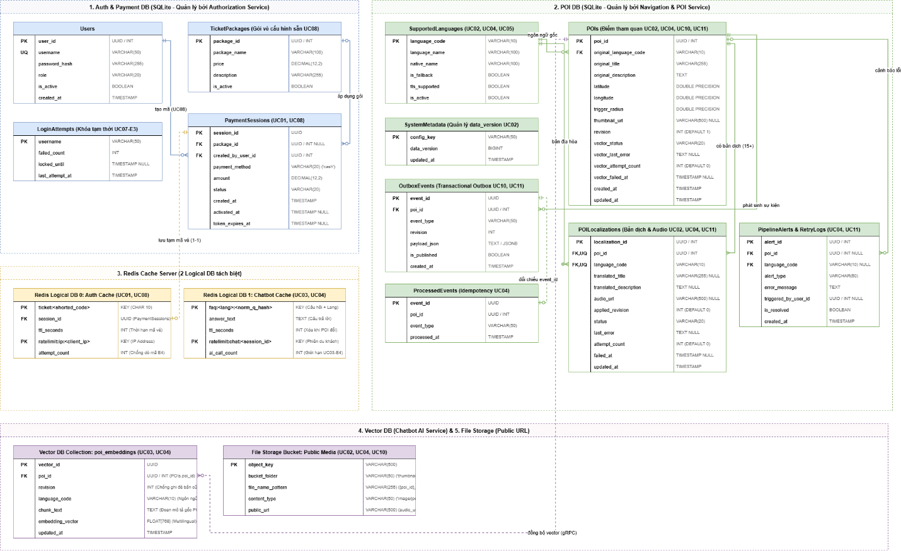

# ĐẶC TẢ CHI TIẾT CƠ SỞ DỮ LIỆU (DATABASE SCHEMA SPECIFICATION)

> [!CAUTION]
> **QUY TẮC BẮT BUỘC:** Database phải tuyệt đối tuân theo tài liệu PRD và lược đồ ERD.
> - Số lượng Database: 2 RDBMS (Auth & Payment DB, POI DB), 1 Redis (2 Logical DBs), 1 Vector DB, 1 File Storage Bucket.
> - Tuyệt đối **KHÔNG** tự ý đổi tên bảng, thêm/bớt cột, đổi kiểu dữ liệu hoặc sửa các ràng buộc nếu không có sự phê duyệt từ người dùng.

---

## 1. CƠ SỞ DỮ LIỆU 1: AUTH & PAYMENT DB (PostgreSQL trên Supabase / SQLite dev-test)
*Quản lý trực tiếp bởi:* **Authorization Service**  
*Mục đích:* Quản lý tài khoản quản trị (Admin), nhân viên (Staff), các gói vé tham quan và các phiên thanh toán tiền mặt sinh token (đồng thời phục vụ truy vấn thống kê Dashboard).

> [!NOTE]
> **Quy chuẩn thực thi trên PostgreSQL (`asyncpg`):** Các cột `TIMESTAMP` được khai báo là `TIMESTAMP WITHOUT TIME ZONE` trong SQLAlchemy. Toàn bộ thời gian UTC khi ghi/so sánh phải dùng **naive UTC datetime** (`datetime.now(timezone.utc).replace(tzinfo=None)` hoặc `datetime.utcnow`), và `normalize_async_db_url()` tự động chuyển host Supabase IPv6 sang Connection Pooler IPv4 cho Render Free Tier.

### 1.1. Bảng `Users`
Lưu trữ thông tin tài khoản Admin và Staff (không hỗ trợ khách đăng ký tự do).

| Tên cột | Kiểu dữ liệu | Ràng buộc | Ý nghĩa / Ghi chú |
| :--- | :--- | :--- | :--- |
| `user_id` | UUID / INT | **PRIMARY KEY** | Mã định danh duy nhất của người dùng |
| `username` | VARCHAR(50) | **UNIQUE, NOT NULL** | Tên đăng nhập (Staff / Admin) |
| `password_hash` | VARCHAR(255) | NOT NULL | Mật khẩu băm (bcrypt / argon2) |
| `role` | VARCHAR(20) | NOT NULL | Vai trò: `'admin'` hoặc `'staff'` |
| `is_active` | BOOLEAN | DEFAULT TRUE | Trạng thái kích hoạt tài khoản |
| `created_at` | TIMESTAMP | DEFAULT CURRENT_TIMESTAMP | Thời điểm tạo tài khoản |

### 1.2. Bảng `TicketPackages`
Danh mục gói vé tham quan cấu hình sẵn (sử dụng trong UC08).

| Tên cột | Kiểu dữ liệu | Ràng buộc | Ý nghĩa / Ghi chú |
| :--- | :--- | :--- | :--- |
| `package_id` | UUID / INT | **PRIMARY KEY** | Mã định danh gói vé |
| `package_name` | VARCHAR(100) | NOT NULL | Tên gói vé (ví dụ: Vé tham quan Chùa Linh Ứng) |
| `price` | DECIMAL(12,2) | NOT NULL | Giá tiền niêm yết (VNĐ) |
| `description` | VARCHAR(255) | NULL | Mô tả quyền lợi của gói vé |
| `is_active` | BOOLEAN | DEFAULT TRUE | Trạng thái mở bán gói vé |

### 1.3. Bảng `LoginAttempts`
Theo dõi số lần đăng nhập thất bại và khóa tài khoản tạm thời (chống Brute-force - UC07-E3).

| Tên cột | Kiểu dữ liệu | Ràng buộc | Ý nghĩa / Ghi chú |
| :--- | :--- | :--- | :--- |
| `username` | VARCHAR(50) | **PRIMARY KEY** | Tên người dùng thử đăng nhập |
| `failed_count` | INT | DEFAULT 0 | Số lần đăng nhập sai liên tiếp |
| `locked_until` | TIMESTAMP | NULL | Thời điểm hết hạn khóa tạm thời (nếu bị khóa) |
| `last_attempt_at` | TIMESTAMP | DEFAULT CURRENT_TIMESTAMP | Thời điểm thử đăng nhập gần nhất |

### 1.4. Bảng `PaymentSessions`
Lưu thông tin phiên thanh toán vé tiền mặt và trạng thái cấp token truy cập (UC01, UC08).

| Tên cột | Kiểu dữ liệu | Ràng buộc | Ý nghĩa / Ghi chú |
| :--- | :--- | :--- | :--- |
| `session_id` | UUID | **PRIMARY KEY** | Mã định danh phiên thanh toán |
| `package_id` | UUID / INT | **FOREIGN KEY** (TicketPackages) NULL | Gói vé áp dụng (nếu có) |
| `created_by_user_id` | UUID / INT | **FOREIGN KEY** (Users) NOT NULL | Staff tạo mã vé tại quầy |
| `payment_method` | VARCHAR(20) | DEFAULT 'cash' | Phương thức thanh toán (mặc định `'cash'`) |
| `amount` | DECIMAL(12,2) | NOT NULL | Số tiền thực thu (VNĐ) |
| `status` | VARCHAR(20) | NOT NULL | Trạng thái: `'Pending'` -> `'Success'` (hoặc `'Expired'`) |
| `created_at` | TIMESTAMP | DEFAULT CURRENT_TIMESTAMP | Thời điểm Staff tạo mã |
| `activated_at` | TIMESTAMP | NULL | Thời điểm du khách kích hoạt mã thành công |
| `token_expires_at` | TIMESTAMP | NULL | Thời điểm `access_token` hết hạn hiệu lực |

---

## 2. CƠ SỞ DỮ LIỆU 2: POI DB (PostgreSQL trên Supabase / SQLite dev-test)
*Quản lý trực tiếp bởi:* **Navigation & POI Service**  
*Mục đích:* Quản lý các điểm tham quan (POIs), tọa độ GPS, bán kính kích hoạt, các ngôn ngữ hỗ trợ, nội dung bản dịch, URL audio và các cơ chế Outbox, Idempotency, Alerts.

### 2.1. Bảng `SupportedLanguages`
Danh mục các ngôn ngữ được hệ thống hỗ trợ (UC02, UC04, UC05).

| Tên cột | Kiểu dữ liệu | Ràng buộc | Ý nghĩa / Ghi chú |
| :--- | :--- | :--- | :--- |
| `language_code` | VARCHAR(10) | **PRIMARY KEY** | Mã ngôn ngữ chuẩn ISO (ví dụ: `'vi'`, `'en'`, `'zh'`, `'ja'`, `'ko'`, `'fr'`) |
| `language_name` | VARCHAR(100) | NOT NULL | Tên tiếng Anh / quốc tế (ví dụ: Vietnamese, English) |
| `native_name` | VARCHAR(100) | NOT NULL | Tên bản địa (ví dụ: Tiếng Việt, English, 中文) |
| `is_fallback` | BOOLEAN | DEFAULT FALSE | Ngôn ngữ mặc định dự phòng khi thiếu bản dịch (ví dụ: `'vi'`) |
| `tts_supported` | BOOLEAN | DEFAULT TRUE | Có hỗ trợ sinh giọng đọc Text-to-Speech không |
| `is_active` | BOOLEAN | DEFAULT TRUE | Trạng thái đang cho phép sử dụng |

### 2.2. Bảng `SystemMetadata`
Lưu trữ phiên bản dữ liệu toàn cục để phục vụ cơ chế phản hồi HTTP 304 Not Modified tối ưu cache cho Client (UC02).

| Tên cột | Kiểu dữ liệu | Ràng buộc | Ý nghĩa / Ghi chú |
| :--- | :--- | :--- | :--- |
| `config_key` | VARCHAR(50) | **PRIMARY KEY** | Khóa cấu hình (ví dụ: `'poi_data_version'`) |
| `data_version` | BIGINT | NOT NULL DEFAULT 1 | Số phiên bản tăng dần mỗi khi có thay đổi dữ liệu POI |
| `updated_at` | TIMESTAMP | DEFAULT CURRENT_TIMESTAMP | Thời điểm cập nhật phiên bản |

### 2.3. Bảng `POIs` (Điểm tham quan)
Thông tin gốc của điểm tham quan tại Chùa Linh Ứng (UC02, UC04, UC10, UC11).

| Tên cột | Kiểu dữ liệu | Ràng buộc | Ý nghĩa / Ghi chú |
| :--- | :--- | :--- | :--- |
| `poi_id` | UUID / INT | **PRIMARY KEY** | Mã định danh điểm tham quan |
| `original_language_code` | VARCHAR(10) | **FOREIGN KEY** (SupportedLanguages) | Mã ngôn ngữ của nội dung gốc do Admin nhập (ví dụ: `'vi'`) |
| `original_title` | VARCHAR(255) | NOT NULL | Tiêu đề gốc của POI (ví dụ: Tượng Phật Bà Quan Âm) |
| `original_description` | TEXT | NOT NULL | Bài thuyết minh gốc |
| `latitude` | DOUBLE PRECISION | NOT NULL | Vĩ độ GPS của POI |
| `longitude` | DOUBLE PRECISION | NOT NULL | Kinh độ GPS của POI |
| `trigger_radius` | DOUBLE PRECISION | NOT NULL | Bán kính kích hoạt thuyết minh tự động (mét, > 0) |
| `thumbnail_url` | VARCHAR(500) | NULL | Đường dẫn ảnh đại diện công khai |
| `revision` | INT | NOT NULL DEFAULT 1 | Số phiên bản sửa đổi (tăng mỗi khi sửa tiêu đề/mô tả gốc) |
| `vector_status` | VARCHAR(20) | NOT NULL DEFAULT 'Pending' | Trạng thái đồng bộ Vector DB: `'Pending'`, `'Synced'`, `'Failed'` |
| `vector_last_error` | TEXT | NULL | Thông điệp lỗi đồng bộ Vector nếu thất bại |
| `vector_attempt_count` | INT | NOT NULL DEFAULT 0 | Số lần thử đồng bộ Vector |
| `vector_failed_at` | TIMESTAMP | NULL | Thời điểm lỗi đồng bộ Vector |
| `created_at` | TIMESTAMP | DEFAULT CURRENT_TIMESTAMP | Thời điểm tạo POI |
| `updated_at` | TIMESTAMP | DEFAULT CURRENT_TIMESTAMP | Thời điểm cập nhật POI |

### 2.4. Bảng `POILocalizations` (Bản dịch & Tệp Audio)
Lưu trữ bản dịch tiêu đề, mô tả và tệp audio thuyết minh tương ứng theo từng ngôn ngữ (UC02, UC04, UC11).

| Tên cột | Kiểu dữ liệu | Ràng buộc | Ý nghĩa / Ghi chú |
| :--- | :--- | :--- | :--- |
| `localization_id` | UUID / INT | **PRIMARY KEY** | Mã định danh bản địa hóa |
| `poi_id` | UUID / INT | **FOREIGN KEY** (POIs), NOT NULL | Thuộc về POI nào |
| `language_code` | VARCHAR(10) | **FOREIGN KEY** (SupportedLanguages), NOT NULL | Ngôn ngữ dịch |
| `translated_title` | VARCHAR(255) | NULL | Tiêu đề đã được dịch |
| `translated_description` | TEXT | NULL | Bài thuyết minh đã được dịch |
| `audio_url` | VARCHAR(500) | NULL | Đường dẫn file âm thanh `.mp3` trên public bucket |
| `applied_revision` | INT | NOT NULL DEFAULT 0 | Revision của POI được áp dụng trong bản dịch này |
| `status` | VARCHAR(20) | NOT NULL DEFAULT 'Pending' | Trạng thái xử lý: `'Pending'`, `'Done'`, `'Failed'` |
| `last_error` | TEXT | NULL | Nội dung lỗi nếu quá trình dịch/tổng hợp audio thất bại |
| `attempt_count` | INT | NOT NULL DEFAULT 0 | Số lần thử dịch/tạo audio |
| `failed_at` | TIMESTAMP | NULL | Thời điểm xảy ra lỗi |
| `updated_at` | TIMESTAMP | DEFAULT CURRENT_TIMESTAMP | Thời điểm cập nhật |
| *Ràng buộc duy nhất* | `UNIQUE(poi_id, language_code)` | | Mỗi POI chỉ có tối đa 1 bản dịch cho 1 ngôn ngữ |

### 2.5. Bảng `OutboxEvents` (Transactional Outbox Pattern)
Ghi nhận sự kiện thay đổi dữ liệu POI trong cùng 1 transaction lưu DB để gửi sang Message Broker an toàn (UC10, UC11).

| Tên cột | Kiểu dữ liệu | Ràng buộc | Ý nghĩa / Ghi chú |
| :--- | :--- | :--- | :--- |
| `event_id` | UUID | **PRIMARY KEY** | Mã định danh duy nhất của sự kiện |
| `poi_id` | UUID / INT | **FOREIGN KEY** (POIs) | POI liên quan đến sự kiện |
| `event_type` | VARCHAR(50) | NOT NULL | Loại sự kiện: `'poi.upserted'`, `'poi.deleted'`, `'poi.retry'` |
| `revision` | INT | NOT NULL | Số revision của POI tại thời điểm bắn sự kiện |
| `payload_json` | TEXT / JSONB | NOT NULL | Toàn bộ dữ liệu chi tiết của sự kiện |
| `is_published` | BOOLEAN | NOT NULL DEFAULT FALSE | Đã publish thành công lên Message Broker chưa |
| `created_at` | TIMESTAMP | DEFAULT CURRENT_TIMESTAMP | Thời điểm phát sinh sự kiện |

### 2.6. Bảng `ProcessedEvents` (Đảm bảo Idempotency)
Lưu lại các sự kiện đã được tiêu thụ thành công bởi Data Pipeline Service để tránh xử lý lặp lại (UC04).

| Tên cột | Kiểu dữ liệu | Ràng buộc | Ý nghĩa / Ghi chú |
| :--- | :--- | :--- | :--- |
| `event_id` | UUID | **PRIMARY KEY** | Mã sự kiện từ OutboxEvents |
| `poi_id` | UUID / INT | NOT NULL | POI đã được xử lý |
| `event_type` | VARCHAR(50) | NOT NULL | Loại sự kiện đã xử lý |
| `processed_at` | TIMESTAMP | DEFAULT CURRENT_TIMESTAMP | Thời điểm xử lý xong |

### 2.7. Bảng `PipelineAlerts` (Nhật ký cảnh báo lỗi & Retry)
Theo dõi các cảnh báo lỗi trong quá trình dịch thuật, sinh TTS, đồng bộ Vector DB và nhật ký retry của Admin (UC04, UC11).

| Tên cột | Kiểu dữ liệu | Ràng buộc | Ý nghĩa / Ghi chú |
| :--- | :--- | :--- | :--- |
| `alert_id` | UUID / INT | **PRIMARY KEY** | Mã định danh cảnh báo |
| `poi_id` | UUID / INT | **FOREIGN KEY** (POIs) NULL | Điểm tham quan bị lỗi |
| `language_code` | VARCHAR(10) | **FOREIGN KEY** (SupportedLanguages) NULL | Ngôn ngữ bị lỗi (nếu có) |
| `alert_type` | VARCHAR(50) | NOT NULL | Phân loại lỗi (`'TRANSLATION_FAILED'`, `'TTS_FAILED'`, `'VECTOR_FAILED'`) |
| `error_message` | TEXT | NOT NULL | Chi tiết thông điệp lỗi kỹ thuật |
| `triggered_by_user_id` | UUID / INT | NULL | ID của Admin/User thực hiện retry |
| `is_resolved` | BOOLEAN | DEFAULT FALSE | Đã được xử lý/khắc phục chưa |
| `created_at` | TIMESTAMP | DEFAULT CURRENT_TIMESTAMP | Thời điểm ghi nhận cảnh báo |

---

## 3. CƠ SỞ DỮ LIỆU 3: REDIS CACHE SERVER (2 LOGICAL DATABASES)
Chạy trên 1 instance Redis duy nhất, được phân tách làm 2 logical database độc lập theo kiến trúc Microservices:

### 3.1. Logical DB 0: Auth Cache (Quản lý bởi Authorization Service - UC01, UC08)
- `ticket:<shorted_code>`:
  - *Loại dữ liệu:* String / Key-Value
  - *Key:* Mã vé ngắn gồm 10 ký tự do Staff tạo (ví dụ: `ticket:A9B8C7D6E5`).
  - *Value:* `session_id` (UUID gắn liền với bản ghi trong `PaymentSessions`).
  - *TTL:* Thời gian sống cấu hình (ví dụ: 15-30 phút sau khi Staff thu tiền).
  - *Thao tác đổi mã:* Thao tác nguyên tử `GETDEL` (lấy và xóa ngay lập tức) để đảm bảo 1 mã chỉ đổi token được 1 lần duy nhất.
- `ratelimit:ip:<client_ip>`:
  - *Key:* Địa chỉ IP của Client gửi yêu cầu.
  - *Value:* `attempt_count` (số lần thử gửi mã vé). Ngưỡng giới hạn cao để tránh chặn nhầm du khách dùng chung WiFi Chùa Linh Ứng.

### 3.2. Logical DB 1: Chatbot Cache (Quản lý bởi Chatbot AI Service - UC03, UC04)
- `faq:<lang>:<norm_q_hash>`:
  - *Key:* Mã ngôn ngữ và mã hash MD5/SHA256 của câu hỏi đã chuẩn hóa (chuyển chữ thường, xóa khoảng trắng thừa).
  - *Value:* Nội dung văn bản câu trả lời đã tạo từ trước.
  - *TTL:* Thời gian sống (ví dụ: 24 giờ) để giảm thiểu chi phí và độ trễ gọi LLM API.
- `ratelimit:chat:<session_id>`:
  - *Key:* `session_id` của du khách.
  - *Value:* `ai_call_count` (số lượt gọi Chatbot AI trong phiên) để chống spam chi phí AI.

---

## 4. CƠ SỞ DỮ LIỆU 4: VECTOR DB (Qdrant Cloud / pgvector)
*Quản lý bởi:* **Chatbot AI Service**  
*Mục đích:* Lưu trữ các vector embeddings của mô tả POI để phục vụ kỹ thuật RAG (Retrieval-Augmented Generation) cho Chatbot.

### Collection: `poi_embeddings`
- `vector_id`: UUID (Primary Key)
- `poi_id`: INT / STRING (Tham chiếu tới POI trong POI DB; `0` hoặc metadata riêng cho `knowledge_base` tổng quan)
- `revision`: INT (Dùng để chống ghi đè dữ liệu cũ khi có sự kiện cập nhật)
- `language_code`: VARCHAR(10) (Ngôn ngữ của đoạn text - nhúng từ mô tả gốc hoặc tri thức tổng quan)
- `chunk_text`: TEXT (Nội dung văn bản được chia nhỏ để nhúng)
- `embedding_vector`: `FLOAT[768]` (Vector biểu diễn từ mô hình nhúng đa ngôn ngữ `gemini-embedding-001` với `output_dimensionality=768`)
- `updated_at`: TIMESTAMP

---

## 5. KHO LƯU TRỮ TỆP CÔNG KHAI (FILE STORAGE BUCKET)
*Dịch vụ:* **Supabase Storage (gọi trực tiếp REST API qua `httpx`, fallback cục bộ `/media/` khi offline)**  
*Chính sách:* Bucket `public-media` có quyền đọc công khai (Public URL).

- **Thư mục ảnh:** `thumbnails/`  
  - Tên tệp: `poi_thumb_<8hex>.[jpg|png|webp]` (Public URL Supabase hoặc fallback `/media/thumbnails/...`)  
  - Sử dụng trong: `POIs.thumbnail_url`
- **Thư mục âm thanh thuyết minh:** `audios/`  
  - Tên tệp theo quy chuẩn: `poi_{poi_id}_{language_code}_rev{revision}.mp3`  
  - Sử dụng trong: `POILocalizations.audio_url`
