# TÀI LIỆU YÊU CẦU SẢN PHẨM (PRD)
## Ứng dụng Thuyết minh tự động đa ngôn ngữ cho Chùa Linh Ứng

**Đơn vị:** TRƯỜNG ĐẠI HỌC SÀI GÒN - KHOA CÔNG NGHỆ THÔNG TIN  
**Học phần:** Công nghệ phần mềm  
**Giảng viên hướng dẫn:** Nguyễn Quốc Huy  
**Sinh viên thực hiện:**
- Nguyễn Mạnh Thắng (MSSV: 3124411283)
- Phạm Minh Khôi (MSSV: 3124411135)
- Trương Thuận Phú (MSSV: 3124411234)

---

Nguyễn Mạnh Thắng	3124411283

Phạm Minh Khôi	3124411135

Trương Thuận Phú	3124411234

## Problem alignment

Du khách tham quan tại Chùa Linh Ứng đang thiếu sự hướng dẫn đa ngôn ngữ hấp dẫn và phù hợp với ngôn ngữ ưa thích của họ. Họ thường có câu hỏi trong quá trình tham quan nhưng không có nguồn hỗ trợ thông tin tức thời.

Bên cạnh đó, việc triển khai các hệ thống truyền thống không đáp ứng được khả năng mở rộng, dễ gây nghẽn cổ chai khi số lượng khách truy cập đông, hoặc khi phải xử lý các tác vụ nặng như tự động dịch thuật và tạo audio AI. Hệ quả là ứng dụng phản hồi chậm, thời gian chết cao, gây ảnh hưởng trực tiếp đến trải nghiệm của du khách.

## High-Level approach

Giải pháp đề xuất là xây dựng kiến trúc hệ thống Backend theo mô hình Microservices, tách biệt hệ thống thành các services độc lập để đảm bảo hiệu suất cao, dễ dàng quản lý và tự động hóa quy trình triển khai (CI/CD).

Chức năng chính của từng Service:

API Gateway & Authorization Service: Quản lý xác thực dựa trên access_token. Hỗ trợ cấp mã vé tiền mặt (shorted_code, hiển thị dưới dạng văn bản hoặc mã QR) để khách đổi lấy token.

Navigation & POI Service: Quản lý và cung cấp dữ liệu điểm đến (POIs, tọa độ, bán kính kích hoạt, bản địa hóa); việc xác định vị trí và kích hoạt thuyết minh theo GPS được thực hiện trên Client (UC06).

Chatbot AI Service: Xử lý câu hỏi ngôn ngữ tự nhiên, giao tiếp với mô hình AI và Vector DB.

Data Pipeline Service: Chạy ngầm, giao tiếp với API dịch thuật và Text-to-Speech để tự động dịch tiêu đề và mô tả POI sang 15+ ngôn ngữ và tạo file âm thanh.

## Narrative

Du khách đến tham quan quét QR code tại cổng để mở ứng dụng, thanh toán tiền mặt tại quầy và nhận mã vé từ Staff; sau đó quét mã QR hiển thị trên màn hình của Staff (hoặc nhập thủ công mã vé) để đăng nhập.

Hệ thống Authorization Service xác thực và cấp access_token cho người dùng hợp lệ.

Ứng dụng Client gọi Navigation & POI Service để tải danh sách Điểm tham quan (POI) và dữ liệu của ngôn ngữ đã chọn, kèm số phiên bản để chỉ tải lại khi dữ liệu có thay đổi, nhằm tối ưu hiệu năng.

Trong quá trình vận hành, khi Admin thêm một POI mới, Data Pipeline Service sẽ nhận thông điệp qua Message Queue, tự động dịch nội dung và tạo Audio ngầm mà không làm gián đoạn trải nghiệm của người dùng hiện tại.

Nếu có thắc mắc trong quá trình tham quan, du khách đặt câu hỏi qua chat. Chatbot AI Service sẽ truy vấn Vector DB lấy ngữ cảnh và trả lời tức thì.

## Goals

Kiến trúc: Phân tách hệ thống thành các Microservices độc lập để dễ dàng scale và quản lý.

Giao tiếp liên dịch vụ: Xây dựng luồng giao tiếp bảo mật và đồng bộ/bất đồng bộ giữa các services thông qua HTTP/REST, gRPC và Message Queue (RabbitMQ/Kafka).

Hiệu suất: Thiết lập luồng tải dữ liệu tối ưu, Client chỉ tải dữ liệu của ngôn ngữ đã chọn và chỉ tải lại khi dữ liệu có phiên bản mới.

Tự động hóa (CI/CD): Chuẩn hóa luồng CI/CD thông qua GitHub Actions, tự động chạy Unit Test và Build Docker Image để triển khai.

## Solution alignment

Hệ thống đứng giữa Client (Mobile/Web App) và các dịch vụ bên thứ ba (dịch vụ AI, dịch vụ bản đồ nền). Mô hình dữ liệu bám sát nguyên tắc mỗi service có một cơ sở dữ liệu độc lập:

Auth & Payment DB: Quản lý bởi Authorization Service. Lưu trữ tài khoản và giao dịch.

POI DB: Quản lý bởi Navigation & POI Service. Lưu tọa độ, bán kính kích hoạt và các bản dịch, đường dẫn audio của POI; đồng thời lưu trạng thái xử lý từng ngôn ngữ, event_id đã xử lý và cảnh báo lỗi của Data Pipeline Service, cùng danh sách ngôn ngữ hỗ trợ.

Vector DB: Quản lý bởi Chatbot Service phục vụ truy xuất RAG.

Redis Cache: gồm hai logical DB tách biệt trên cùng một Redis server: một do Authorization Service quản lý để lưu tạm thời các mã vé tiền mặt (shorted_code), một do Chatbot Service quản lý để cache câu hỏi thường gặp; mỗi service chỉ truy cập logical DB của mình.

Kho lưu trữ tệp (File Storage): Lưu tệp âm thanh thuyết minh và ảnh thumbnail của POI, được truy cập công khai (public URL) qua đường dẫn audio_url và thumbnail_url.

## Product backlog

### Sơ đồ Use Case tổng quan hệ thống

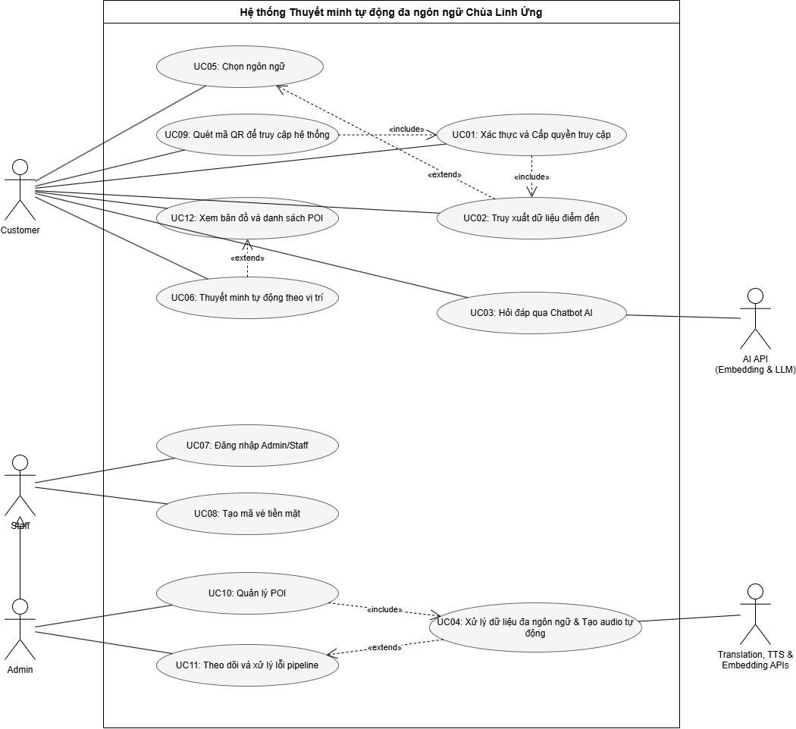

### UC01 - Xác thực và Cấp quyền truy cập

#### Bảng đặc tả chi tiết UC01

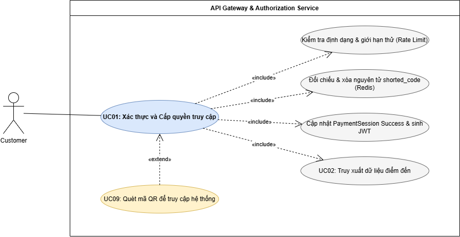

| Thuộc tính / Bước | Tác nhân (Actor Action) | Phản hồi hệ thống (System Response) |
| :--- | :--- | :--- |
| **Use Case Number:** | UC01 | UC01 |
| **Use Case Name:** | Xác thực và Cấp quyền truy cập. | Xác thực và Cấp quyền truy cập. |
| **Actor(s):** | Customer (Client App). | Customer (Client App). |
| **Maturity:** | Focused. | Focused. |
| **Summary:** | Customer gửi shorted_code tiền mặt do Staff cấp (UC08) tới hệ thống để kiểm tra và nhận access_token truy cập ứng dụng. Mã có thể được nhập thủ công hoặc được điền tự động sau khi Customer quét mã QR (UC09). | Customer gửi shorted_code tiền mặt do Staff cấp (UC08) tới hệ thống để kiểm tra và nhận access_token truy cập ứng dụng. Mã có thể được nhập thủ công hoặc được điền tự động sau khi Customer quét mã QR (UC09). |
| **Basic Course of Events:** | Actor Action | System Response |
| **Basic Course of Events:** | 1. Customer nhập shorted_code do Staff cấp trên ứng dụng rồi gửi yêu cầu xác thực; hoặc quét mã QR ở UC09 thì Client App tự động điền mã và gửi yêu cầu. |  |
| **Basic Course of Events:** |  | 2. API Gateway tiếp nhận HTTPS Request, áp dụng giới hạn số lần thử và định tuyến đến Authorization Service. E4. |
| **Basic Course of Events:** |  | 3. Authorization Service kiểm tra mã không bị bỏ trống, đúng định dạng shorted_code (10 ký tự). E1. |
| **Basic Course of Events:** |  | 4. Authorization Service truy vấn Redis Cache, đối chiếu mã, lấy session_id gắn với mã và xóa mã khỏi Redis ngay khi đối chiếu thành công (một thao tác nguyên tử, dùng một lần). E2. |
| **Basic Course of Events:** |  | 5. Hệ thống tra PaymentSession theo session_id trong Auth & Payment DB, chuyển sang Success và sinh access_token (JWT) có thời hạn, gắn với session_id của yêu cầu. E3. |
| **Basic Course of Events:** |  | 6. Hệ thống trả access_token (kèm thời điểm hết hạn) về cho Client App. |
| **Basic Course of Events:** | 7. Client App lưu access_token vào localStorage để sử dụng cho các tính năng tiếp theo. |  |
| **Basic Course of Events:** | 8. Client App tự động kích hoạt UC02. |  |
| **Basic Course of Events:** |  | 9. Usecase kết thúc tại đây. |
| **Alternative Path:** | Không có. | Không có. |
| **Exception Path:** | E1. Mã xác thực bị bỏ trống hoặc sai định dạng → Hệ thống trả về mã lỗi 400 Bad Request (error_code: INVALID_CODE_FORMAT); Client App hiển thị “Vui lòng nhập mã xác thực hợp lệ” theo ngôn ngữ đang chọn. E2. Mã shorted_code không tồn tại, đã được sử dụng hoặc hết hạn (TTL) trong Redis Cache → Hệ thống trả về lỗi 401 Unauthorized (error_code: CODE_INVALID_OR_EXPIRED); Client App hiển thị “Mã xác thực không hợp lệ hoặc đã hết hạn”. E3. Auth & Payment DB hoặc Redis Cache không khả dụng → Hệ thống trả về 503 Service Unavailable (error_code: AUTH_SERVICE_UNAVAILABLE); Client App hiển thị “Hệ thống đang bận, vui lòng thử lại”. Nếu lỗi xảy ra sau khi shorted_code đã bị xóa, hệ thống khôi phục lại mã trong Redis Cache để Customer có thể thử lại. E4. Vượt giới hạn số lần thử theo IP (đặt ngưỡng đủ cao vì nhiều du khách có thể dùng chung IP của WiFi hoặc mạng di động) → 429 Too Many Requests (error_code: RATE_LIMIT_EXCEEDED). | E1. Mã xác thực bị bỏ trống hoặc sai định dạng → Hệ thống trả về mã lỗi 400 Bad Request (error_code: INVALID_CODE_FORMAT); Client App hiển thị “Vui lòng nhập mã xác thực hợp lệ” theo ngôn ngữ đang chọn. E2. Mã shorted_code không tồn tại, đã được sử dụng hoặc hết hạn (TTL) trong Redis Cache → Hệ thống trả về lỗi 401 Unauthorized (error_code: CODE_INVALID_OR_EXPIRED); Client App hiển thị “Mã xác thực không hợp lệ hoặc đã hết hạn”. E3. Auth & Payment DB hoặc Redis Cache không khả dụng → Hệ thống trả về 503 Service Unavailable (error_code: AUTH_SERVICE_UNAVAILABLE); Client App hiển thị “Hệ thống đang bận, vui lòng thử lại”. Nếu lỗi xảy ra sau khi shorted_code đã bị xóa, hệ thống khôi phục lại mã trong Redis Cache để Customer có thể thử lại. E4. Vượt giới hạn số lần thử theo IP (đặt ngưỡng đủ cao vì nhiều du khách có thể dùng chung IP của WiFi hoặc mạng di động) → 429 Too Many Requests (error_code: RATE_LIMIT_EXCEEDED). |
| **Extension Points:** | Không có. (UC02 được kích hoạt tuần tự sau UC01 khi Client App nhận được access_token.) | Không có. (UC02 được kích hoạt tuần tự sau UC01 khi Client App nhận được access_token.) |
| **Triggers:** | Customer đã thanh toán tiền mặt tại quầy và nhận shorted_code từ Staff, dưới dạng văn bản hoặc mã QR (UC09). | Customer đã thanh toán tiền mặt tại quầy và nhận shorted_code từ Staff, dưới dạng văn bản hoặc mã QR (UC09). |
| **Assumptions:** | Hệ thống Auth & Payment DB (SQL Server/PostgreSQL), Redis Cache hoạt động bình thường. | Hệ thống Auth & Payment DB (SQL Server/PostgreSQL), Redis Cache hoạt động bình thường. |
| **Preconditions:** | Customer chưa có access_token hợp lệ trong localStorage (hoặc token cũ đã hết hạn). Customer đã chọn ngôn ngữ (UC05). Customer đã nhận shorted_code do Staff cấp (UC08), dạng văn bản hoặc mã QR (UC09). | Customer chưa có access_token hợp lệ trong localStorage (hoặc token cũ đã hết hạn). Customer đã chọn ngôn ngữ (UC05). Customer đã nhận shorted_code do Staff cấp (UC08), dạng văn bản hoặc mã QR (UC09). |
| **Post Conditions:** | Customer nhận được access_token hợp lệ. Trạng thái thanh toán được ghi nhận Success trong Auth & Payment DB và shorted_code đã bị xóa khỏi Redis Cache. | Customer nhận được access_token hợp lệ. Trạng thái thanh toán được ghi nhận Success trong Auth & Payment DB và shorted_code đã bị xóa khỏi Redis Cache. |
| **Reference: Business Rules** | - Mỗi mã shorted_code lưu trong Redis Cache có thời hạn (TTL) nhất định và chỉ đổi lấy token được 1 lần duy nhất; việc đối chiếu và xóa mã là một thao tác nguyên tử để khi hai thiết bị gửi cùng lúc chỉ một thiết bị thành công. - shorted_code nhập thủ công và shorted_code lấy từ mã QR (UC09) là cùng một giá trị và được xử lý hoàn toàn giống nhau; hệ thống không phân biệt cách Customer cung cấp mã. - access_token là JWT có thời hạn (mặc định đến hết ngày tham quan, giá trị cấu hình được), chứa session_id và role = customer. - Mọi request gọi đến các service khác sau bước này đều bắt buộc đính kèm access_token; API Gateway tự kiểm tra chữ ký, thời hạn của token và từ chối (401, error_code: TOKEN_INVALID) khi token không hợp lệ hoặc đã hết hạn. - Trạng thái thanh toán dùng thống nhất ba giá trị: Pending, Success, Failed. - Hệ thống trả lỗi dưới dạng error_code; Client App hiển thị thông báo theo ngôn ngữ đã chọn (UC05). - Mỗi mã chỉ dùng một lần nên một mã chỉ cấp quyền truy cập cho một thiết bị. Hệ thống không có chức năng cấp lại mã hoặc khôi phục token: mất token (đổi trình duyệt, xóa dữ liệu trình duyệt) thì không lấy lại được quyền truy cập đã cấp. - Endpoint xác thực là công khai nên áp dụng giới hạn số lần thử để chống dò mã. | - Mỗi mã shorted_code lưu trong Redis Cache có thời hạn (TTL) nhất định và chỉ đổi lấy token được 1 lần duy nhất; việc đối chiếu và xóa mã là một thao tác nguyên tử để khi hai thiết bị gửi cùng lúc chỉ một thiết bị thành công. - shorted_code nhập thủ công và shorted_code lấy từ mã QR (UC09) là cùng một giá trị và được xử lý hoàn toàn giống nhau; hệ thống không phân biệt cách Customer cung cấp mã. - access_token là JWT có thời hạn (mặc định đến hết ngày tham quan, giá trị cấu hình được), chứa session_id và role = customer. - Mọi request gọi đến các service khác sau bước này đều bắt buộc đính kèm access_token; API Gateway tự kiểm tra chữ ký, thời hạn của token và từ chối (401, error_code: TOKEN_INVALID) khi token không hợp lệ hoặc đã hết hạn. - Trạng thái thanh toán dùng thống nhất ba giá trị: Pending, Success, Failed. - Hệ thống trả lỗi dưới dạng error_code; Client App hiển thị thông báo theo ngôn ngữ đã chọn (UC05). - Mỗi mã chỉ dùng một lần nên một mã chỉ cấp quyền truy cập cho một thiết bị. Hệ thống không có chức năng cấp lại mã hoặc khôi phục token: mất token (đổi trình duyệt, xóa dữ liệu trình duyệt) thì không lấy lại được quyền truy cập đã cấp. - Endpoint xác thực là công khai nên áp dụng giới hạn số lần thử để chống dò mã. |
| **Author(s):** | Nguyễn Mạnh Thắng. | Nguyễn Mạnh Thắng. |
| **Date:** | Bản gốc: 11/10/2026. Hiệu chỉnh: 11/11/2026 | Bản gốc: 11/10/2026. Hiệu chỉnh: 11/11/2026 |
| **Activity Diagram:** | Activity Diagram: | Activity Diagram: |

**Activity Diagram UC01:**

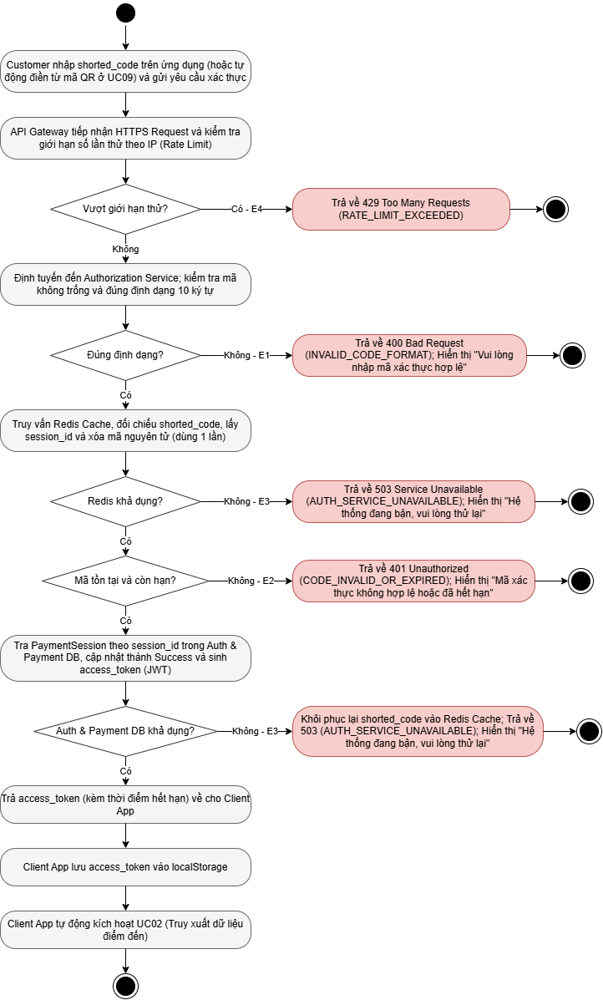

### UC02 - Truy xuất dữ liệu điểm đến

#### Bảng đặc tả chi tiết UC02

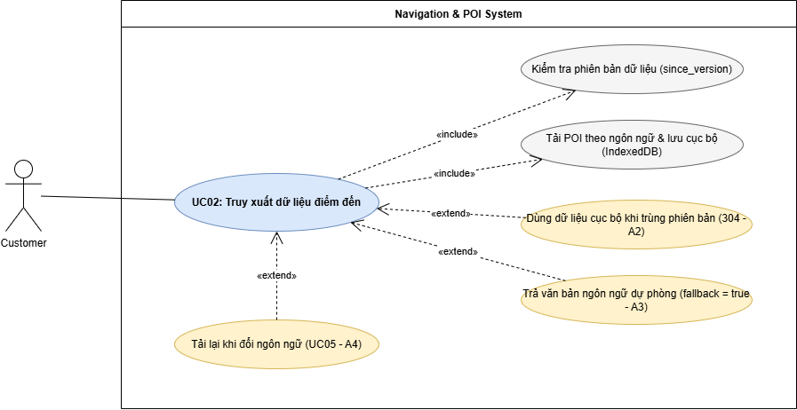

| Thuộc tính / Bước | Tác nhân (Actor Action) | Phản hồi hệ thống (System Response) |
| :--- | :--- | :--- |
| **Use Case Number:** | UC02 | UC02 |
| **Use Case Name:** | Truy xuất dữ liệu điểm đến. | Truy xuất dữ liệu điểm đến. |
| **Actor(s):** | Customer (Client App – Mobile / Web App). | Customer (Client App – Mobile / Web App). |
| **Maturity:** | Focused. | Focused. |
| **Summary:** | Sau khi xác thực thành công (UC01) và chọn ngôn ngữ (UC05), Client App gọi API tải dữ liệu POI (tọa độ GPS, bán kính kích hoạt, thumbnail, văn bản và đường dẫn audio) của đúng ngôn ngữ đã chọn, kèm data_version. Ở các lần mở lại ứng dụng hoặc khi đổi ngôn ngữ, Client App chỉ tải lại khi dữ liệu có phiên bản mới. | Sau khi xác thực thành công (UC01) và chọn ngôn ngữ (UC05), Client App gọi API tải dữ liệu POI (tọa độ GPS, bán kính kích hoạt, thumbnail, văn bản và đường dẫn audio) của đúng ngôn ngữ đã chọn, kèm data_version. Ở các lần mở lại ứng dụng hoặc khi đổi ngôn ngữ, Client App chỉ tải lại khi dữ liệu có phiên bản mới. |
| **Basic Course of Events:** | Actor Action | System Response |
| **Basic Course of Events:** | 1. Sau khi có access_token (UC01) và ngôn ngữ đã chọn (UC05), Client App tự động gửi request lấy danh sách POI kèm access_token, tham số lang và since_version (phiên bản dữ liệu đang lưu cục bộ, bỏ trống ở lần tải đầu) tới API Gateway. |  |
| **Basic Course of Events:** |  | 2. API Gateway tự kiểm tra chữ ký và thời hạn của access_token. A1. |
| **Basic Course of Events:** |  | 3. Khi token hợp lệ, API Gateway chuyển tiếp request đến Navigation & POI Service. |
| **Basic Course of Events:** |  | 4. Navigation & POI Service kiểm tra tham số lang thuộc danh sách ngôn ngữ được hỗ trợ (E3), sau đó so sánh since_version với data_version hiện tại. Nếu khác nhau hoặc since_version bỏ trống thì tiếp tục; nếu trùng nhau thì chuyển sang A2. |
| **Basic Course of Events:** |  | 5. Navigation & POI Service truy vấn POI DB để đọc danh sách điểm tham quan, tọa độ, bán kính, hình ảnh thumbnail và bản địa hóa (tiêu đề, mô tả, audio_url) của ngôn ngữ được yêu cầu. A3, E1, E2. |
| **Basic Course of Events:** |  | 6. Navigation & POI Service đóng gói dữ liệu thành định dạng JSON kèm data_version và trả về cho Client App qua API Gateway. |
| **Basic Course of Events:** | 7. Client App lưu dữ liệu POI và data_version vào bộ nhớ cục bộ của thiết bị (IndexedDB/Cache API) theo từng ngôn ngữ, sau đó hiển thị màn hình Bản đồ/Danh sách POI (UC12). |  |
| **Basic Course of Events:** | 8. Khi cần phát audio của một POI (UC06), Client App tải tệp âm thanh từ audio_url và lưu đệm cục bộ; Client App có thể tải trước audio của các POI gần vị trí hiện tại. |  |
| **Basic Course of Events:** |  | 9. Usecase kết thúc tại đây. |
| **Alternative Path:** | A1. Token xác thực không hợp lệ hoặc đã hết hạn. | A1. Token xác thực không hợp lệ hoặc đã hết hạn. |
| **Alternative Path:** | Actor Action | System Response |
| **Alternative Path:** | A1.1. Client App gửi request kèm access_token đã hết hạn hoặc bị chỉnh sửa. |  |
| **Alternative Path:** |  | A1.2. Hệ thống từ chối truy cập, trả về mã lỗi 401 Unauthorized (error_code: TOKEN_INVALID). |
| **Alternative Path:** | A1.3. Client App xóa token cũ và yêu cầu người dùng xác thực lại (quay về UC01). |  |
| **Alternative Path:** | A2. Dữ liệu cục bộ đã là phiên bản mới nhất. | A2. Dữ liệu cục bộ đã là phiên bản mới nhất. |
| **Alternative Path:** | Actor Action | System Response |
| **Alternative Path:** | A2.1. Customer mở lại ứng dụng hoặc thiết bị có kết nối mạng trở lại; Client App gửi request kèm since_version. |  |
| **Alternative Path:** |  | A2.2. Navigation & POI Service thấy since_version trùng với data_version hiện tại, trả về 304 Not Modified và không kèm dữ liệu. |
| **Alternative Path:** | A2.3. Client App tiếp tục sử dụng dữ liệu đã lưu cục bộ và hiển thị màn hình Bản đồ/Danh sách POI (UC12). |  |
| **Alternative Path:** | A3. POI chưa có bản dịch hoặc audio của ngôn ngữ đã chọn. | A3. POI chưa có bản dịch hoặc audio của ngôn ngữ đã chọn. |
| **Alternative Path:** | Actor Action | System Response |
| **Alternative Path:** |  | A3.1. Với POI mà ngôn ngữ được yêu cầu chưa từng xử lý xong (UC04), hệ thống trả về nội dung văn bản (tiêu đề, mô tả) của ngôn ngữ dự phòng, đánh dấu fallback = true và để trống audio_url cho POI đó (không phát audio của ngôn ngữ dự phòng). |
| **Alternative Path:** | A3.2. Client App hiển thị văn bản dự phòng và không phát audio cho POI đó; ở lần kiểm tra phiên bản sau, khi data_version tăng (ngôn ngữ đó đã Done ở UC04), Client App nhận được bản đúng ngôn ngữ. |  |
| **Alternative Path:** | A4. Customer đổi ngôn ngữ (từ UC05). | A4. Customer đổi ngôn ngữ (từ UC05). |
| **Alternative Path:** | Actor Action | System Response |
| **Alternative Path:** | A4.1. Client App gửi request với lang mới; since_version bỏ trống nếu chưa có dữ liệu cục bộ của ngôn ngữ mới, hoặc là phiên bản đang lưu của ngôn ngữ đó nếu đã có (khi dữ liệu chưa thay đổi thì xử lý như A2). |  |
| **Alternative Path:** |  | A4.2. Hệ thống thực hiện lại từ bước 2 của luồng chính. |
| **Exception Path:** | E1. Mất kết nối giữa Navigation & POI Service và POI DB → Hệ thống trả về lỗi 503 Service Unavailable (error_code: POI_DB_UNAVAILABLE); Client App hiển thị “Không thể tải dữ liệu bản đồ, vui lòng thử lại”. Nếu đã có dữ liệu cục bộ thì Client App tiếp tục sử dụng dữ liệu đó. E2. Dữ liệu POI trong Database đang trống → Hệ thống trả về 200 OK với đối tượng JSON {"pois": [], "message_code": "POI_EMPTY", "data_version": n}; Client App hiển thị “Dữ liệu điểm tham quan đang được cập nhật”. E3. Tham số lang không nằm trong danh sách ngôn ngữ được hỗ trợ → Hệ thống trả về 400 Bad Request (error_code: UNSUPPORTED_LANGUAGE); Client App quay lại UC05. | E1. Mất kết nối giữa Navigation & POI Service và POI DB → Hệ thống trả về lỗi 503 Service Unavailable (error_code: POI_DB_UNAVAILABLE); Client App hiển thị “Không thể tải dữ liệu bản đồ, vui lòng thử lại”. Nếu đã có dữ liệu cục bộ thì Client App tiếp tục sử dụng dữ liệu đó. E2. Dữ liệu POI trong Database đang trống → Hệ thống trả về 200 OK với đối tượng JSON {"pois": [], "message_code": "POI_EMPTY", "data_version": n}; Client App hiển thị “Dữ liệu điểm tham quan đang được cập nhật”. E3. Tham số lang không nằm trong danh sách ngôn ngữ được hỗ trợ → Hệ thống trả về 400 Bad Request (error_code: UNSUPPORTED_LANGUAGE); Client App quay lại UC05. |
| **Extension Points:** | Không có. | Không có. |
| **Triggers:** | Kích hoạt tự động ngay sau khi hoàn tất xác thực (UC01) và chọn ngôn ngữ (UC05); kích hoạt lại khi Customer mở lại ứng dụng hoặc đổi ngôn ngữ. | Kích hoạt tự động ngay sau khi hoàn tất xác thực (UC01) và chọn ngôn ngữ (UC05); kích hoạt lại khi Customer mở lại ứng dụng hoặc đổi ngôn ngữ. |
| **Assumptions:** | Thiết bị của du khách có kết nối Internet tại thời điểm tải dữ liệu; POI DB hoạt động ổn định; thiết bị đủ dung lượng lưu trữ cục bộ cho dữ liệu của một ngôn ngữ; audio_url và thumbnail_url là đường dẫn công khai (public URL) tới kho lưu trữ tệp. | Thiết bị của du khách có kết nối Internet tại thời điểm tải dữ liệu; POI DB hoạt động ổn định; thiết bị đủ dung lượng lưu trữ cục bộ cho dữ liệu của một ngôn ngữ; audio_url và thumbnail_url là đường dẫn công khai (public URL) tới kho lưu trữ tệp. |
| **Preconditions:** | Client App đã có access_token hợp lệ và Customer đã chọn ngôn ngữ (UC05). | Client App đã có access_token hợp lệ và Customer đã chọn ngôn ngữ (UC05). |
| **Post Conditions:** | Dữ liệu POI và dữ liệu đa ngôn ngữ của ngôn ngữ đã chọn, cùng data_version, được nạp xuống Client App thành công; Client App hiển thị màn hình Bản đồ/Danh sách POI (UC12). | Dữ liệu POI và dữ liệu đa ngôn ngữ của ngôn ngữ đã chọn, cùng data_version, được nạp xuống Client App thành công; Client App hiển thị màn hình Bản đồ/Danh sách POI (UC12). |
| **Reference: Business Rules** | - Cơ chế tải theo ngôn ngữ và phiên bản: Client chỉ tải dữ liệu của ngôn ngữ đang chọn, giúp giảm dung lượng truyền tải và lưu trữ trên thiết bị. - Client chỉ gọi lại API khi mở lại ứng dụng hoặc có mạng trở lại, hoặc khi đổi ngôn ngữ, và luôn kèm since_version để Backend trả về 304 nếu không có thay đổi; Client không gọi lặp liên tục trong suốt quá trình tham quan. - data_version tăng khi dữ liệu POI thay đổi: ngay sau khi lưu thay đổi tọa độ, bán kính hoặc thumbnail (UC10), hoặc mỗi khi Data Pipeline hoàn tất một ngôn ngữ (Done) khi xử lý nội dung văn bản (UC04). - Response chỉ chứa audio_url; tệp âm thanh không được nhúng trong JSON và chỉ được tải khi cần. - Danh sách POI rỗng được coi là phản hồi hợp lệ (HTTP 200). - POI mới hoặc thay đổi văn bản chỉ đến Client đang có dữ liệu cũ sau khi UC04 hoàn tất ngôn ngữ tương ứng (data_version tăng); Client tải lần đầu nhận ngay, kèm văn bản dự phòng (không kèm audio) cho phần chưa xử lý xong. - POI đã có bản Done của một ngôn ngữ nhưng đang được xử lý lại (Pending hoặc Failed sau khi Admin sửa nội dung hoặc yêu cầu xử lý lại) vẫn được trả bản Done gần nhất (kèm audio_url cũ) cho đến khi bản mới Done; chỉ POI chưa từng Done ở ngôn ngữ đó mới dùng nội dung dự phòng (A3). | - Cơ chế tải theo ngôn ngữ và phiên bản: Client chỉ tải dữ liệu của ngôn ngữ đang chọn, giúp giảm dung lượng truyền tải và lưu trữ trên thiết bị. - Client chỉ gọi lại API khi mở lại ứng dụng hoặc có mạng trở lại, hoặc khi đổi ngôn ngữ, và luôn kèm since_version để Backend trả về 304 nếu không có thay đổi; Client không gọi lặp liên tục trong suốt quá trình tham quan. - data_version tăng khi dữ liệu POI thay đổi: ngay sau khi lưu thay đổi tọa độ, bán kính hoặc thumbnail (UC10), hoặc mỗi khi Data Pipeline hoàn tất một ngôn ngữ (Done) khi xử lý nội dung văn bản (UC04). - Response chỉ chứa audio_url; tệp âm thanh không được nhúng trong JSON và chỉ được tải khi cần. - Danh sách POI rỗng được coi là phản hồi hợp lệ (HTTP 200). - POI mới hoặc thay đổi văn bản chỉ đến Client đang có dữ liệu cũ sau khi UC04 hoàn tất ngôn ngữ tương ứng (data_version tăng); Client tải lần đầu nhận ngay, kèm văn bản dự phòng (không kèm audio) cho phần chưa xử lý xong. - POI đã có bản Done của một ngôn ngữ nhưng đang được xử lý lại (Pending hoặc Failed sau khi Admin sửa nội dung hoặc yêu cầu xử lý lại) vẫn được trả bản Done gần nhất (kèm audio_url cũ) cho đến khi bản mới Done; chỉ POI chưa từng Done ở ngôn ngữ đó mới dùng nội dung dự phòng (A3). |
| **Author(s):** | Nguyễn Mạnh Thắng. | Nguyễn Mạnh Thắng. |
| **Date:** | Bản gốc: 12/10/2026. Hiệu chỉnh: 11/11/2026 | Bản gốc: 12/10/2026. Hiệu chỉnh: 11/11/2026 |
| **Activity Diagram:** | Activity Diagram: | Activity Diagram: |

**Activity Diagram UC02:**

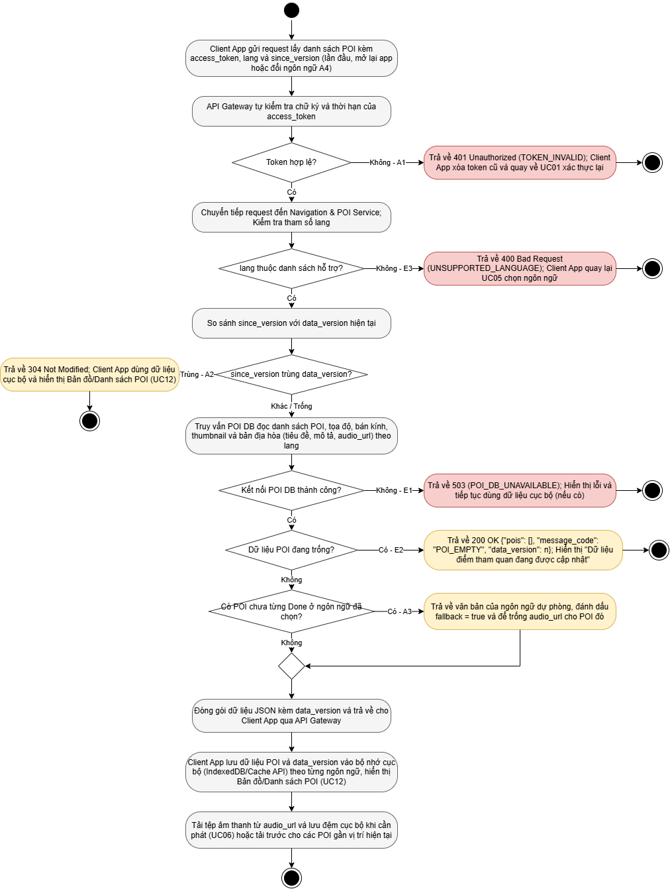

### UC03 - Hỏi đáp qua Chatbot AI

#### Bảng đặc tả chi tiết UC03

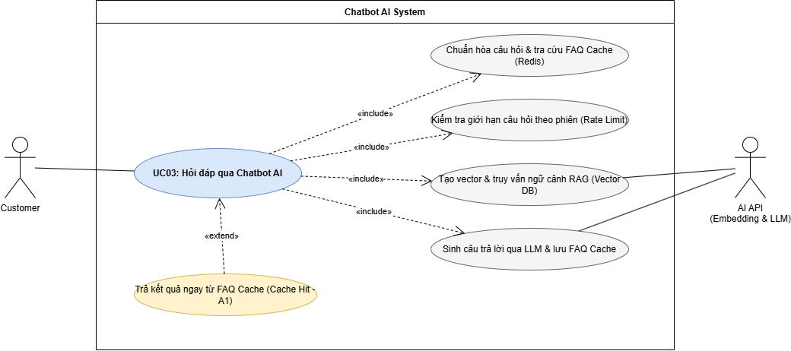

| Thuộc tính / Bước | Tác nhân (Actor Action) | Phản hồi hệ thống (System Response) |
| :--- | :--- | :--- |
| **Use Case Number:** | UC03 | UC03 |
| **Use Case Name:** | Hỏi đáp qua Chatbot AI | Hỏi đáp qua Chatbot AI |
| **Actor(s):** | Customer, AI API. | Customer, AI API. |
| **Maturity:** | Focused. | Focused. |
| **Summary:** | Du khách đặt câu hỏi bằng ngôn ngữ tự nhiên; hệ thống sử dụng kiến trúc RAG kết hợp Vector DB và AI để tìm kiếm ngữ cảnh và trả lời tức thì bằng ngôn ngữ mà du khách đã chọn. | Du khách đặt câu hỏi bằng ngôn ngữ tự nhiên; hệ thống sử dụng kiến trúc RAG kết hợp Vector DB và AI để tìm kiếm ngữ cảnh và trả lời tức thì bằng ngôn ngữ mà du khách đã chọn. |
| **Basic Course of Events:** | Actor Action | System Response |
| **Basic Course of Events:** | 1. Customer nhập câu hỏi vào giao diện Chatbot trên ứng dụng và nhấn gửi (kèm access_token và ngôn ngữ đang chọn). |  |
| **Basic Course of Events:** |  | 2. API Gateway kiểm tra chữ ký, thời hạn của access_token và định tuyến yêu cầu đến Chatbot AI Service. A2. |
| **Basic Course of Events:** |  | 3. Chatbot AI Service chuẩn hóa câu hỏi (loại bỏ khoảng trắng thừa, chuyển chữ thường) và kiểm tra trong Redis Cache theo khóa gồm câu hỏi đã chuẩn hóa và mã ngôn ngữ xem đã có câu trả lời được lưu đệm gần đây hay chưa. A1. |
| **Basic Course of Events:** |  | 4. Nếu chưa có trong Cache, Chatbot AI Service kiểm tra giới hạn số câu hỏi phải gọi AI của phiên (theo session_id). E4. |
| **Basic Course of Events:** |  | 5. Chatbot AI Service gọi Embedding Model để chuyển đổi câu hỏi của người dùng thành vector. E1. |
| **Basic Course of Events:** |  | 6. Chatbot AI Service truy vấn Vector DB để tìm kiếm các đoạn thông tin (văn bản) có ngữ cảnh liên quan nhất. E1, E2. |
| **Basic Course of Events:** |  | 7. Chatbot AI Service ghép câu hỏi gốc, ngữ cảnh tìm được và chỉ dẫn trả lời bằng ngôn ngữ đã chọn thành Prompt, gửi tới mô hình AI để sinh câu trả lời. E3. |
| **Basic Course of Events:** |  | 8. Chatbot AI Service lưu cặp câu hỏi - trả lời mới vào Redis Cache (kèm TTL và mã ngôn ngữ), sau đó trả kết quả (văn bản) về cho Client App. |
| **Basic Course of Events:** | 9. Customer xem câu trả lời hiển thị trên màn hình chat. |  |
| **Basic Course of Events:** |  | 10. Use Case kết thúc tại đây. |
| **Alternative Path:** | A1. Câu hỏi trùng với dữ liệu đã có trong Redis Cache. | A1. Câu hỏi trùng với dữ liệu đã có trong Redis Cache. |
| **Alternative Path:** | Actor Action | System Response |
| **Alternative Path:** | A1.1. Customer gửi một câu hỏi phổ biến đã được hỏi trước đó (cùng ngôn ngữ). |  |
| **Alternative Path:** |  | A1.2. Tại bước 3, Chatbot AI Service tìm thấy câu trả lời tương ứng trong Redis Cache. |
| **Alternative Path:** |  | A1.3. Hệ thống lập tức trả kết quả từ Cache về cho Client mà không cần gọi Embedding, truy vấn Vector DB hay gọi AI (bỏ qua bước 4, 5, 6, 7 và phần lưu Cache của bước 8; chuyển thẳng sang bước 9). |
| **Alternative Path:** | A2. Token xác thực không hợp lệ hoặc đã hết hạn. | A2. Token xác thực không hợp lệ hoặc đã hết hạn. |
| **Alternative Path:** | Actor Action | System Response |
| **Alternative Path:** | A2.1. Customer gửi câu hỏi kèm access_token đã hết hạn. |  |
| **Alternative Path:** |  | A2.2. API Gateway từ chối, trả về 401 Unauthorized (error_code: TOKEN_INVALID). |
| **Alternative Path:** | A2.3. Client App yêu cầu người dùng xác thực lại (quay về UC01). |  |
| **Exception Path:** | E1. Embedding Model hoặc Vector DB phản hồi quá thời gian chờ / lỗi kết nối (bước 5, 6) → Hệ thống trả về 503 Service Unavailable (error_code: CHATBOT_UNAVAILABLE) và không lưu Cache; Client App hiển thị “Hệ thống trợ lý ảo đang bận, vui lòng thử lại sau giây lát” theo ngôn ngữ đã chọn. E2. Câu hỏi nằm ngoài phạm vi dữ liệu kiến thức tại điểm tham quan (không tìm thấy vector có độ tương đồng đạt ngưỡng) → Hệ thống không gọi mô hình AI, không lưu Cache và trả về 200 OK kèm message_code: OUT_OF_SCOPE; Client App hiển thị phản hồi mặc định: “Xin lỗi, tôi chỉ có thể giải đáp các thông tin liên quan đến khu di tích Chùa Linh Ứng” (theo ngôn ngữ đã chọn). E3. Mô hình AI sinh câu trả lời phản hồi quá thời gian chờ / lỗi kết nối (bước 7) → Hệ thống trả về 503 Service Unavailable (error_code: AI_UNAVAILABLE) và không lưu Cache; Client App hiển thị thông báo bận như E1. E4. Phiên vượt giới hạn số câu hỏi cho phép trong một khoảng thời gian → Hệ thống trả về 429 Too Many Requests (error_code: RATE_LIMIT_EXCEEDED); Client App hiển thị “Bạn đã gửi quá nhiều câu hỏi, vui lòng thử lại sau”. | E1. Embedding Model hoặc Vector DB phản hồi quá thời gian chờ / lỗi kết nối (bước 5, 6) → Hệ thống trả về 503 Service Unavailable (error_code: CHATBOT_UNAVAILABLE) và không lưu Cache; Client App hiển thị “Hệ thống trợ lý ảo đang bận, vui lòng thử lại sau giây lát” theo ngôn ngữ đã chọn. E2. Câu hỏi nằm ngoài phạm vi dữ liệu kiến thức tại điểm tham quan (không tìm thấy vector có độ tương đồng đạt ngưỡng) → Hệ thống không gọi mô hình AI, không lưu Cache và trả về 200 OK kèm message_code: OUT_OF_SCOPE; Client App hiển thị phản hồi mặc định: “Xin lỗi, tôi chỉ có thể giải đáp các thông tin liên quan đến khu di tích Chùa Linh Ứng” (theo ngôn ngữ đã chọn). E3. Mô hình AI sinh câu trả lời phản hồi quá thời gian chờ / lỗi kết nối (bước 7) → Hệ thống trả về 503 Service Unavailable (error_code: AI_UNAVAILABLE) và không lưu Cache; Client App hiển thị thông báo bận như E1. E4. Phiên vượt giới hạn số câu hỏi cho phép trong một khoảng thời gian → Hệ thống trả về 429 Too Many Requests (error_code: RATE_LIMIT_EXCEEDED); Client App hiển thị “Bạn đã gửi quá nhiều câu hỏi, vui lòng thử lại sau”. |
| **Extension Points:** | Không có. | Không có. |
| **Triggers:** | Du khách có thắc mắc trong quá trình tham quan và gửi câu hỏi qua khung chat. | Du khách có thắc mắc trong quá trình tham quan và gửi câu hỏi qua khung chat. |
| **Assumptions:** | Dữ liệu kiến thức về điểm tham quan đã được nhúng và lưu sẵn trong Vector DB (UC04); mô hình embedding hỗ trợ đa ngôn ngữ và là cùng một mô hình với mô hình UC04 dùng để tạo vector (để câu hỏi và dữ liệu nằm trong cùng không gian vector); kết nối tới AI API hoạt động tốt. | Dữ liệu kiến thức về điểm tham quan đã được nhúng và lưu sẵn trong Vector DB (UC04); mô hình embedding hỗ trợ đa ngôn ngữ và là cùng một mô hình với mô hình UC04 dùng để tạo vector (để câu hỏi và dữ liệu nằm trong cùng không gian vector); kết nối tới AI API hoạt động tốt. |
| **Preconditions:** | Du khách đã xác thực thành công, có access_token hợp lệ và đã chọn ngôn ngữ (UC05). | Du khách đã xác thực thành công, có access_token hợp lệ và đã chọn ngôn ngữ (UC05). |
| **Post Conditions:** | Du khách nhận được câu trả lời sát ngữ cảnh bằng ngôn ngữ đã chọn; câu hỏi thường gặp được lưu vào Redis Cache để tối ưu tốc độ cho các lần truy vấn sau. | Du khách nhận được câu trả lời sát ngữ cảnh bằng ngôn ngữ đã chọn; câu hỏi thường gặp được lưu vào Redis Cache để tối ưu tốc độ cho các lần truy vấn sau. |
| **Reference: Business Rules** | - Áp dụng cơ chế RAG để đảm bảo AI chỉ trả lời dựa trên nguồn dữ liệu chính thống của địa điểm tham quan. - Ngưỡng độ tương đồng (cosine similarity) tối thiểu để coi là có ngữ cảnh phù hợp là 0,35 (giá trị cấu hình được). - Khóa Cache gồm câu hỏi đã chuẩn hóa và mã ngôn ngữ; Cache được lưu với TTL. Khi dữ liệu tri thức của POI được cập nhật hoặc POI bị xóa (UC04), toàn bộ FAQ Cache bị xóa để không trả về câu trả lời cũ. - Lưu cache các câu hỏi và câu trả lời gần nhất vào Redis để giảm độ trễ và tiết kiệm chi phí gọi API AI. - Giới hạn số câu hỏi phải gọi AI theo session_id trong một khoảng thời gian (giá trị cấu hình được) để kiểm soát chi phí gọi AI; câu hỏi được trả lời từ Cache không bị tính. - Thông báo lỗi và phản hồi mặc định được hiển thị theo ngôn ngữ mà Customer đã chọn. | - Áp dụng cơ chế RAG để đảm bảo AI chỉ trả lời dựa trên nguồn dữ liệu chính thống của địa điểm tham quan. - Ngưỡng độ tương đồng (cosine similarity) tối thiểu để coi là có ngữ cảnh phù hợp là 0,35 (giá trị cấu hình được). - Khóa Cache gồm câu hỏi đã chuẩn hóa và mã ngôn ngữ; Cache được lưu với TTL. Khi dữ liệu tri thức của POI được cập nhật hoặc POI bị xóa (UC04), toàn bộ FAQ Cache bị xóa để không trả về câu trả lời cũ. - Lưu cache các câu hỏi và câu trả lời gần nhất vào Redis để giảm độ trễ và tiết kiệm chi phí gọi API AI. - Giới hạn số câu hỏi phải gọi AI theo session_id trong một khoảng thời gian (giá trị cấu hình được) để kiểm soát chi phí gọi AI; câu hỏi được trả lời từ Cache không bị tính. - Thông báo lỗi và phản hồi mặc định được hiển thị theo ngôn ngữ mà Customer đã chọn. |
| **Author(s):** | Trương Thuận Phú. | Trương Thuận Phú. |
| **Date:** | Bản gốc: 13/10/2026. Hiệu chỉnh: 11/11/2026 | Bản gốc: 13/10/2026. Hiệu chỉnh: 11/11/2026 |
| **Activity Diagram:** | Activity Diagram: | Activity Diagram: |

**Activity Diagram UC03:**

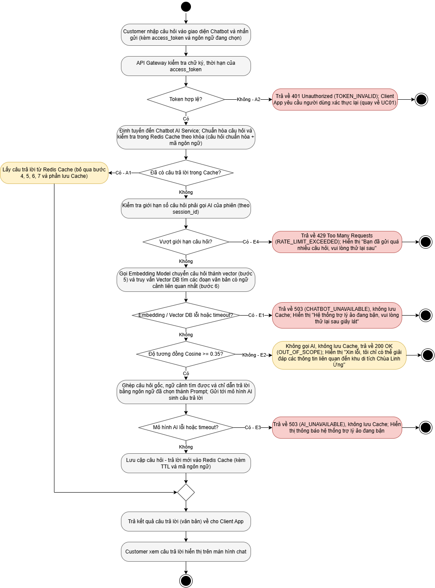

### UC04 - Xử lý dữ liệu đa ngôn ngữ & Tạo audio tự động

#### Bảng đặc tả chi tiết UC04

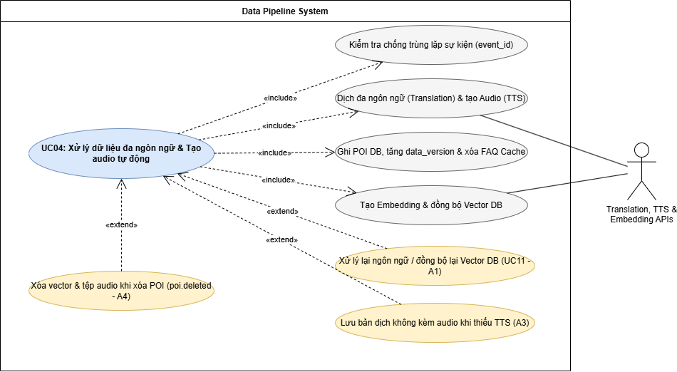

| Thuộc tính / Bước | Tác nhân (Actor Action) | Phản hồi hệ thống (System Response) |
| :--- | :--- | :--- |
| **Use Case Number:** | UC04 | UC04 |
| **Use Case Name:** | Xử lý dữ liệu đa ngôn ngữ & Tạo audio tự động. | Xử lý dữ liệu đa ngôn ngữ & Tạo audio tự động. |
| **Actor(s):** | Translation, TTS & Embedding APIs. (Use Case chạy ngầm, được kích hoạt bởi sự kiện poi.upserted từ UC10; Admin không tương tác trực tiếp.) | Translation, TTS & Embedding APIs. (Use Case chạy ngầm, được kích hoạt bởi sự kiện poi.upserted từ UC10; Admin không tương tác trực tiếp.) |
| **Maturity:** | Focused. | Focused. |
| **Summary:** | Khi Admin thêm hoặc cập nhật tiêu đề/mô tả/ngôn ngữ gốc của một POI (UC10), sự kiện được phát qua Message Queue để Data Pipeline Service chạy ngầm: tự động dịch tiêu đề và mô tả sang 15+ ngôn ngữ, tổng hợp file âm thanh cho từng ngôn ngữ, ghi kết quả qua Navigation & POI Service, cập nhật Vector DB qua Chatbot AI Service và tăng data_version. | Khi Admin thêm hoặc cập nhật tiêu đề/mô tả/ngôn ngữ gốc của một POI (UC10), sự kiện được phát qua Message Queue để Data Pipeline Service chạy ngầm: tự động dịch tiêu đề và mô tả sang 15+ ngôn ngữ, tổng hợp file âm thanh cho từng ngôn ngữ, ghi kết quả qua Navigation & POI Service, cập nhật Vector DB qua Chatbot AI Service và tăng data_version. |
| **Basic Course of Events:** | Actor Action | System Response |
| **Basic Course of Events:** |  | 1. Sau khi Navigation & POI Service lưu POI (UC10), sự kiện poi.upserted (event_id, poi_id, revision, tiêu đề, mô tả gốc, ngôn ngữ gốc) được phát từ bảng outbox lên Message Queue; event_id là mã duy nhất, được tạo mới mỗi lần Admin lưu thay đổi. |
| **Basic Course of Events:** |  | 2. Data Pipeline Service lắng nghe hàng đợi, nhận sự kiện và kiểm tra tính trùng lặp theo event_id bằng cách hỏi Navigation & POI Service (gRPC) xem event_id đã được ghi nhận xử lý hoàn tất chưa. A2. |
| **Basic Course of Events:** |  | 3. Data Pipeline Service lấy từ Navigation & POI Service danh sách ngôn ngữ ở trạng thái Pending (do Navigation & POI Service tạo ở UC10) và lần lượt xử lý từng ngôn ngữ (lặp các bước 4 đến 8 cho từng ngôn ngữ). |
| **Basic Course of Events:** |  | 4. Với từng ngôn ngữ, nếu khác ngôn ngữ gốc của POI thì Data Pipeline Service gọi Translation API để dịch tiêu đề và mô tả gốc (với ngôn ngữ gốc thì dùng nguyên văn, không gọi Translation API). E1. |
| **Basic Course of Events:** | 5. Translation API (nếu đã được gọi ở bước 4) trả về bản dịch của ngôn ngữ tương ứng. |  |
| **Basic Course of Events:** |  | 6. Data Pipeline Service gọi TTS API để tổng hợp tệp âm thanh cho ngôn ngữ tương ứng. A3, E1. |
| **Basic Course of Events:** | 7. TTS API trả về tệp âm thanh của ngôn ngữ tương ứng. |  |
| **Basic Course of Events:** |  | 8. Data Pipeline Service lưu tệp âm thanh vào kho lưu trữ tệp (tên tệp gắn poi_id, lang và revision nên audio_url thay đổi khi nội dung đổi), nhận về audio_url, rồi gọi Navigation & POI Service (lời gọi nội bộ gRPC, kèm revision của sự kiện) để ghi bản dịch, audio_url vào POI DB (ghi đè bản Done cũ của ngôn ngữ đó), đặt trạng thái ngôn ngữ là Done và tăng data_version; sau khi ghi thành công, Data Pipeline Service xóa tệp audio cũ của cùng poi_id và lang khỏi kho lưu trữ tệp. Nếu Navigation & POI Service từ chối vì revision đã cũ hoặc POI không còn tồn tại, Data Pipeline Service xác nhận (ack) và bỏ qua phần còn lại của sự kiện. E2. |
| **Basic Course of Events:** |  | 9. Sau khi xử lý xong các ngôn ngữ, Data Pipeline Service tạo vector embeddings từ mô tả gốc của POI (mô hình embedding đa ngôn ngữ; mỗi đoạn lưu kèm poi_id và language_code của văn bản nguồn) và gọi Chatbot AI Service (gRPC) cập nhật vào Vector DB (thay thế vector cũ cùng poi_id, kèm revision) làm giàu tri thức cho Chatbot RAG, rồi gọi Navigation & POI Service (gRPC) đặt vector_status = Synced. Trước khi ghi Vector DB, Data Pipeline Service kiểm tra POI vẫn tồn tại; Chatbot AI Service từ chối ghi nếu revision thấp hơn revision đang lưu cho poi_id đó. Trong cả hai trường hợp, Data Pipeline Service bỏ qua bước này. E2. |
| **Basic Course of Events:** |  | 10. Khi mọi ngôn ngữ cần xử lý đều có kết quả cuối (Done hoặc Failed) và bước 9 (nếu có chạy) đã hoàn tất, Data Pipeline Service yêu cầu Chatbot AI Service xóa toàn bộ FAQ Cache. Sau cùng, Data Pipeline Service ghi nhận event_id là đã xử lý hoàn tất qua Navigation & POI Service (gRPC). |
| **Basic Course of Events:** |  | 11. Tiến trình chạy ngầm hoàn tất, Use Case kết thúc tại đây. |
| **Alternative Path:** | A1. Xử lý lại ngôn ngữ hoặc đồng bộ lại Vector DB theo yêu cầu của Admin (từ UC11). | A1. Xử lý lại ngôn ngữ hoặc đồng bộ lại Vector DB theo yêu cầu của Admin (từ UC11). |
| **Alternative Path:** | Actor Action | System Response |
| **Alternative Path:** |  | A1.1. Data Pipeline Service nhận yêu cầu xử lý lại (hoặc đồng bộ lại Vector DB) kèm event_id, poi_id và danh sách ngôn ngữ, rồi lấy tiêu đề, mô tả gốc và revision hiện tại của POI từ Navigation & POI Service (gRPC). |
| **Alternative Path:** |  | A1.2. Nếu yêu cầu là xử lý lại ngôn ngữ, Data Pipeline Service thực hiện bước 4 đến 8 cho các ngôn ngữ được yêu cầu rồi đến bước 10. Nếu yêu cầu là đồng bộ lại Vector DB, Data Pipeline Service chỉ thực hiện bước 9 và bước 10 (xóa toàn bộ FAQ Cache), không thay đổi data_version. |
| **Alternative Path:** | A2. Sự kiện trùng lặp (Message Queue giao lại cùng một sự kiện). | A2. Sự kiện trùng lặp (Message Queue giao lại cùng một sự kiện). |
| **Alternative Path:** | Actor Action | System Response |
| **Alternative Path:** |  | A2.1. Data Pipeline Service nhận ra sự kiện đã được xử lý hoàn tất (Navigation & POI Service đã ghi nhận event_id này). |
| **Alternative Path:** |  | A2.2. Hệ thống xác nhận (ack) sự kiện và bỏ qua, không gọi lại Translation & TTS APIs. |
| **Alternative Path:** | A3. Ngôn ngữ không có giọng đọc TTS. | A3. Ngôn ngữ không có giọng đọc TTS. |
| **Alternative Path:** | Actor Action | System Response |
| **Alternative Path:** |  | A3.1. TTS API thông báo ngôn ngữ không được hỗ trợ. |
| **Alternative Path:** |  | A3.2. Data Pipeline Service vẫn lưu bản dịch văn bản, để audio_url rỗng và đặt trạng thái ngôn ngữ là Done (không có audio); Client App chỉ hiển thị văn bản cho POI này (UC06-A3). |
| **Alternative Path:** | A4. Sự kiện poi.deleted (POI bị xóa ở UC10-A2). | A4. Sự kiện poi.deleted (POI bị xóa ở UC10-A2). |
| **Alternative Path:** | Actor Action | System Response |
| **Alternative Path:** |  | A4.1. Data Pipeline Service nhận sự kiện poi.deleted kèm poi_id. |
| **Alternative Path:** |  | A4.2. Data Pipeline Service gọi Chatbot AI Service (gRPC) xóa vector theo poi_id và xóa toàn bộ FAQ Cache, đồng thời xóa tệp audio của POI trong kho lưu trữ. Nếu vẫn lỗi sau khi thử lại, Data Pipeline Service ghi cảnh báo qua Navigation & POI Service (gRPC) để hiển thị trên màn hình theo dõi của Admin Dashboard (UC11), nhằm xử lý thủ công. |
| **Exception Path:** | E1. Lỗi kết nối hoặc quá giới hạn (rate limit) từ Translation & TTS APIs cho một ngôn ngữ → Data Pipeline Service tự động thử lại tối đa 3 lần (giãn cách tăng dần); nếu vẫn lỗi thì đặt trạng thái ngôn ngữ đó là Failed (ghi last_error, attempt_count, failed_at) và chuyển thông điệp vào Dead-Letter Queue (poi.dlq). Các ngôn ngữ còn lại vẫn tiếp tục được xử lý, không làm mất dữ liệu. E2. Lỗi ghi dữ liệu vào POI DB (qua Navigation & POI Service), lỗi gọi Embedding API hoặc lỗi ghi Vector DB (qua Chatbot AI Service) → Hệ thống thử lại; nếu vẫn lỗi thì đặt Failed cho ngôn ngữ chưa ghi được (POI DB) hoặc vector_status = Failed cho POI (Embedding API hoặc Vector DB), kèm last_error, attempt_count, failed_at, và ghi cảnh báo qua Navigation & POI Service (gRPC) để hiển thị trên màn hình theo dõi của Admin Dashboard (UC11). Việc tạo embedding và ghi Vector DB là bước độc lập: lỗi ở bước này không làm mất các bản dịch đã lưu. | E1. Lỗi kết nối hoặc quá giới hạn (rate limit) từ Translation & TTS APIs cho một ngôn ngữ → Data Pipeline Service tự động thử lại tối đa 3 lần (giãn cách tăng dần); nếu vẫn lỗi thì đặt trạng thái ngôn ngữ đó là Failed (ghi last_error, attempt_count, failed_at) và chuyển thông điệp vào Dead-Letter Queue (poi.dlq). Các ngôn ngữ còn lại vẫn tiếp tục được xử lý, không làm mất dữ liệu. E2. Lỗi ghi dữ liệu vào POI DB (qua Navigation & POI Service), lỗi gọi Embedding API hoặc lỗi ghi Vector DB (qua Chatbot AI Service) → Hệ thống thử lại; nếu vẫn lỗi thì đặt Failed cho ngôn ngữ chưa ghi được (POI DB) hoặc vector_status = Failed cho POI (Embedding API hoặc Vector DB), kèm last_error, attempt_count, failed_at, và ghi cảnh báo qua Navigation & POI Service (gRPC) để hiển thị trên màn hình theo dõi của Admin Dashboard (UC11). Việc tạo embedding và ghi Vector DB là bước độc lập: lỗi ở bước này không làm mất các bản dịch đã lưu. |
| **Extension Points:** | Không có. | Không có. |
| **Triggers:** | Sự kiện poi.upserted xuất hiện trong Message Queue khi Admin tạo mới hoặc cập nhật tiêu đề/mô tả/ngôn ngữ gốc của một POI (UC10); hoặc sự kiện poi.deleted (UC10-A2); hoặc yêu cầu xử lý lại từ UC11. | Sự kiện poi.upserted xuất hiện trong Message Queue khi Admin tạo mới hoặc cập nhật tiêu đề/mô tả/ngôn ngữ gốc của một POI (UC10); hoặc sự kiện poi.deleted (UC10-A2); hoặc yêu cầu xử lý lại từ UC11. |
| **Assumptions:** | Hệ thống Message Queue, các Translation, TTS & Embedding APIs, Navigation & POI Service và Chatbot AI Service hoạt động bình thường; danh sách 15+ ngôn ngữ hỗ trợ do Navigation & POI Service quản lý (cấu hình sẵn) và được Data Pipeline Service dùng chung; kho lưu trữ tệp (audio, thumbnail) hoạt động bình thường. | Hệ thống Message Queue, các Translation, TTS & Embedding APIs, Navigation & POI Service và Chatbot AI Service hoạt động bình thường; danh sách 15+ ngôn ngữ hỗ trợ do Navigation & POI Service quản lý (cấu hình sẵn) và được Data Pipeline Service dùng chung; kho lưu trữ tệp (audio, thumbnail) hoạt động bình thường. |
| **Preconditions:** | POI đã được lưu thành công (UC10) và sự kiện đã được đưa vào Message Queue, hoặc yêu cầu xử lý lại hợp lệ từ UC11. | POI đã được lưu thành công (UC10) và sự kiện đã được đưa vào Message Queue, hoặc yêu cầu xử lý lại hợp lệ từ UC11. |
| **Post Conditions:** | Bản dịch cùng tệp thuyết minh âm thanh của các ngôn ngữ xử lý thành công được lưu trong POI DB; trạng thái từng ngôn ngữ và trạng thái đồng bộ vector (vector_status) được ghi nhận; dữ liệu vector mới được đồng bộ sang Vector DB; data_version được tăng theo từng ngôn ngữ hoàn tất (Done) và toàn bộ FAQ Cache của chatbot được xóa. | Bản dịch cùng tệp thuyết minh âm thanh của các ngôn ngữ xử lý thành công được lưu trong POI DB; trạng thái từng ngôn ngữ và trạng thái đồng bộ vector (vector_status) được ghi nhận; dữ liệu vector mới được đồng bộ sang Vector DB; data_version được tăng theo từng ngôn ngữ hoàn tất (Done) và toàn bộ FAQ Cache của chatbot được xóa. |
| **Reference: Business Rules** | - Giao tiếp bất đồng bộ: Tác vụ dịch thuật 15+ ngôn ngữ và sinh file Audio rất tốn thời gian, bắt buộc phải tách rời qua Message Queue để không làm nghẽn hệ thống chính. - Mỗi service chỉ ghi vào cơ sở dữ liệu của chính nó: Data Pipeline Service không ghi trực tiếp vào POI DB hay Vector DB mà thông qua Navigation & POI Service và Chatbot AI Service. - Xử lý idempotent (nhận diện theo event_id đã được ghi nhận trong POI DB qua Navigation & POI Service; hai lần Admin lưu cùng một nội dung vẫn là hai sự kiện khác nhau): cùng một sự kiện được giao lại nhiều lần chỉ tạo ra một kết quả và không gây thêm chi phí gọi API ngoài. - Trạng thái xử lý được lưu theo từng ngôn ngữ (Pending, Done, Failed); lỗi của một ngôn ngữ không chặn các ngôn ngữ khác. Ngôn ngữ chưa từng Done được Client App xử lý bằng nội dung dự phòng (UC02-A3); ngôn ngữ đã có bản Done cũ vẫn được phục vụ bằng bản đó khi đang Pending hoặc Failed. - Chỉ sự kiện poi.upserted (thay đổi tiêu đề/mô tả/ngôn ngữ gốc), poi.deleted hoặc yêu cầu xử lý lại từ UC11 mới kích hoạt Use Case này; thay đổi tọa độ, bán kính hoặc thumbnail không dịch lại (xem UC10-A1). - Chống xử lý sai thứ tự: mỗi POI có trường revision tăng mỗi lần thay đổi tiêu đề/mô tả/ngôn ngữ gốc, và sự kiện mang revision tại thời điểm Admin lưu. Navigation & POI Service từ chối mọi lần ghi có revision thấp hơn hiện tại hoặc cho POI đã bị xóa; Chatbot AI Service lưu revision cùng vector và từ chối ghi revision thấp hơn revision đang lưu; Data Pipeline Service không ghi Vector DB cho POI đã bị xóa. | - Giao tiếp bất đồng bộ: Tác vụ dịch thuật 15+ ngôn ngữ và sinh file Audio rất tốn thời gian, bắt buộc phải tách rời qua Message Queue để không làm nghẽn hệ thống chính. - Mỗi service chỉ ghi vào cơ sở dữ liệu của chính nó: Data Pipeline Service không ghi trực tiếp vào POI DB hay Vector DB mà thông qua Navigation & POI Service và Chatbot AI Service. - Xử lý idempotent (nhận diện theo event_id đã được ghi nhận trong POI DB qua Navigation & POI Service; hai lần Admin lưu cùng một nội dung vẫn là hai sự kiện khác nhau): cùng một sự kiện được giao lại nhiều lần chỉ tạo ra một kết quả và không gây thêm chi phí gọi API ngoài. - Trạng thái xử lý được lưu theo từng ngôn ngữ (Pending, Done, Failed); lỗi của một ngôn ngữ không chặn các ngôn ngữ khác. Ngôn ngữ chưa từng Done được Client App xử lý bằng nội dung dự phòng (UC02-A3); ngôn ngữ đã có bản Done cũ vẫn được phục vụ bằng bản đó khi đang Pending hoặc Failed. - Chỉ sự kiện poi.upserted (thay đổi tiêu đề/mô tả/ngôn ngữ gốc), poi.deleted hoặc yêu cầu xử lý lại từ UC11 mới kích hoạt Use Case này; thay đổi tọa độ, bán kính hoặc thumbnail không dịch lại (xem UC10-A1). - Chống xử lý sai thứ tự: mỗi POI có trường revision tăng mỗi lần thay đổi tiêu đề/mô tả/ngôn ngữ gốc, và sự kiện mang revision tại thời điểm Admin lưu. Navigation & POI Service từ chối mọi lần ghi có revision thấp hơn hiện tại hoặc cho POI đã bị xóa; Chatbot AI Service lưu revision cùng vector và từ chối ghi revision thấp hơn revision đang lưu; Data Pipeline Service không ghi Vector DB cho POI đã bị xóa. |
| **Author(s):** | Phạm Minh Khôi. | Phạm Minh Khôi. |
| **Date:** | Bản gốc: 14/10/2026. Hiệu chỉnh: 11/11/2026 | Bản gốc: 14/10/2026. Hiệu chỉnh: 11/11/2026 |
| **Activity Diagram:** | Activity Diagram: | Activity Diagram: |

**Activity Diagram UC04:**

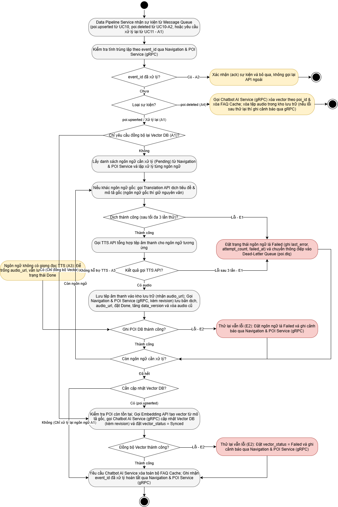

### UC05 - Chọn ngôn ngữ

#### Bảng đặc tả chi tiết UC05

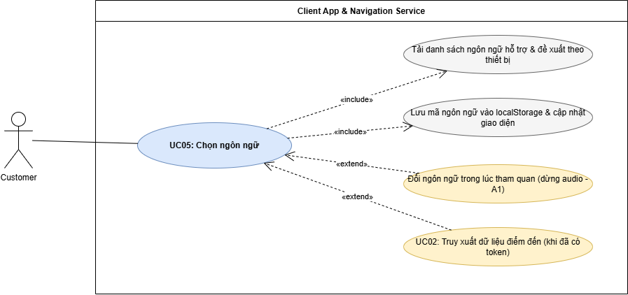

| Thuộc tính / Bước | Tác nhân (Actor Action) | Phản hồi hệ thống (System Response) |
| :--- | :--- | :--- |
| **Use Case Number:** | UC05 | UC05 |
| **Use Case Name:** | Chọn ngôn ngữ. | Chọn ngôn ngữ. |
| **Actor(s):** | Customer. | Customer. |
| **Maturity:** | Focused. | Focused. |
| **Summary:** | Customer chọn (hoặc đổi) ngôn ngữ sử dụng cho nội dung thuyết minh, audio, chatbot và thông báo của ứng dụng. Lựa chọn được lưu cục bộ trên thiết bị và đi kèm mọi request lấy dữ liệu (UC02, UC03). | Customer chọn (hoặc đổi) ngôn ngữ sử dụng cho nội dung thuyết minh, audio, chatbot và thông báo của ứng dụng. Lựa chọn được lưu cục bộ trên thiết bị và đi kèm mọi request lấy dữ liệu (UC02, UC03). |
| **Basic Course of Events:** | Actor Action | System Response |
| **Basic Course of Events:** | 1. Customer mở màn hình chọn ngôn ngữ (tự hiển thị ở lần mở ứng dụng đầu tiên, trước khi xác thực, hoặc mở từ phần Cài đặt). |  |
| **Basic Course of Events:** |  | 2. Client App lấy danh sách các ngôn ngữ được hỗ trợ từ Navigation & POI Service (API công khai, không cần access_token; danh sách được lưu cục bộ để dùng lại khi không có mạng), hiển thị danh sách và đánh dấu đề xuất theo ngôn ngữ của thiết bị nếu ngôn ngữ đó được hỗ trợ. E2. |
| **Basic Course of Events:** | 3. Customer chọn một ngôn ngữ. E1. |  |
| **Basic Course of Events:** |  | 4. Client App lưu mã ngôn ngữ vào bộ nhớ cục bộ (localStorage). E3. |
| **Basic Course of Events:** |  | 5. Client App kiểm tra dữ liệu POI cục bộ của ngôn ngữ đã chọn. Nếu Customer đã có access_token thì kích hoạt UC02 (E2): nếu đã có dữ liệu cục bộ của ngôn ngữ này thì Client App dùng ngay dữ liệu đó và gửi kèm since_version để UC02 kiểm tra phiên bản (304 nếu chưa thay đổi), nếu chưa có thì tải mới; nếu chưa có access_token thì chỉ lưu lựa chọn, UC02 sẽ chạy sau UC01. |
| **Basic Course of Events:** |  | 6. Sau khi có dữ liệu của ngôn ngữ mới (dùng dữ liệu cục bộ hoặc UC02 tải xong), Client App cập nhật giao diện, nội dung POI, audio và chatbot theo ngôn ngữ mới. |
| **Basic Course of Events:** |  | 7. Usecase kết thúc tại đây. |
| **Alternative Path:** | A1. Customer đổi ngôn ngữ trong lúc tham quan. | A1. Customer đổi ngôn ngữ trong lúc tham quan. |
| **Alternative Path:** | Actor Action | System Response |
| **Alternative Path:** | A1.1. Customer mở Cài đặt và chọn một ngôn ngữ khác. |  |
| **Alternative Path:** |  | A1.2. Client App dừng audio đang phát, lưu ngôn ngữ mới và thực hiện từ bước 5 của luồng chính; nội dung chatbot mới hỏi sẽ dùng ngôn ngữ mới. |
| **Exception Path:** | E1. Customer đóng màn hình mà không chọn ngôn ngữ → Client App dùng ngôn ngữ của thiết bị nếu được hỗ trợ, nếu không thì dùng ngôn ngữ dự phòng. E2. Không có kết nối Internet khi cần tải danh sách ngôn ngữ (lần mở đầu tiên, chưa có danh sách lưu cục bộ) hoặc dữ liệu của ngôn ngữ mới → Client App hiển thị thông báo, hoàn tác việc lưu ở bước 4 (khôi phục ngôn ngữ đang dùng trước đó, nếu có) và cho phép thử lại. E3. Không lưu được lựa chọn vào bộ nhớ cục bộ → Client App vẫn áp dụng ngôn ngữ cho phiên làm việc hiện tại và thông báo lựa chọn sẽ không được ghi nhớ. | E1. Customer đóng màn hình mà không chọn ngôn ngữ → Client App dùng ngôn ngữ của thiết bị nếu được hỗ trợ, nếu không thì dùng ngôn ngữ dự phòng. E2. Không có kết nối Internet khi cần tải danh sách ngôn ngữ (lần mở đầu tiên, chưa có danh sách lưu cục bộ) hoặc dữ liệu của ngôn ngữ mới → Client App hiển thị thông báo, hoàn tác việc lưu ở bước 4 (khôi phục ngôn ngữ đang dùng trước đó, nếu có) và cho phép thử lại. E3. Không lưu được lựa chọn vào bộ nhớ cục bộ → Client App vẫn áp dụng ngôn ngữ cho phiên làm việc hiện tại và thông báo lựa chọn sẽ không được ghi nhớ. |
| **Extension Points:** | Không có. (UC02 được kích hoạt khi cần tải dữ liệu của ngôn ngữ mới.) | Không có. (UC02 được kích hoạt khi cần tải dữ liệu của ngôn ngữ mới.) |
| **Triggers:** | Customer mở ứng dụng lần đầu (trước UC09/UC01) hoặc mở mục chọn ngôn ngữ trong Cài đặt. | Customer mở ứng dụng lần đầu (trước UC09/UC01) hoặc mở mục chọn ngôn ngữ trong Cài đặt. |
| **Assumptions:** | Danh sách ngôn ngữ hỗ trợ do Navigation & POI Service quản lý (cấu hình sẵn) và là nguồn duy nhất cho Client App, UC02, UC10 và Data Pipeline Service (UC04). | Danh sách ngôn ngữ hỗ trợ do Navigation & POI Service quản lý (cấu hình sẵn) và là nguồn duy nhất cho Client App, UC02, UC10 và Data Pipeline Service (UC04). |
| **Preconditions:** | Ứng dụng đã khởi động. | Ứng dụng đã khởi động. |
| **Post Conditions:** | Mã ngôn ngữ được lưu cục bộ; giao diện và nội dung được hiển thị theo ngôn ngữ đã chọn. | Mã ngôn ngữ được lưu cục bộ; giao diện và nội dung được hiển thị theo ngôn ngữ đã chọn. |
| **Reference: Business Rules** | - Ngôn ngữ dự phòng được cấu hình sẵn (mặc định: tiếng Anh; nếu chưa có thì dùng ngôn ngữ gốc của POI). - Mã ngôn ngữ được gửi kèm mọi request lấy dữ liệu (UC02, UC03); thông báo lỗi dựa trên error_code và được hiển thị theo ngôn ngữ này. - Lựa chọn ngôn ngữ chỉ lưu trên thiết bị, không gắn với danh tính của Customer. - Ngôn ngữ đã chọn áp dụng cho cả màn hình quét mã QR và xác thực (UC09, UC01). | - Ngôn ngữ dự phòng được cấu hình sẵn (mặc định: tiếng Anh; nếu chưa có thì dùng ngôn ngữ gốc của POI). - Mã ngôn ngữ được gửi kèm mọi request lấy dữ liệu (UC02, UC03); thông báo lỗi dựa trên error_code và được hiển thị theo ngôn ngữ này. - Lựa chọn ngôn ngữ chỉ lưu trên thiết bị, không gắn với danh tính của Customer. - Ngôn ngữ đã chọn áp dụng cho cả màn hình quét mã QR và xác thực (UC09, UC01). |
| **Author(s):** | Phạm Minh Khôi | Phạm Minh Khôi |
| **Date:** | Bản gốc: 07/11/2026. Hiệu chỉnh: 11/11/2026 | Bản gốc: 07/11/2026. Hiệu chỉnh: 11/11/2026 |
| **Activity Diagram:** | Activity Diagram: | Activity Diagram: |

**Activity Diagram UC05:**

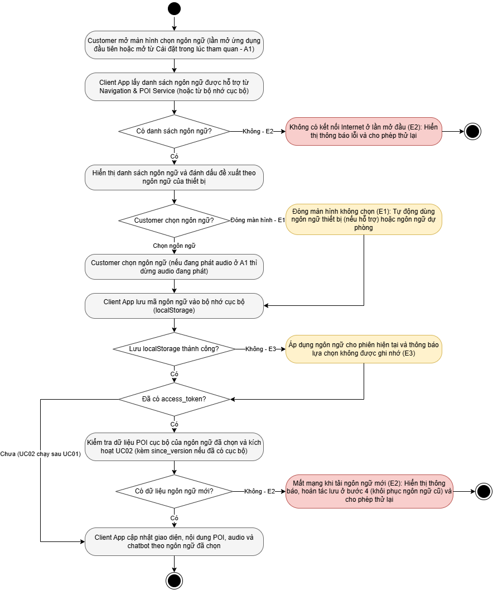

### UC06 - Thuyết minh tự động theo vị trí

#### Bảng đặc tả chi tiết UC06

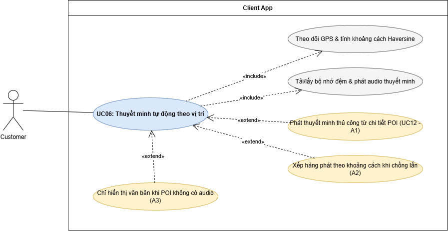

| Thuộc tính / Bước | Tác nhân (Actor Action) | Phản hồi hệ thống (System Response) |
| :--- | :--- | :--- |
| **Use Case Number:** | UC06 | UC06 |
| **Use Case Name:** | Thuyết minh tự động theo vị trí. | Thuyết minh tự động theo vị trí. |
| **Actor(s):** | Customer (Client App). | Customer (Client App). |
| **Maturity:** | Focused. | Focused. |
| **Summary:** | Dựa trên vị trí GPS và dữ liệu POI đã lưu cục bộ (tọa độ, trigger_radius), Client App tự động phát audio thuyết minh bằng ngôn ngữ đã chọn khi Customer đi vào vùng kích hoạt của một POI. Use Case chạy hoàn toàn trên thiết bị, không gọi Backend service (chỉ tải tệp audio từ audio_url khi chưa có trong bộ nhớ đệm). | Dựa trên vị trí GPS và dữ liệu POI đã lưu cục bộ (tọa độ, trigger_radius), Client App tự động phát audio thuyết minh bằng ngôn ngữ đã chọn khi Customer đi vào vùng kích hoạt của một POI. Use Case chạy hoàn toàn trên thiết bị, không gọi Backend service (chỉ tải tệp audio từ audio_url khi chưa có trong bộ nhớ đệm). |
| **Basic Course of Events:** | Actor Action | System Response |
| **Basic Course of Events:** | 1. Customer cấp quyền truy cập vị trí và bật chế độ thuyết minh tự động. E1. |  |
| **Basic Course of Events:** |  | 2. Client App theo dõi vị trí GPS định kỳ (tần suất cấu hình được để tiết kiệm pin). E1. |
| **Basic Course of Events:** |  | 3. Client App tính khoảng cách từ vị trí hiện tại đến từng POI trong dữ liệu cục bộ và xác định các POI có khoảng cách nhỏ hơn hoặc bằng trigger_radius. E3. |
| **Basic Course of Events:** |  | 4. Với các POI đủ điều kiện và chưa được phát trong lượt đi vào vùng hiện tại, Client App chọn POI gần nhất để phát trước (các POI còn lại xếp hàng). A2. |
| **Basic Course of Events:** |  | 5. Client App lấy audio của POI theo ngôn ngữ đã chọn từ bộ nhớ đệm; nếu chưa có thì tải từ audio_url. A3, E2. |
| **Basic Course of Events:** |  | 6. Client App phát audio, đồng thời hiển thị tiêu đề, mô tả và thumbnail của POI. |
| **Basic Course of Events:** | 7. Customer nghe thuyết minh (có thể tạm dừng, tua hoặc bỏ qua). |  |
| **Basic Course of Events:** |  | 8. Khi audio kết thúc, Client App đánh dấu POI đã phát và quay lại theo dõi vị trí (bước 2) cho đến khi Customer tắt chế độ này. |
| **Basic Course of Events:** |  | 9. Usecase kết thúc khi Customer tắt chế độ thuyết minh tự động. |
| **Alternative Path:** | A1. Customer phát thuyết minh thủ công. | A1. Customer phát thuyết minh thủ công. |
| **Alternative Path:** | Actor Action | System Response |
| **Alternative Path:** | A1.1. Customer nhấn Phát trên màn hình chi tiết của một POI ở UC12. |  |
| **Alternative Path:** |  | A1.2. Client App thực hiện luồng phát audio dùng chung (bước 5 đến 7 của luồng chính), không phụ thuộc vào vị trí GPS; khi audio kết thúc, Client App đánh dấu POI đã phát và quay về màn hình chi tiết POI (UC12). |
| **Alternative Path:** | A2. Customer đứng trong vùng chồng lấn của nhiều POI. | A2. Customer đứng trong vùng chồng lấn của nhiều POI. |
| **Alternative Path:** | Actor Action | System Response |
| **Alternative Path:** |  | A2.1. Client App phát lần lượt các POI theo thứ tự khoảng cách tăng dần, mỗi lần chỉ phát một audio; POI đã phát trong lượt này không bị phát lặp. |
| **Alternative Path:** | A3. POI không có audio (ngôn ngữ không có giọng đọc hoặc chưa từng xử lý xong). | A3. POI không có audio (ngôn ngữ không có giọng đọc hoặc chưa từng xử lý xong). |
| **Alternative Path:** | Actor Action | System Response |
| **Alternative Path:** |  | A3.1. Client App chỉ hiển thị nội dung văn bản của POI (với POI có fallback = true thì là văn bản của ngôn ngữ dự phòng, xem UC02-A3) và không phát audio. |
| **Exception Path:** | E1. Customer từ chối quyền truy cập vị trí hoặc GPS bị tắt → Client App hiển thị hướng dẫn bật vị trí và chuyển sang chế độ phát thủ công (A1). E2. Không tải được hoặc không phát được tệp audio (mất mạng, tệp lỗi hoặc tệp đã được thay bằng phiên bản mới) → Client App hiển thị văn bản của POI, cho phép Customer thử lại và kiểm tra lại phiên bản dữ liệu (UC02) để cập nhật audio_url. E3. Tín hiệu GPS yếu, sai số vị trí lớn hơn bán kính kích hoạt của POI → Client App không kích hoạt tự động và gợi ý Customer phát thủ công. | E1. Customer từ chối quyền truy cập vị trí hoặc GPS bị tắt → Client App hiển thị hướng dẫn bật vị trí và chuyển sang chế độ phát thủ công (A1). E2. Không tải được hoặc không phát được tệp audio (mất mạng, tệp lỗi hoặc tệp đã được thay bằng phiên bản mới) → Client App hiển thị văn bản của POI, cho phép Customer thử lại và kiểm tra lại phiên bản dữ liệu (UC02) để cập nhật audio_url. E3. Tín hiệu GPS yếu, sai số vị trí lớn hơn bán kính kích hoạt của POI → Client App không kích hoạt tự động và gợi ý Customer phát thủ công. |
| **Extension Points:** | Không có. | Không có. |
| **Triggers:** | Customer bật chế độ thuyết minh tự động và di chuyển vào vùng bán kính kích hoạt (trigger_radius) của một POI. | Customer bật chế độ thuyết minh tự động và di chuyển vào vùng bán kính kích hoạt (trigger_radius) của một POI. |
| **Assumptions:** | Thiết bị có GPS hoạt động; Customer đang ở trong khuôn viên tham quan; ứng dụng chạy ở chế độ foreground với màn hình bật (trình duyệt web thường không theo dõi GPS ổn định khi chạy nền); trình duyệt thường chặn tự phát âm thanh khi chưa có tương tác của người dùng nên thao tác bật chế độ thuyết minh tự động ở bước 1 được dùng để mở khóa phát audio. | Thiết bị có GPS hoạt động; Customer đang ở trong khuôn viên tham quan; ứng dụng chạy ở chế độ foreground với màn hình bật (trình duyệt web thường không theo dõi GPS ổn định khi chạy nền); trình duyệt thường chặn tự phát âm thanh khi chưa có tương tác của người dùng nên thao tác bật chế độ thuyết minh tự động ở bước 1 được dùng để mở khóa phát audio. |
| **Preconditions:** | Client App đã có dữ liệu POI cục bộ của ngôn ngữ đã chọn (UC02, UC05). | Client App đã có dữ liệu POI cục bộ của ngôn ngữ đã chọn (UC02, UC05). |
| **Post Conditions:** | Audio thuyết minh của POI được phát; trạng thái “đã phát” của POI được ghi nhận cục bộ cho lượt tham quan hiện tại. | Audio thuyết minh của POI được phát; trạng thái “đã phát” của POI được ghi nhận cục bộ cho lượt tham quan hiện tại. |
| **Reference: Business Rules** | - Xử lý hoàn toàn tại Client App, không gọi Backend service (chỉ tải tệp audio khi cần) và không gửi vị trí của Customer lên server, nhằm giảm tải cho hệ thống và bảo vệ quyền riêng tư. - Khoảng cách được tính theo công thức Haversine từ tọa độ GPS hiện tại và tọa độ POI. - Chống phát lặp: một POI đã phát chỉ được tự động phát lại sau khi Customer rời khỏi vùng kích hoạt và quay lại, hoặc khi Customer chọn phát lại thủ công. - Tại một thời điểm chỉ phát một audio. - Luồng phát audio của một POI (bước 5 đến 7) là luồng dùng chung cho phát tự động (bước 4) và phát thủ công từ UC12; quan hệ chỉ theo một chiều (UC12 sử dụng luồng này của UC06). | - Xử lý hoàn toàn tại Client App, không gọi Backend service (chỉ tải tệp audio khi cần) và không gửi vị trí của Customer lên server, nhằm giảm tải cho hệ thống và bảo vệ quyền riêng tư. - Khoảng cách được tính theo công thức Haversine từ tọa độ GPS hiện tại và tọa độ POI. - Chống phát lặp: một POI đã phát chỉ được tự động phát lại sau khi Customer rời khỏi vùng kích hoạt và quay lại, hoặc khi Customer chọn phát lại thủ công. - Tại một thời điểm chỉ phát một audio. - Luồng phát audio của một POI (bước 5 đến 7) là luồng dùng chung cho phát tự động (bước 4) và phát thủ công từ UC12; quan hệ chỉ theo một chiều (UC12 sử dụng luồng này của UC06). |
| **Author(s):** | Phạm Minh Khôi | Phạm Minh Khôi |
| **Date:** | Bản gốc: 07/11/2026. Hiệu chỉnh: 11/11/2026 | Bản gốc: 07/11/2026. Hiệu chỉnh: 11/11/2026 |
| **Activity Diagram:** | Activity Diagram: | Activity Diagram: |

**Activity Diagram UC06:**

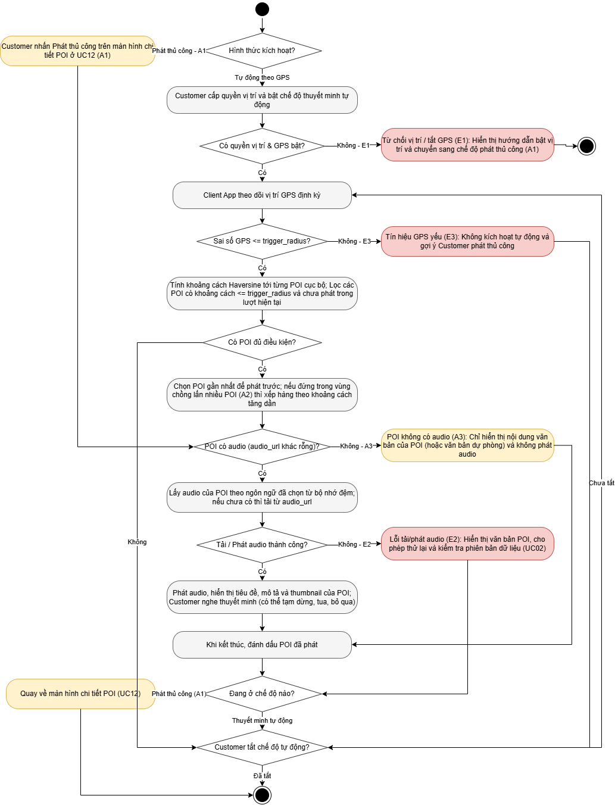

### UC07 - Đăng nhập Admin/Staff

#### Bảng đặc tả chi tiết UC07

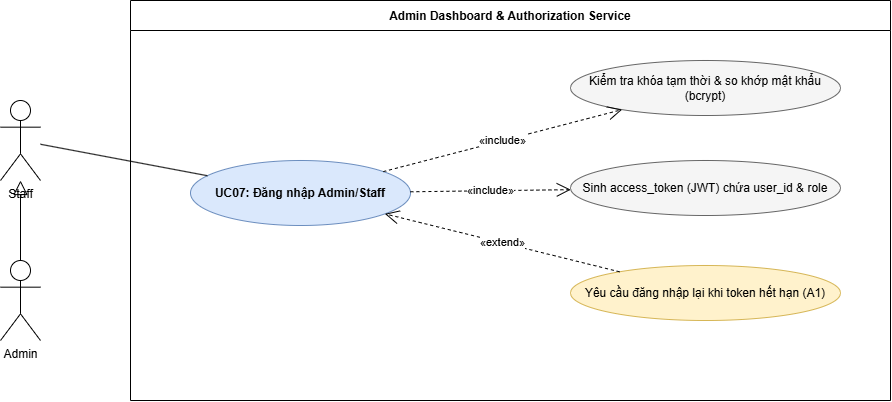

| Thuộc tính / Bước | Tác nhân (Actor Action) | Phản hồi hệ thống (System Response) |
| :--- | :--- | :--- |
| **Use Case Number:** | UC07 | UC07 |
| **Use Case Name:** | Đăng nhập Admin/Staff. | Đăng nhập Admin/Staff. |
| **Actor(s):** | Admin/Staff (thông qua Admin Dashboard). | Admin/Staff (thông qua Admin Dashboard). |
| **Maturity:** | Focused. | Focused. |
| **Summary:** | Admin hoặc Staff đăng nhập bằng username và password trên Admin Dashboard để nhận access_token (JWT) mang vai trò (role) tương ứng, dùng cho các chức năng quản trị (UC08, UC10, UC11). | Admin hoặc Staff đăng nhập bằng username và password trên Admin Dashboard để nhận access_token (JWT) mang vai trò (role) tương ứng, dùng cho các chức năng quản trị (UC08, UC10, UC11). |
| **Basic Course of Events:** | Actor Action | System Response |
| **Basic Course of Events:** | 1. Admin/Staff nhập username, password trên Admin Dashboard và nhấn Đăng nhập. |  |
| **Basic Course of Events:** |  | 2. API Gateway tiếp nhận HTTPS Request và định tuyến đến Authorization Service. |
| **Basic Course of Events:** |  | 3. Authorization Service kiểm tra dữ liệu đầu vào và tra tài khoản trong bảng Users của Auth & Payment DB, đồng thời kiểm tra username có đang bị tạm khóa không (tính theo username đã nhập, kể cả username không tồn tại). E1, E3. |
| **Basic Course of Events:** |  | 4. Authorization Service so khớp password với password_hash (bcrypt). E2, E3. |
| **Basic Course of Events:** |  | 5. Authorization Service sinh access_token (JWT) chứa user_id, role và thời hạn. E4. |
| **Basic Course of Events:** |  | 6. Hệ thống trả access_token về cho Admin Dashboard. |
| **Basic Course of Events:** | 7. Admin Dashboard lưu access_token (trong bộ nhớ phiên) và hiển thị các chức năng theo role. |  |
| **Basic Course of Events:** |  | 8. Usecase kết thúc tại đây. |
| **Alternative Path:** | A1. Token quản trị hết hạn trong lúc thao tác. | A1. Token quản trị hết hạn trong lúc thao tác. |
| **Alternative Path:** | Actor Action | System Response |
| **Alternative Path:** | A1.1. Admin/Staff thực hiện một thao tác quản trị kèm access_token đã hết hạn. |  |
| **Alternative Path:** |  | A1.2. API Gateway trả về 401 Unauthorized (error_code: TOKEN_INVALID). |
| **Alternative Path:** | A1.3. Admin Dashboard chuyển về màn hình đăng nhập; sau khi đăng nhập lại, thao tác chưa hoàn tất có thể được thực hiện lại. |  |
| **Exception Path:** | E1. Thiếu username hoặc password → Hệ thống trả về 400 Bad Request (error_code: INVALID_INPUT). E2. Sai username hoặc password → Hệ thống trả về 401 Unauthorized (error_code: INVALID_CREDENTIALS) với thông báo chung “Tên đăng nhập hoặc mật khẩu không đúng”, không tiết lộ thông tin nào bị sai. E3. Đăng nhập sai quá số lần cho phép liên tiếp với cùng một username (đếm cả username không tồn tại để không lộ username hợp lệ) → Hệ thống tạm khóa username đó trong một khoảng thời gian (cấu hình được) và trả về 429 Too Many Requests (error_code: ACCOUNT_LOCKED); trong thời gian khóa, mọi yêu cầu đăng nhập (kể cả khi đúng mật khẩu) đều bị từ chối với cùng mã lỗi. E4. Auth & Payment DB không khả dụng → Hệ thống trả về 503 Service Unavailable (error_code: AUTH_SERVICE_UNAVAILABLE). | E1. Thiếu username hoặc password → Hệ thống trả về 400 Bad Request (error_code: INVALID_INPUT). E2. Sai username hoặc password → Hệ thống trả về 401 Unauthorized (error_code: INVALID_CREDENTIALS) với thông báo chung “Tên đăng nhập hoặc mật khẩu không đúng”, không tiết lộ thông tin nào bị sai. E3. Đăng nhập sai quá số lần cho phép liên tiếp với cùng một username (đếm cả username không tồn tại để không lộ username hợp lệ) → Hệ thống tạm khóa username đó trong một khoảng thời gian (cấu hình được) và trả về 429 Too Many Requests (error_code: ACCOUNT_LOCKED); trong thời gian khóa, mọi yêu cầu đăng nhập (kể cả khi đúng mật khẩu) đều bị từ chối với cùng mã lỗi. E4. Auth & Payment DB không khả dụng → Hệ thống trả về 503 Service Unavailable (error_code: AUTH_SERVICE_UNAVAILABLE). |
| **Extension Points:** | Không có. | Không có. |
| **Triggers:** | Admin/Staff mở Admin Dashboard và thực hiện đăng nhập. | Admin/Staff mở Admin Dashboard và thực hiện đăng nhập. |
| **Assumptions:** | Tài khoản Admin/Staff đã được tạo sẵn trong bảng Users (không có chức năng tự đăng ký); Auth & Payment DB hoạt động bình thường. | Tài khoản Admin/Staff đã được tạo sẵn trong bảng Users (không có chức năng tự đăng ký); Auth & Payment DB hoạt động bình thường. |
| **Preconditions:** | Admin/Staff chưa có access_token hợp lệ. | Admin/Staff chưa có access_token hợp lệ. |
| **Post Conditions:** | Admin/Staff nhận được access_token hợp lệ mang role admin hoặc staff. | Admin/Staff nhận được access_token hợp lệ mang role admin hoặc staff. |
| **Reference: Business Rules** | - Mật khẩu được lưu dưới dạng băm (bcrypt), không lưu mật khẩu gốc. - Phân quyền theo role: Staff chỉ được dùng UC08 (tạo mã vé tiền mặt); Admin được dùng UC08, UC10 và UC11. - access_token quản trị có thời hạn ngắn hơn access_token của Customer (giá trị cấu hình được). - Không có chức năng đăng ký công khai; việc tạo tài khoản nằm ngoài phạm vi của Use Case này. | - Mật khẩu được lưu dưới dạng băm (bcrypt), không lưu mật khẩu gốc. - Phân quyền theo role: Staff chỉ được dùng UC08 (tạo mã vé tiền mặt); Admin được dùng UC08, UC10 và UC11. - access_token quản trị có thời hạn ngắn hơn access_token của Customer (giá trị cấu hình được). - Không có chức năng đăng ký công khai; việc tạo tài khoản nằm ngoài phạm vi của Use Case này. |
| **Author(s):** | Trương Thuận Phú | Trương Thuận Phú |
| **Date:** | Bản gốc: 07/11/2026. Hiệu chỉnh: 11/11/2026 | Bản gốc: 07/11/2026. Hiệu chỉnh: 11/11/2026 |
| **Activity Diagram:** | Activity Diagram: | Activity Diagram: |

**Activity Diagram UC07:**

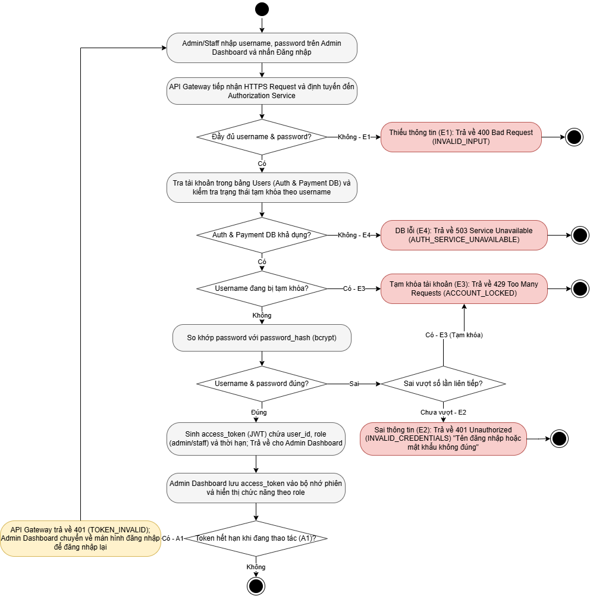

### UC08 - Tạo mã vé tiền mặt

#### Bảng đặc tả chi tiết UC08

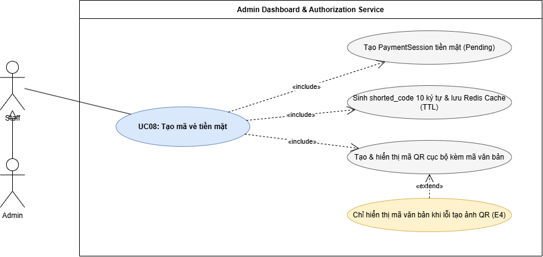

| Thuộc tính / Bước | Tác nhân (Actor Action) | Phản hồi hệ thống (System Response) |
| :--- | :--- | :--- |
| **Use Case Number:** | UC08 | UC08 |
| **Use Case Name:** | Tạo mã vé tiền mặt. | Tạo mã vé tiền mặt. |
| **Actor(s):** | Staff (Admin cũng có thể thực hiện). | Staff (Admin cũng có thể thực hiện). |
| **Maturity:** | Focused. | Focused. |
| **Summary:** | Sau khi thu tiền mặt của du khách tại quầy, Staff tạo mã vé shorted_code (10 ký tự) có thời hạn. Hệ thống tạo PaymentSession tiền mặt ở trạng thái Pending và lưu mã trong Redis Cache; Admin Dashboard hiển thị mã dưới dạng văn bản kèm mã QR. Customer dùng mã này để xác thực ở UC01, bằng cách quét mã QR trên màn hình của Staff (UC09) hoặc nhập thủ công. | Sau khi thu tiền mặt của du khách tại quầy, Staff tạo mã vé shorted_code (10 ký tự) có thời hạn. Hệ thống tạo PaymentSession tiền mặt ở trạng thái Pending và lưu mã trong Redis Cache; Admin Dashboard hiển thị mã dưới dạng văn bản kèm mã QR. Customer dùng mã này để xác thực ở UC01, bằng cách quét mã QR trên màn hình của Staff (UC09) hoặc nhập thủ công. |
| **Basic Course of Events:** | Actor Action | System Response |
| **Basic Course of Events:** | 1. Staff thu tiền mặt của du khách và nhấn “Tạo mã vé” trên Admin Dashboard (nhập số tiền hoặc gói vé). |  |
| **Basic Course of Events:** |  | 2. API Gateway xác thực access_token (role staff hoặc admin) và định tuyến đến Authorization Service. E1, E3. |
| **Basic Course of Events:** |  | 3. Authorization Service tạo PaymentSession (payment_method = cash, status = Pending, amount) trong Auth & Payment DB (sinh session_id cho phiên). |
| **Basic Course of Events:** |  | 4. Authorization Service sinh shorted_code gồm 10 ký tự ngẫu nhiên, kiểm tra không trùng với mã đang có trong Redis Cache. E2. |
| **Basic Course of Events:** |  | 5. Authorization Service lưu shorted_code cùng session_id vào Redis Cache với TTL. |
| **Basic Course of Events:** |  | 6. Hệ thống trả shorted_code và thời hạn hiệu lực về cho Admin Dashboard. Admin Dashboard tạo ảnh mã QR cục bộ từ shorted_code (mã QR chỉ là dạng ảnh của shorted_code, không được lưu hay xử lý riêng) và hiển thị trên màn hình cả shorted_code dạng văn bản lẫn ảnh mã QR. E4. |
| **Basic Course of Events:** | 7. Staff cho du khách quét mã QR trên màn hình (UC09), hoặc đọc/in shorted_code để du khách nhập thủ công vào ứng dụng ở UC01. |  |
| **Basic Course of Events:** |  | 8. Usecase kết thúc tại đây. |
| **Alternative Path:** | Không có. | Không có. |
| **Exception Path:** | E1. Token không hợp lệ hoặc hết hạn → Hệ thống trả về 401 Unauthorized (error_code: TOKEN_INVALID); Admin Dashboard yêu cầu đăng nhập lại (UC07). E2. Redis Cache không khả dụng hoặc không sinh được mã duy nhất sau số lần thử tối đa → Hệ thống đặt PaymentSession vừa tạo sang trạng thái Failed (không ghi nhận thu tiền), trả về 503 Service Unavailable (error_code: CODE_GENERATION_FAILED) và Staff thử lại. E3. Tài khoản không đủ quyền hoặc dữ liệu đầu vào không hợp lệ (ví dụ số tiền nhỏ hơn hoặc bằng 0) → Hệ thống trả về 403 Forbidden (error_code: FORBIDDEN) hoặc 400 Bad Request (error_code: INVALID_INPUT) tương ứng. E4. Admin Dashboard không tạo hoặc không hiển thị được ảnh mã QR → vẫn hiển thị shorted_code dạng văn bản để Staff đọc cho du khách nhập thủ công (UC01); Staff có thể tải lại để tạo lại ảnh QR từ cùng shorted_code (không phát sinh mã mới). | E1. Token không hợp lệ hoặc hết hạn → Hệ thống trả về 401 Unauthorized (error_code: TOKEN_INVALID); Admin Dashboard yêu cầu đăng nhập lại (UC07). E2. Redis Cache không khả dụng hoặc không sinh được mã duy nhất sau số lần thử tối đa → Hệ thống đặt PaymentSession vừa tạo sang trạng thái Failed (không ghi nhận thu tiền), trả về 503 Service Unavailable (error_code: CODE_GENERATION_FAILED) và Staff thử lại. E3. Tài khoản không đủ quyền hoặc dữ liệu đầu vào không hợp lệ (ví dụ số tiền nhỏ hơn hoặc bằng 0) → Hệ thống trả về 403 Forbidden (error_code: FORBIDDEN) hoặc 400 Bad Request (error_code: INVALID_INPUT) tương ứng. E4. Admin Dashboard không tạo hoặc không hiển thị được ảnh mã QR → vẫn hiển thị shorted_code dạng văn bản để Staff đọc cho du khách nhập thủ công (UC01); Staff có thể tải lại để tạo lại ảnh QR từ cùng shorted_code (không phát sinh mã mới). |
| **Extension Points:** | Không có. (Customer đổi shorted_code lấy access_token ở UC01, bằng cách nhập thủ công hoặc quét mã QR ở UC09.) | Không có. (Customer đổi shorted_code lấy access_token ở UC01, bằng cách nhập thủ công hoặc quét mã QR ở UC09.) |
| **Triggers:** | Du khách chọn thanh toán bằng tiền mặt tại quầy và Staff nhận tiền. | Du khách chọn thanh toán bằng tiền mặt tại quầy và Staff nhận tiền. |
| **Assumptions:** | Staff đã thu đúng số tiền; Auth & Payment DB và Redis Cache hoạt động bình thường; danh mục gói vé và giá vé được cấu hình sẵn trong hệ thống. | Staff đã thu đúng số tiền; Auth & Payment DB và Redis Cache hoạt động bình thường; danh mục gói vé và giá vé được cấu hình sẵn trong hệ thống. |
| **Preconditions:** | Staff đã đăng nhập (UC07) và có access_token với role staff hoặc admin. | Staff đã đăng nhập (UC07) và có access_token với role staff hoặc admin. |
| **Post Conditions:** | Một PaymentSession tiền mặt ở trạng thái Pending và một shorted_code có TTL được tạo; Staff nhận được mã (dạng văn bản và mã QR) để giao cho du khách. | Một PaymentSession tiền mặt ở trạng thái Pending và một shorted_code có TTL được tạo; Staff nhận được mã (dạng văn bản và mã QR) để giao cho du khách. |
| **Reference: Business Rules** | - shorted_code gồm 10 ký tự, có TTL cấu hình được và chỉ đổi lấy token được một lần (xem UC01). - PaymentSession tiền mặt chuyển từ Pending sang Success khi Customer đổi mã thành công lần đầu ở UC01. - Mỗi lần tạo mã được ghi nhật ký (người tạo, thời điểm) để phục vụ đối soát. - Mã QR và shorted_code là hai dạng biểu diễn của cùng một giá trị: hệ thống chỉ lưu và xử lý shorted_code; ảnh QR được tạo cục bộ trên Admin Dashboard từ shorted_code, chỉ dùng để hiển thị và không được lưu trữ. Nội dung mã QR là đường dẫn truy cập kèm mã, có dạng https://<domain>/access#code=<shorted_code>. | - shorted_code gồm 10 ký tự, có TTL cấu hình được và chỉ đổi lấy token được một lần (xem UC01). - PaymentSession tiền mặt chuyển từ Pending sang Success khi Customer đổi mã thành công lần đầu ở UC01. - Mỗi lần tạo mã được ghi nhật ký (người tạo, thời điểm) để phục vụ đối soát. - Mã QR và shorted_code là hai dạng biểu diễn của cùng một giá trị: hệ thống chỉ lưu và xử lý shorted_code; ảnh QR được tạo cục bộ trên Admin Dashboard từ shorted_code, chỉ dùng để hiển thị và không được lưu trữ. Nội dung mã QR là đường dẫn truy cập kèm mã, có dạng https://<domain>/access#code=<shorted_code>. |
| **Author(s):** | Trương Thuận Phú | Trương Thuận Phú |
| **Date:** | Bản gốc: 07/11/2026. Hiệu chỉnh: 11/11/2026 | Bản gốc: 07/11/2026. Hiệu chỉnh: 11/11/2026 |
| **Activity Diagram:** | Activity Diagram: | Activity Diagram: |

**Activity Diagram UC08:**

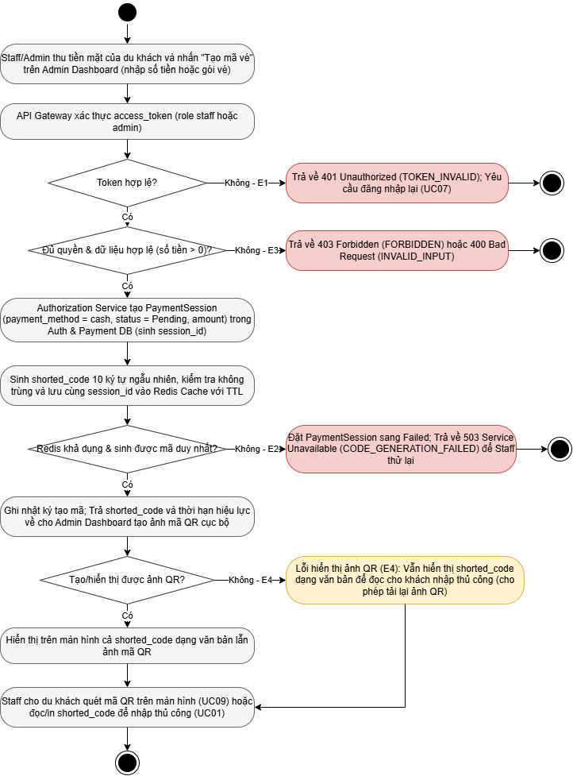

### UC09 - Quét mã QR để truy cập hệ thống

#### Bảng đặc tả chi tiết UC09

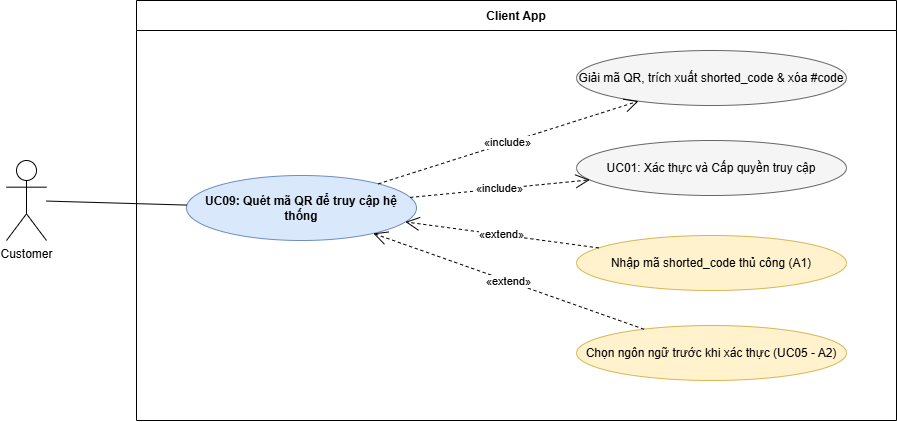

| Thuộc tính / Bước | Tác nhân (Actor Action) | Phản hồi hệ thống (System Response) |
| :--- | :--- | :--- |
| **Use Case Number:** | UC09 | UC09 |
| **Use Case Name:** | Quét mã QR để truy cập hệ thống. | Quét mã QR để truy cập hệ thống. |
| **Actor(s):** | Customer (Client App). | Customer (Client App). |
| **Maturity:** | Focused. | Focused. |
| **Summary:** | Customer quét mã QR do Staff hiển thị trên màn hình bằng camera điện thoại hoặc trình quét trong Client App. Mã QR là dạng ảnh của shorted_code (UC08), nên Client App chỉ cần đọc mã từ nội dung QR, tự động điền và gửi sang UC01 để nhận access_token, giúp du khách không phải nhập mã thủ công. | Customer quét mã QR do Staff hiển thị trên màn hình bằng camera điện thoại hoặc trình quét trong Client App. Mã QR là dạng ảnh của shorted_code (UC08), nên Client App chỉ cần đọc mã từ nội dung QR, tự động điền và gửi sang UC01 để nhận access_token, giúp du khách không phải nhập mã thủ công. |
| **Basic Course of Events:** | Actor Action | System Response |
| **Basic Course of Events:** | 1. Customer quét mã QR trên màn hình của Staff bằng camera điện thoại hoặc chức năng “Quét mã QR” trong Client App. A1, E1. |  |
| **Basic Course of Events:** |  | 2. Client App nhận nội dung mã QR (đường dẫn truy cập có phần #code khi quét bằng camera điện thoại, hoặc nội dung do trình quét trong ứng dụng giải mã) và trích xuất giá trị code. E2. |
| **Basic Course of Events:** |  | 3. Client App kiểm tra code đúng định dạng shorted_code (10 ký tự); nếu Customer chưa chọn ngôn ngữ thì thực hiện A2. E2. |
| **Basic Course of Events:** |  | 4. Client App tự động điền code vào ô nhập mã xác thực và xóa phần #code khỏi đường dẫn trên trình duyệt. |
| **Basic Course of Events:** |  | 5. Client App tự động kích hoạt UC01 với shorted_code vừa nhận; UC01 kiểm tra mã và cấp access_token. E3. |
| **Basic Course of Events:** |  | 6. Usecase kết thúc tại đây. |
| **Alternative Path:** | A1. Customer không quét được mã QR (QR mờ, camera lỗi hoặc không có quyền camera). | A1. Customer không quét được mã QR (QR mờ, camera lỗi hoặc không có quyền camera). |
| **Alternative Path:** | Actor Action | System Response |
| **Alternative Path:** | A1.1. Customer chọn “Nhập mã thủ công”. |  |
| **Alternative Path:** |  | A1.2. Client App hiển thị ô nhập shorted_code. |
| **Alternative Path:** |  | A1.3. Sau khi Customer nhập và gửi shorted_code do Staff cung cấp, hệ thống tiếp tục xử lý theo UC01. |
| **** | A2. Customer chưa chọn ngôn ngữ khi quét mã QR (ví dụ mở ứng dụng lần đầu bằng camera điện thoại). | A2. Customer chưa chọn ngôn ngữ khi quét mã QR (ví dụ mở ứng dụng lần đầu bằng camera điện thoại). |
| **** | Actor Action | System Response |
| **** | A2.1. Customer mở ứng dụng bằng đường dẫn từ mã QR, Client App chưa có ngôn ngữ đã chọn. |  |
| **** |  | A2.2. Client App lưu tạm code trong bộ nhớ phiên của trình duyệt, xóa phần #code khỏi đường dẫn và hiển thị màn hình chọn ngôn ngữ (UC05). |
| **** |  | A2.3. Sau khi Customer chọn ngôn ngữ, Client App tiếp tục từ bước 4 của luồng chính với code đã lưu tạm. |
| **Exception Path:** | E1. Customer từ chối quyền camera hoặc thiết bị không có camera/không hỗ trợ quét → Client App hiển thị hướng dẫn cấp quyền camera theo ngôn ngữ đang chọn và chuyển sang A1. E2. Nội dung mã QR không hợp lệ (không phải mã QR của hệ thống, thiếu phần code hoặc code sai định dạng) → Client App hiển thị “Mã QR không hợp lệ, vui lòng quét lại hoặc nhập mã thủ công” và không gửi yêu cầu lên Backend. E3. UC01 trả về lỗi (mã không tồn tại, đã được sử dụng, hết hạn hoặc vượt giới hạn số lần thử) → Client App hiển thị thông báo lỗi tương ứng của UC01, cho phép quét lại hoặc nhập thủ công. | E1. Customer từ chối quyền camera hoặc thiết bị không có camera/không hỗ trợ quét → Client App hiển thị hướng dẫn cấp quyền camera theo ngôn ngữ đang chọn và chuyển sang A1. E2. Nội dung mã QR không hợp lệ (không phải mã QR của hệ thống, thiếu phần code hoặc code sai định dạng) → Client App hiển thị “Mã QR không hợp lệ, vui lòng quét lại hoặc nhập mã thủ công” và không gửi yêu cầu lên Backend. E3. UC01 trả về lỗi (mã không tồn tại, đã được sử dụng, hết hạn hoặc vượt giới hạn số lần thử) → Client App hiển thị thông báo lỗi tương ứng của UC01, cho phép quét lại hoặc nhập thủ công. |
| **Extension Points:** | Không có. (UC01 được kích hoạt tuần tự sau UC09 khi Client App đã có shorted_code.) | Không có. (UC01 được kích hoạt tuần tự sau UC09 khi Client App đã có shorted_code.) |
| **Triggers:** | Customer nhận mã QR từ Staff (hiển thị trên Admin Dashboard) sau khi thanh toán tiền mặt và muốn truy cập hệ thống. | Customer nhận mã QR từ Staff (hiển thị trên Admin Dashboard) sau khi thanh toán tiền mặt và muốn truy cập hệ thống. |
| **Assumptions:** | Thiết bị của Customer có camera và kết nối Internet; trình duyệt cho phép truy cập camera (HTTPS) nếu dùng trình quét trong Client App; Staff đã cấp mã QR ở UC08 và mã còn hiệu lực. | Thiết bị của Customer có camera và kết nối Internet; trình duyệt cho phép truy cập camera (HTTPS) nếu dùng trình quét trong Client App; Staff đã cấp mã QR ở UC08 và mã còn hiệu lực. |
| **Preconditions:** | Customer chưa có access_token hợp lệ trong localStorage (hoặc token cũ đã hết hạn). Staff đã tạo mã vé và hiển thị mã QR trên Admin Dashboard (UC08). Customer đã chọn ngôn ngữ (UC05), hoặc sẽ chọn ngôn ngữ theo A2. | Customer chưa có access_token hợp lệ trong localStorage (hoặc token cũ đã hết hạn). Staff đã tạo mã vé và hiển thị mã QR trên Admin Dashboard (UC08). Customer đã chọn ngôn ngữ (UC05), hoặc sẽ chọn ngôn ngữ theo A2. |
| **Post Conditions:** | shorted_code được trích xuất từ mã QR và chuyển cho UC01 để đổi lấy access_token; nếu mã hợp lệ, Customer truy cập được hệ thống mà không cần nhập mã thủ công. | shorted_code được trích xuất từ mã QR và chuyển cho UC01 để đổi lấy access_token; nếu mã hợp lệ, Customer truy cập được hệ thống mà không cần nhập mã thủ công. |
| **Reference: Business Rules** | - Mã QR và shorted_code là hai dạng biểu diễn của cùng một giá trị: hệ thống chỉ lưu và xử lý shorted_code (Redis Cache), không lưu ảnh QR và không tạo mã riêng cho QR. - Ảnh QR được tạo cục bộ trên Admin Dashboard từ shorted_code (UC08) và chỉ dùng để hiển thị; nội dung QR là đường dẫn truy cập kèm mã, có dạng https://<domain>/access#code=<shorted_code>. - Việc đọc và giải mã QR thực hiện hoàn toàn trên thiết bị của Customer; Backend không có API giải mã QR riêng. - Mọi quy tắc của shorted_code (TTL, chỉ dùng một lần, đối chiếu và xóa nguyên tử, giới hạn số lần thử) áp dụng nguyên vẹn khi dùng mã QR (xem UC01). - Nhập thủ công shorted_code luôn được giữ làm phương án dự phòng. - Client App xóa phần #code khỏi đường dẫn ngay sau khi đọc để mã không lưu lại trong thanh địa chỉ hoặc lịch sử trình duyệt; vì phần sau dấu # không được gửi lên máy chủ nên mã cũng không xuất hiện trong log của máy chủ. | - Mã QR và shorted_code là hai dạng biểu diễn của cùng một giá trị: hệ thống chỉ lưu và xử lý shorted_code (Redis Cache), không lưu ảnh QR và không tạo mã riêng cho QR. - Ảnh QR được tạo cục bộ trên Admin Dashboard từ shorted_code (UC08) và chỉ dùng để hiển thị; nội dung QR là đường dẫn truy cập kèm mã, có dạng https://<domain>/access#code=<shorted_code>. - Việc đọc và giải mã QR thực hiện hoàn toàn trên thiết bị của Customer; Backend không có API giải mã QR riêng. - Mọi quy tắc của shorted_code (TTL, chỉ dùng một lần, đối chiếu và xóa nguyên tử, giới hạn số lần thử) áp dụng nguyên vẹn khi dùng mã QR (xem UC01). - Nhập thủ công shorted_code luôn được giữ làm phương án dự phòng. - Client App xóa phần #code khỏi đường dẫn ngay sau khi đọc để mã không lưu lại trong thanh địa chỉ hoặc lịch sử trình duyệt; vì phần sau dấu # không được gửi lên máy chủ nên mã cũng không xuất hiện trong log của máy chủ. |
| **Author(s):** | Nguyễn Mạnh Thắng. | Nguyễn Mạnh Thắng. |
| **Date:** | Bản gốc: 10/11/2026. Hiệu chỉnh: 11/11/2026 | Bản gốc: 10/11/2026. Hiệu chỉnh: 11/11/2026 |
| **Activity Diagram:** | Activity Diagram: | Activity Diagram: |

**Activity Diagram UC09:**

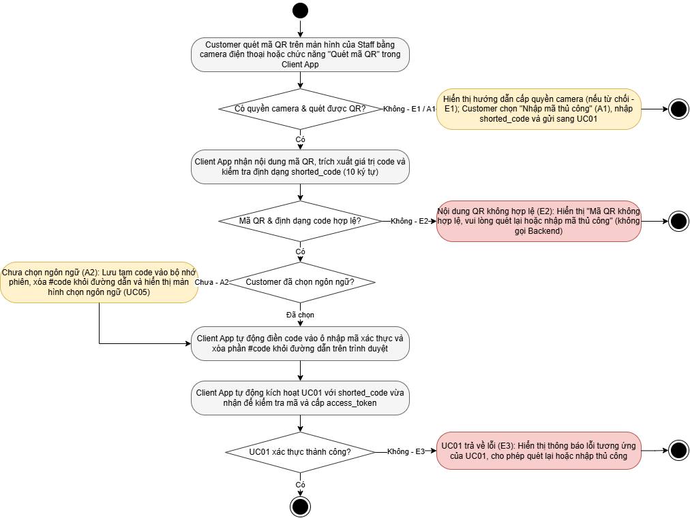

### UC10 - Quản lý POI

#### Bảng đặc tả chi tiết UC10

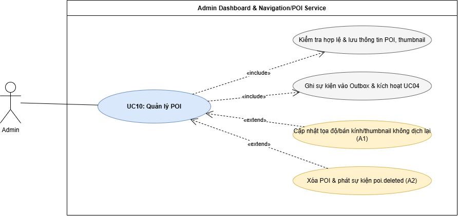

| Thuộc tính / Bước | Tác nhân (Actor Action) | Phản hồi hệ thống (System Response) |
| :--- | :--- | :--- |
| **Use Case Number:** | UC10 | UC10 |
| **Use Case Name:** | Quản lý POI. | Quản lý POI. |
| **Actor(s):** | Admin (thông qua Admin Dashboard). | Admin (thông qua Admin Dashboard). |
| **Maturity:** | Focused. | Focused. |
| **Summary:** | Admin thêm, sửa, xóa điểm tham quan (POI). Khi tiêu đề, mô tả hoặc ngôn ngữ gốc thay đổi, hệ thống phát sự kiện để UC04 xử lý dịch thuật và tạo audio bất đồng bộ mà không làm gián đoạn người dùng hiện tại. | Admin thêm, sửa, xóa điểm tham quan (POI). Khi tiêu đề, mô tả hoặc ngôn ngữ gốc thay đổi, hệ thống phát sự kiện để UC04 xử lý dịch thuật và tạo audio bất đồng bộ mà không làm gián đoạn người dùng hiện tại. |
| **Basic Course of Events:** | Actor Action | System Response |
| **Basic Course of Events:** | 1. Admin mở màn hình quản lý POI và chọn Thêm mới hoặc Sửa một POI (chọn Xóa: A2). |  |
| **Basic Course of Events:** | 2. Admin nhập hoặc chỉnh sửa thông tin gốc của POI (tiêu đề, ngôn ngữ gốc của nội dung, tọa độ, bán kính kích hoạt, thumbnail, mô tả gốc) và nhấn Lưu. |  |
| **Basic Course of Events:** |  | 3. API Gateway xác thực access_token (role admin) và định tuyến đến Navigation & POI Service. E1. |
| **Basic Course of Events:** |  | 4. Navigation & POI Service kiểm tra dữ liệu hợp lệ (tọa độ nằm trong khoảng hợp lệ, bán kính lớn hơn 0, tiêu đề và mô tả không rỗng, ngôn ngữ gốc thuộc danh sách ngôn ngữ hỗ trợ). E2. |
| **Basic Course of Events:** |  | 5. Navigation & POI Service lưu tệp thumbnail (nếu Admin tải lên thumbnail mới) vào kho lưu trữ tệp để nhận thumbnail_url, rồi lưu thông tin POI vào POI DB. Nếu POI mới hoặc tiêu đề/mô tả/ngôn ngữ gốc thay đổi, đồng thời tăng revision của POI, ghi sự kiện poi.upserted (kèm revision) vào bảng outbox và tạo trạng thái xử lý Pending cho từng ngôn ngữ trong danh sách hỗ trợ (cùng vector_status = Pending) trong cùng một giao dịch. Nếu lần lưu đồng thời thay đổi tọa độ, bán kính hoặc thumbnail thì data_version cũng được tăng ngay trong giao dịch này. A1, E3. |
| **Basic Course of Events:** |  | 6. Navigation & POI Service trả phản hồi thành công ngay lập tức cho Admin (không chờ dịch thuật). |
| **Basic Course of Events:** |  | 7. Cơ chế outbox phát sự kiện poi.upserted lên Message Queue để kích hoạt UC04. |
| **Basic Course of Events:** | 8. Admin xem POI ở trạng thái “Đang xử lý ngôn ngữ”; có thể theo dõi chi tiết ở UC11. |  |
| **Basic Course of Events:** |  | 9. Usecase kết thúc tại đây. |
| **Alternative Path:** | A1. Admin chỉ cập nhật tọa độ, bán kính hoặc thumbnail (không thay đổi tiêu đề, mô tả, ngôn ngữ gốc). | A1. Admin chỉ cập nhật tọa độ, bán kính hoặc thumbnail (không thay đổi tiêu đề, mô tả, ngôn ngữ gốc). |
| **Alternative Path:** | Actor Action | System Response |
| **Alternative Path:** |  | A1.1. Navigation & POI Service chỉ cập nhật POI DB (nếu thay thumbnail thì thumbnail mới đã được lưu ở bước 5 và tệp thumbnail cũ bị xóa khỏi kho lưu trữ tệp), không phát sự kiện dịch thuật lên Message Queue để tiết kiệm tài nguyên API. |
| **Alternative Path:** |  | A1.2. Navigation & POI Service tăng data_version ngay để Client App nhận thay đổi ở lần kiểm tra phiên bản kế tiếp (UC02-A2). |
| **Alternative Path:** | A2. Admin xóa một POI. | A2. Admin xóa một POI. |
| **Alternative Path:** | Actor Action | System Response |
| **Alternative Path:** | A2.1. Admin chọn Xóa POI và xác nhận. |  |
| **Alternative Path:** |  | A2.2. Navigation & POI Service xóa POI cùng các bản địa hóa, ghi sự kiện poi.deleted vào outbox trong cùng giao dịch, tăng data_version và xóa tệp thumbnail của POI trong kho lưu trữ tệp. |
| **Alternative Path:** |  | A2.3. Việc xóa vector và tệp audio được thực hiện bất đồng bộ theo UC04-A4. |
| **Exception Path:** | E1. Token không hợp lệ hoặc hết hạn → Hệ thống trả về 401 Unauthorized (error_code: TOKEN_INVALID) và Admin Dashboard yêu cầu đăng nhập lại (UC07); tài khoản không đủ quyền → Hệ thống trả về 403 Forbidden (error_code: FORBIDDEN). E2. Dữ liệu không hợp lệ → Hệ thống trả về 400 Bad Request (error_code: INVALID_INPUT) kèm danh sách trường lỗi; không lưu dữ liệu. E3. Lỗi ghi dữ liệu vào POI DB → Hệ thống trả về 503 Service Unavailable (error_code: POI_DB_UNAVAILABLE); không ghi sự kiện và không thay đổi dữ liệu (giao dịch được hoàn tác). | E1. Token không hợp lệ hoặc hết hạn → Hệ thống trả về 401 Unauthorized (error_code: TOKEN_INVALID) và Admin Dashboard yêu cầu đăng nhập lại (UC07); tài khoản không đủ quyền → Hệ thống trả về 403 Forbidden (error_code: FORBIDDEN). E2. Dữ liệu không hợp lệ → Hệ thống trả về 400 Bad Request (error_code: INVALID_INPUT) kèm danh sách trường lỗi; không lưu dữ liệu. E3. Lỗi ghi dữ liệu vào POI DB → Hệ thống trả về 503 Service Unavailable (error_code: POI_DB_UNAVAILABLE); không ghi sự kiện và không thay đổi dữ liệu (giao dịch được hoàn tác). |
| **Extension Points:** | Không có. (UC04 được kích hoạt bất đồng bộ qua sự kiện poi.upserted/poi.deleted.) | Không có. (UC04 được kích hoạt bất đồng bộ qua sự kiện poi.upserted/poi.deleted.) |
| **Triggers:** | Admin thêm, sửa, xóa POI trên Admin Dashboard. | Admin thêm, sửa, xóa POI trên Admin Dashboard. |
| **Assumptions:** | POI DB và Message Queue hoạt động bình thường; Admin Dashboard truy cập qua API Gateway. | POI DB và Message Queue hoạt động bình thường; Admin Dashboard truy cập qua API Gateway. |
| **Preconditions:** | Admin đã đăng nhập (UC07) với access_token có role admin. | Admin đã đăng nhập (UC07) với access_token có role admin. |
| **Post Conditions:** | Dữ liệu POI được lưu trong POI DB; sự kiện tương ứng được phát (nếu cần); data_version được tăng ngay khi có thay đổi tọa độ, bán kính hoặc thumbnail (kể cả khi đi kèm thay đổi văn bản), và tăng thêm mỗi khi UC04 hoàn tất một ngôn ngữ (Done) khi có thay đổi văn bản. | Dữ liệu POI được lưu trong POI DB; sự kiện tương ứng được phát (nếu cần); data_version được tăng ngay khi có thay đổi tọa độ, bán kính hoặc thumbnail (kể cả khi đi kèm thay đổi văn bản), và tăng thêm mỗi khi UC04 hoàn tất một ngôn ngữ (Done) khi có thay đổi văn bản. |
| **Reference: Business Rules** | - Lưu dữ liệu và ghi sự kiện (outbox) trong cùng một giao dịch để không mất sự kiện khi hệ thống gặp sự cố giữa chừng. - Chỉ role admin được quản lý POI; Staff không có quyền này. - Thay đổi dữ liệu không làm gián đoạn người dùng đang tham quan; Client App nhận thay đổi ở lần kiểm tra phiên bản kế tiếp (UC02-A2). - Việc dịch thuật và tạo audio luôn bất đồng bộ qua Message Queue (xem UC04). - Khi sửa nội dung POI đã có bản dịch, các bản địa hóa Done cũ được giữ nguyên và tiếp tục phục vụ Client cho đến khi bản mới của ngôn ngữ đó Done (ghi đè). | - Lưu dữ liệu và ghi sự kiện (outbox) trong cùng một giao dịch để không mất sự kiện khi hệ thống gặp sự cố giữa chừng. - Chỉ role admin được quản lý POI; Staff không có quyền này. - Thay đổi dữ liệu không làm gián đoạn người dùng đang tham quan; Client App nhận thay đổi ở lần kiểm tra phiên bản kế tiếp (UC02-A2). - Việc dịch thuật và tạo audio luôn bất đồng bộ qua Message Queue (xem UC04). - Khi sửa nội dung POI đã có bản dịch, các bản địa hóa Done cũ được giữ nguyên và tiếp tục phục vụ Client cho đến khi bản mới của ngôn ngữ đó Done (ghi đè). |
| **Author(s):** | Nguyễn Mạnh Thắng | Nguyễn Mạnh Thắng |
| **Date:** | Bản gốc: 07/11/2026. Hiệu chỉnh: 11/11/2026 | Bản gốc: 07/11/2026. Hiệu chỉnh: 11/11/2026 |
| **Activity Diagram:** | Activity Diagram: | Activity Diagram: |

**Activity Diagram UC10:**

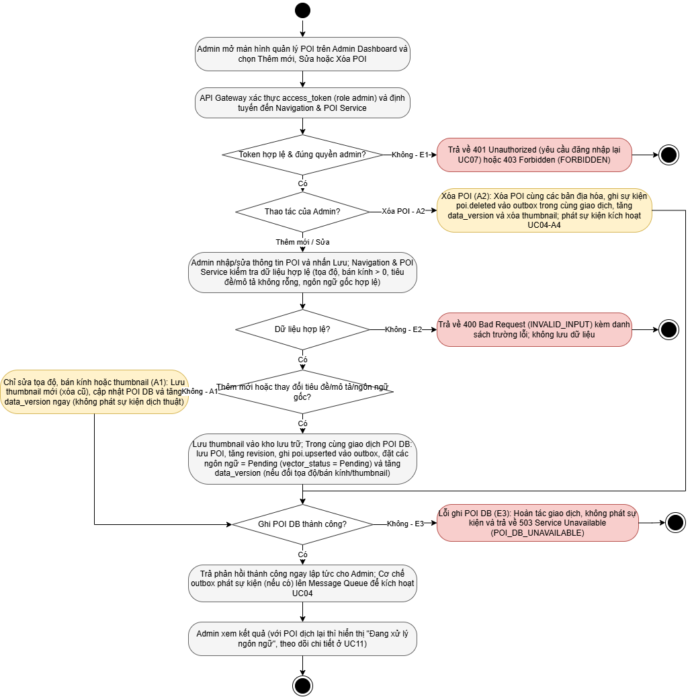

### UC11 - Theo dõi và xử lý lỗi pipeline

#### Bảng đặc tả chi tiết UC11

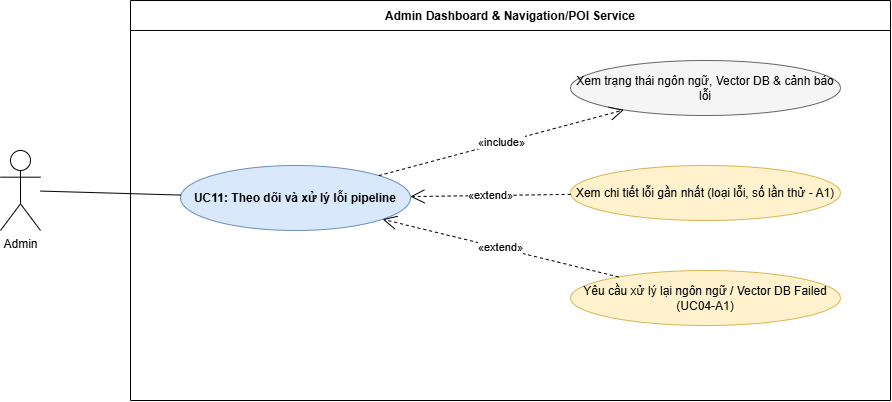

| Thuộc tính / Bước | Tác nhân (Actor Action) | Phản hồi hệ thống (System Response) |
| :--- | :--- | :--- |
| **Use Case Number:** | UC11 | UC11 |
| **Use Case Name:** | Theo dõi và xử lý lỗi pipeline. | Theo dõi và xử lý lỗi pipeline. |
| **Actor(s):** | Admin (thông qua Admin Dashboard). | Admin (thông qua Admin Dashboard). |
| **Maturity:** | Focused. (Ưu tiên thấp.) | Focused. (Ưu tiên thấp.) |
| **Summary:** | Admin xem trạng thái dịch thuật và tạo audio của từng POI theo từng ngôn ngữ, xem các cảnh báo lỗi và yêu cầu xử lý lại các ngôn ngữ bị lỗi (Failed) hoặc đồng bộ lại Vector DB. | Admin xem trạng thái dịch thuật và tạo audio của từng POI theo từng ngôn ngữ, xem các cảnh báo lỗi và yêu cầu xử lý lại các ngôn ngữ bị lỗi (Failed) hoặc đồng bộ lại Vector DB. |
| **Basic Course of Events:** | Actor Action | System Response |
| **Basic Course of Events:** | 1. Admin mở màn hình “Trạng thái xử lý ngôn ngữ” trên Admin Dashboard. |  |
| **Basic Course of Events:** |  | 2. API Gateway xác thực access_token (role admin) và định tuyến đến Navigation & POI Service. E1. |
| **Basic Course of Events:** |  | 3. Navigation & POI Service trả danh sách POI cùng trạng thái từng ngôn ngữ (Pending, Done, Failed), trạng thái đồng bộ Vector DB (Pending, Synced, Failed) và các cảnh báo lỗi. A2. |
| **Basic Course of Events:** | 4. Admin chọn một POI và các ngôn ngữ Failed, hoặc chọn “Đồng bộ lại Vector DB” cho POI có vector_status = Failed, rồi nhấn “Xử lý lại”. A1. |  |
| **Basic Course of Events:** |  | 5. Navigation & POI Service kiểm tra các ngôn ngữ (hoặc vector_status) được chọn đều đang Failed. E2. |
| **Basic Course of Events:** |  | 6. Navigation & POI Service đặt trạng thái các ngôn ngữ (hoặc vector_status) đó về Pending và ghi yêu cầu xử lý lại (kèm event_id) vào bảng outbox trong cùng một giao dịch; cơ chế outbox phát yêu cầu lên Message Queue và Data Pipeline Service xử lý theo UC04-A1. |
| **Basic Course of Events:** | 7. Admin theo dõi trạng thái được cập nhật trên màn hình. |  |
| **Basic Course of Events:** |  | 8. Usecase kết thúc tại đây. |
| **Alternative Path:** | A1. Admin xem chi tiết lỗi. | A1. Admin xem chi tiết lỗi. |
| **Alternative Path:** | Actor Action | System Response |
| **Alternative Path:** | A1.1. Admin chọn một ngôn ngữ (hoặc vector_status) ở trạng thái Failed để xem chi tiết. |  |
| **Alternative Path:** |  | A1.2. Hệ thống hiển thị thông tin lỗi gần nhất (loại lỗi, thời điểm, số lần đã thử). |
| **Alternative Path:** | A2. Không có ngôn ngữ nào bị lỗi. | A2. Không có ngôn ngữ nào bị lỗi. |
| **Alternative Path:** | Actor Action | System Response |
| **Alternative Path:** |  | A2.1. Hệ thống hiển thị thông báo “Tất cả ngôn ngữ đã được xử lý thành công” và không hiển thị nút “Xử lý lại”. |
| **Exception Path:** | E1. Token không hợp lệ hoặc hết hạn → Hệ thống trả về 401 Unauthorized (error_code: TOKEN_INVALID) và Admin Dashboard yêu cầu đăng nhập lại (UC07); tài khoản không đủ quyền → Hệ thống trả về 403 Forbidden (error_code: FORBIDDEN). E2. Ngôn ngữ (hoặc vector_status) được chọn không ở trạng thái Failed → Hệ thống trả về 409 Conflict (error_code: NOT_IN_FAILED_STATE) và từ chối yêu cầu xử lý lại. | E1. Token không hợp lệ hoặc hết hạn → Hệ thống trả về 401 Unauthorized (error_code: TOKEN_INVALID) và Admin Dashboard yêu cầu đăng nhập lại (UC07); tài khoản không đủ quyền → Hệ thống trả về 403 Forbidden (error_code: FORBIDDEN). E2. Ngôn ngữ (hoặc vector_status) được chọn không ở trạng thái Failed → Hệ thống trả về 409 Conflict (error_code: NOT_IN_FAILED_STATE) và từ chối yêu cầu xử lý lại. |
| **Extension Points:** | Không có. (Yêu cầu xử lý lại kích hoạt UC04 theo nhánh A1.) | Không có. (Yêu cầu xử lý lại kích hoạt UC04 theo nhánh A1.) |
| **Triggers:** | Admin nhận thấy cảnh báo lỗi trên màn hình theo dõi của Admin Dashboard hoặc chủ động kiểm tra trạng thái xử lý ngôn ngữ. | Admin nhận thấy cảnh báo lỗi trên màn hình theo dõi của Admin Dashboard hoặc chủ động kiểm tra trạng thái xử lý ngôn ngữ. |
| **Assumptions:** | Trạng thái xử lý theo từng ngôn ngữ đã được UC04 ghi nhận (mô hình dữ liệu có trường status, last_error, attempt_count, failed_at cho từng ngôn ngữ và vector_status cho từng POI); Message Queue hoạt động bình thường. | Trạng thái xử lý theo từng ngôn ngữ đã được UC04 ghi nhận (mô hình dữ liệu có trường status, last_error, attempt_count, failed_at cho từng ngôn ngữ và vector_status cho từng POI); Message Queue hoạt động bình thường. |
| **Preconditions:** | Admin đã đăng nhập (UC07) với access_token có role admin. | Admin đã đăng nhập (UC07) với access_token có role admin. |
| **Post Conditions:** | Các ngôn ngữ (hoặc vector_status) được yêu cầu xử lý lại chuyển sang Pending và được Data Pipeline Service xử lý lại. | Các ngôn ngữ (hoặc vector_status) được yêu cầu xử lý lại chuyển sang Pending và được Data Pipeline Service xử lý lại. |
| **Reference: Business Rules** | - Chỉ cho phép xử lý lại các ngôn ngữ đang Failed hoặc POI có vector_status = Failed. - Mỗi yêu cầu xử lý lại được ghi nhật ký (người thực hiện, thời điểm). - Việc xử lý lại không ảnh hưởng đến các ngôn ngữ đã Done của cùng POI. - Ngôn ngữ (hoặc vector_status) ở trạng thái Pending quá 30 phút được Navigation & POI Service tự động chuyển sang Failed (last_error = TIMEOUT) để Admin có thể xử lý lại. | - Chỉ cho phép xử lý lại các ngôn ngữ đang Failed hoặc POI có vector_status = Failed. - Mỗi yêu cầu xử lý lại được ghi nhật ký (người thực hiện, thời điểm). - Việc xử lý lại không ảnh hưởng đến các ngôn ngữ đã Done của cùng POI. - Ngôn ngữ (hoặc vector_status) ở trạng thái Pending quá 30 phút được Navigation & POI Service tự động chuyển sang Failed (last_error = TIMEOUT) để Admin có thể xử lý lại. |
| **Author(s):** | Nguyễn Mạnh Thắng | Nguyễn Mạnh Thắng |
| **Date:** | Bản gốc: 07/11/2026. Hiệu chỉnh: 11/11/2026 | Bản gốc: 07/11/2026. Hiệu chỉnh: 11/11/2026 |
| **Activity Diagram:** | Activity Diagram: | Activity Diagram: |

**Activity Diagram UC11:**

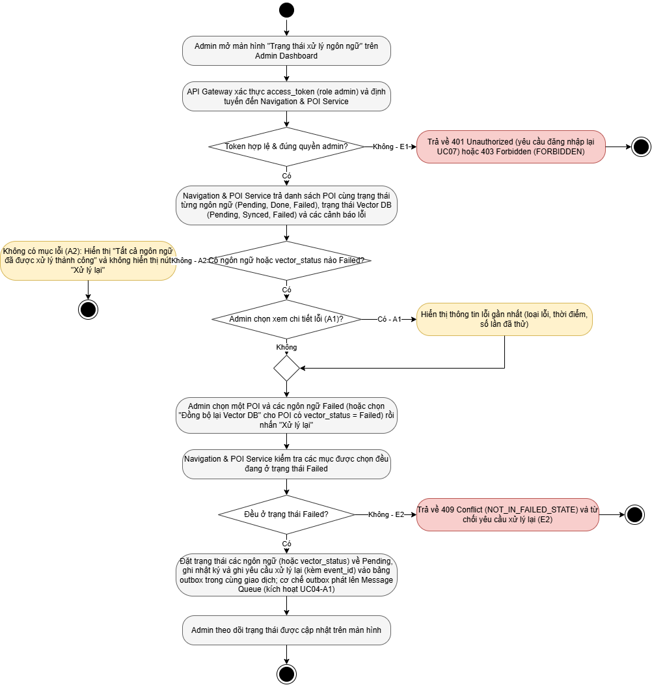

### UC12 - Xem bản đồ và danh sách POI

#### Bảng đặc tả chi tiết UC12

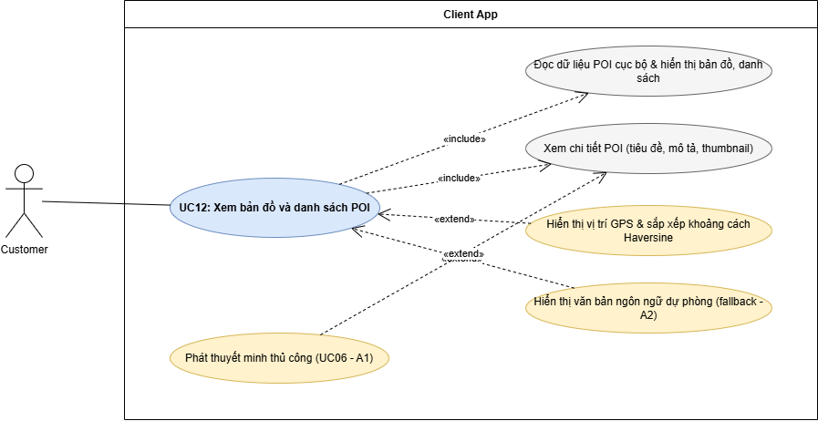

| Thuộc tính / Bước | Tác nhân (Actor Action) | Phản hồi hệ thống (System Response) |
| :--- | :--- | :--- |
| **Use Case Number:** | UC12 | UC12 |
| **Use Case Name:** | Xem bản đồ và danh sách POI. | Xem bản đồ và danh sách POI. |
| **Actor(s):** | Customer (Client App). | Customer (Client App). |
| **Maturity:** | Focused. | Focused. |
| **Summary:** | Customer xem các điểm tham quan (POI) trên bản đồ và trong danh sách theo ngôn ngữ đã chọn, xem chi tiết từng POI (tiêu đề, mô tả, thumbnail) và chọn phát thuyết minh thủ công. Use Case dùng dữ liệu POI đã lưu cục bộ ở UC02, không gọi Backend service. | Customer xem các điểm tham quan (POI) trên bản đồ và trong danh sách theo ngôn ngữ đã chọn, xem chi tiết từng POI (tiêu đề, mô tả, thumbnail) và chọn phát thuyết minh thủ công. Use Case dùng dữ liệu POI đã lưu cục bộ ở UC02, không gọi Backend service. |
| **Basic Course of Events:** | Actor Action | System Response |
| **Basic Course of Events:** | 1. Customer mở màn hình Bản đồ/Danh sách POI (hiển thị mặc định sau khi UC02 hoàn tất). |  |
| **Basic Course of Events:** |  | 2. Client App đọc danh sách POI của ngôn ngữ đã chọn từ bộ nhớ cục bộ. E1. |
| **Basic Course of Events:** |  | 3. Client App hiển thị bản đồ nền kèm marker các POI và danh sách POI (tiêu đề, thumbnail) theo ngôn ngữ đã chọn. A2, E2. |
| **Basic Course of Events:** |  | 4. Nếu Customer đã cấp quyền vị trí, Client App hiển thị vị trí hiện tại trên bản đồ và sắp xếp danh sách POI theo khoảng cách tăng dần (tính tại thiết bị). A1. |
| **Basic Course of Events:** | 5. Customer chọn một POI trên bản đồ hoặc trong danh sách. |  |
| **Basic Course of Events:** |  | 6. Client App hiển thị chi tiết POI gồm tiêu đề, mô tả, thumbnail và nút Phát thuyết minh. A3. |
| **Basic Course of Events:** | 7. Customer nhấn Phát để nghe thuyết minh (Client App thực hiện luồng phát audio dùng chung ở bước 5 đến 7 của UC06, không phụ thuộc vị trí GPS) hoặc quay lại danh sách để chọn POI khác. |  |
| **Basic Course of Events:** |  | 8. Usecase kết thúc tại đây. |
| **Alternative Path:** | A1. Customer chưa cấp quyền vị trí hoặc GPS bị tắt. | A1. Customer chưa cấp quyền vị trí hoặc GPS bị tắt. |
| **Alternative Path:** | Actor Action | System Response |
| **Alternative Path:** |  | A1.1. Client App vẫn hiển thị bản đồ và danh sách POI nhưng không hiển thị vị trí hiện tại; danh sách giữ thứ tự mặc định. Customer vẫn xem chi tiết và phát thuyết minh thủ công bình thường. |
| **Alternative Path:** | A2. POI chưa có nội dung của ngôn ngữ đã chọn (fallback = true, xem UC02-A3). | A2. POI chưa có nội dung của ngôn ngữ đã chọn (fallback = true, xem UC02-A3). |
| **Alternative Path:** | Actor Action | System Response |
| **Alternative Path:** |  | A2.1. Client App hiển thị văn bản ngôn ngữ dự phòng của POI đó kèm nhãn cho biết đây là nội dung dự phòng, đồng thời ẩn hoặc vô hiệu hóa nút Phát vì POI không có audio dự phòng (xem A3). |
| **Alternative Path:** | A3. POI không có audio. | A3. POI không có audio. |
| **Alternative Path:** | Actor Action | System Response |
| **Alternative Path:** |  | A3.1. Client App ẩn hoặc vô hiệu hóa nút Phát, chỉ hiển thị nội dung văn bản của POI (xem UC06-A3). |
| **Exception Path:** | E1. Chưa có dữ liệu POI cục bộ (UC02 chưa hoàn tất hoặc bị lỗi), hoặc danh sách POI rỗng (POI_EMPTY) → Client App hiển thị thông báo “Dữ liệu điểm tham quan đang được cập nhật” và kích hoạt lại UC02 nếu chưa có dữ liệu. E2. Không tải được bản đồ nền (mất kết nối hoặc dịch vụ bản đồ lỗi) → Client App chỉ hiển thị danh sách POI kèm thông báo; việc xem chi tiết và phát audio đã được lưu đệm vẫn hoạt động. | E1. Chưa có dữ liệu POI cục bộ (UC02 chưa hoàn tất hoặc bị lỗi), hoặc danh sách POI rỗng (POI_EMPTY) → Client App hiển thị thông báo “Dữ liệu điểm tham quan đang được cập nhật” và kích hoạt lại UC02 nếu chưa có dữ liệu. E2. Không tải được bản đồ nền (mất kết nối hoặc dịch vụ bản đồ lỗi) → Client App chỉ hiển thị danh sách POI kèm thông báo; việc xem chi tiết và phát audio đã được lưu đệm vẫn hoạt động. |
| **Extension Points:** | Không có. (Khi Customer nhấn Phát, UC12 sử dụng luồng phát audio dùng chung ở UC06; quan hệ một chiều từ UC12 sang UC06, xem UC06-A1.) | Không có. (Khi Customer nhấn Phát, UC12 sử dụng luồng phát audio dùng chung ở UC06; quan hệ một chiều từ UC12 sang UC06, xem UC06-A1.) |
| **Triggers:** | Customer mở màn hình bản đồ/danh sách POI sau khi có dữ liệu POI, hoặc chọn một POI để xem chi tiết. | Customer mở màn hình bản đồ/danh sách POI sau khi có dữ liệu POI, hoặc chọn một POI để xem chi tiết. |
| **Assumptions:** | Dữ liệu POI cục bộ đã được tải (UC02); dịch vụ bản đồ nền khả dụng khi thiết bị có kết nối Internet. | Dữ liệu POI cục bộ đã được tải (UC02); dịch vụ bản đồ nền khả dụng khi thiết bị có kết nối Internet. |
| **Preconditions:** | Customer đã chọn ngôn ngữ (UC05) và Client App đã có dữ liệu POI cục bộ của ngôn ngữ đó (UC02). | Customer đã chọn ngôn ngữ (UC05) và Client App đã có dữ liệu POI cục bộ của ngôn ngữ đó (UC02). |
| **Post Conditions:** | POI được hiển thị trên bản đồ và trong danh sách; Customer xem được chi tiết POI và có thể bắt đầu phát thuyết minh thủ công. | POI được hiển thị trên bản đồ và trong danh sách; Customer xem được chi tiết POI và có thể bắt đầu phát thuyết minh thủ công. |
| **Reference: Business Rules** | - Chỉ hiển thị dữ liệu cục bộ của ngôn ngữ đã chọn; không gọi Backend service khi xem bản đồ/danh sách (chỉ tải bản đồ nền, thumbnail và audio khi cần). - Vị trí của Customer chỉ dùng trên thiết bị để hiển thị và sắp xếp, không gửi lên server (giống UC06). - Khoảng cách được tính theo công thức Haversine từ tọa độ GPS hiện tại và tọa độ POI. - POI có fallback = true hiển thị văn bản ngôn ngữ dự phòng, không có audio, theo UC02-A3. | - Chỉ hiển thị dữ liệu cục bộ của ngôn ngữ đã chọn; không gọi Backend service khi xem bản đồ/danh sách (chỉ tải bản đồ nền, thumbnail và audio khi cần). - Vị trí của Customer chỉ dùng trên thiết bị để hiển thị và sắp xếp, không gửi lên server (giống UC06). - Khoảng cách được tính theo công thức Haversine từ tọa độ GPS hiện tại và tọa độ POI. - POI có fallback = true hiển thị văn bản ngôn ngữ dự phòng, không có audio, theo UC02-A3. |
| **Author(s):** | Nguyễn Mạnh Thắng | Nguyễn Mạnh Thắng |
| **Date:** | Bản gốc: 08/11/2026. Hiệu chỉnh: 11/11/2026 | Bản gốc: 08/11/2026. Hiệu chỉnh: 11/11/2026 |
| **Activity Diagram:** | Activity Diagram: | Activity Diagram: |

**Activity Diagram UC12:**

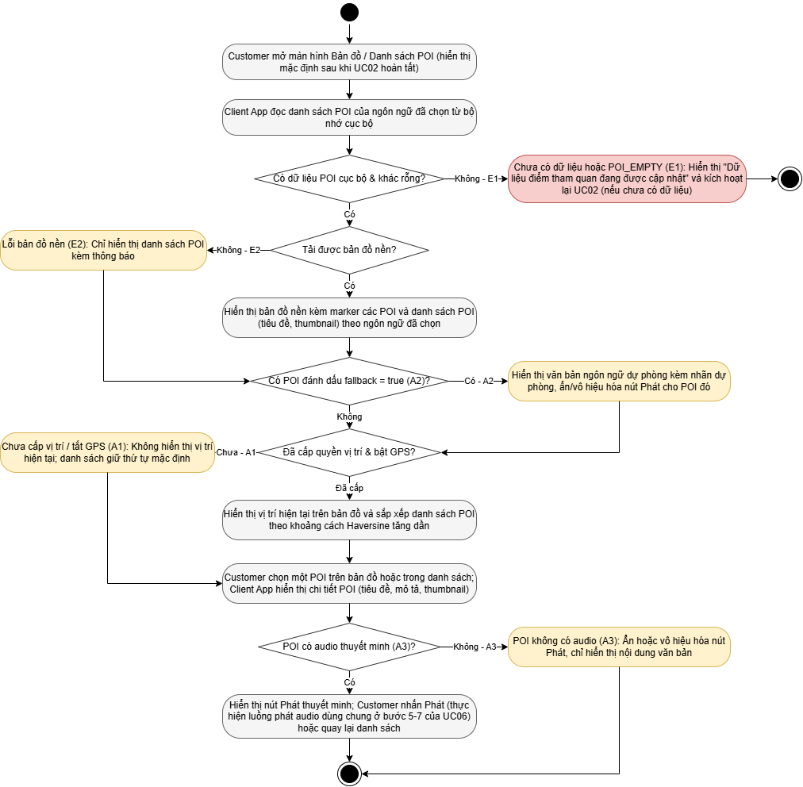

## Key flows

### ERD tổng quan hệ thống

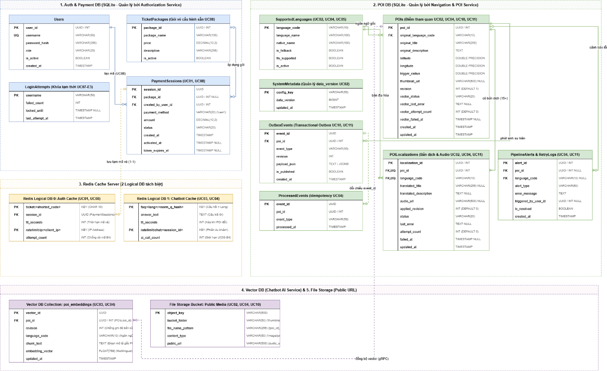

### Lược đồ component

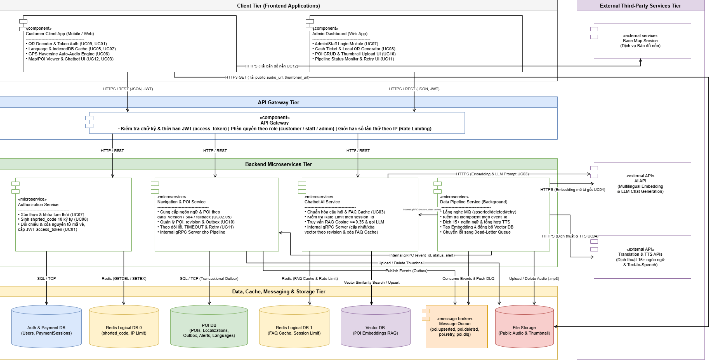

### Lược đồ triển khai

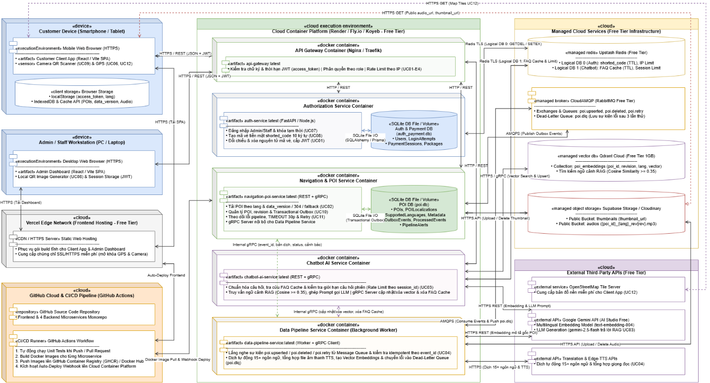

### DFD

### DFD Mức 0

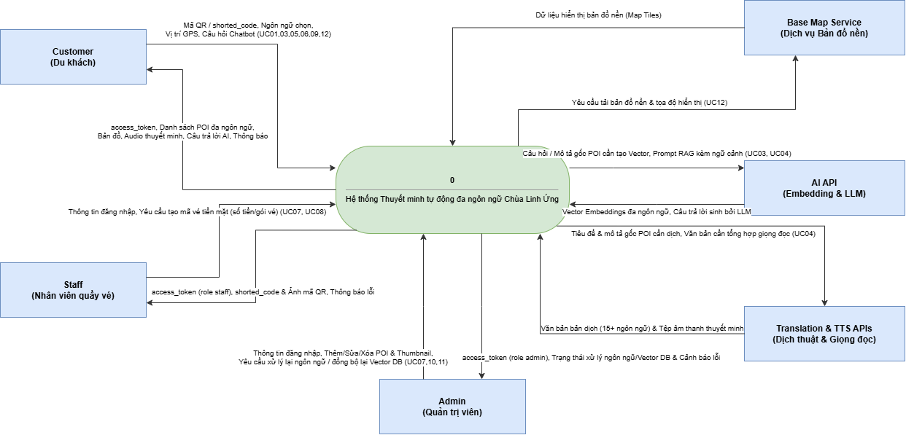

### DFD Mức 1

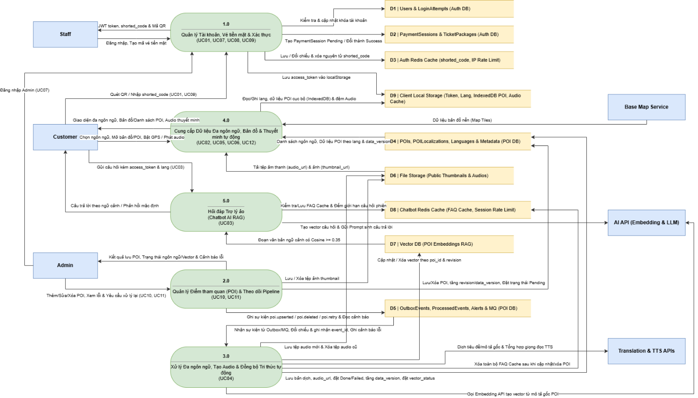

### DFD Mức 2

### DFD Mức 2.1

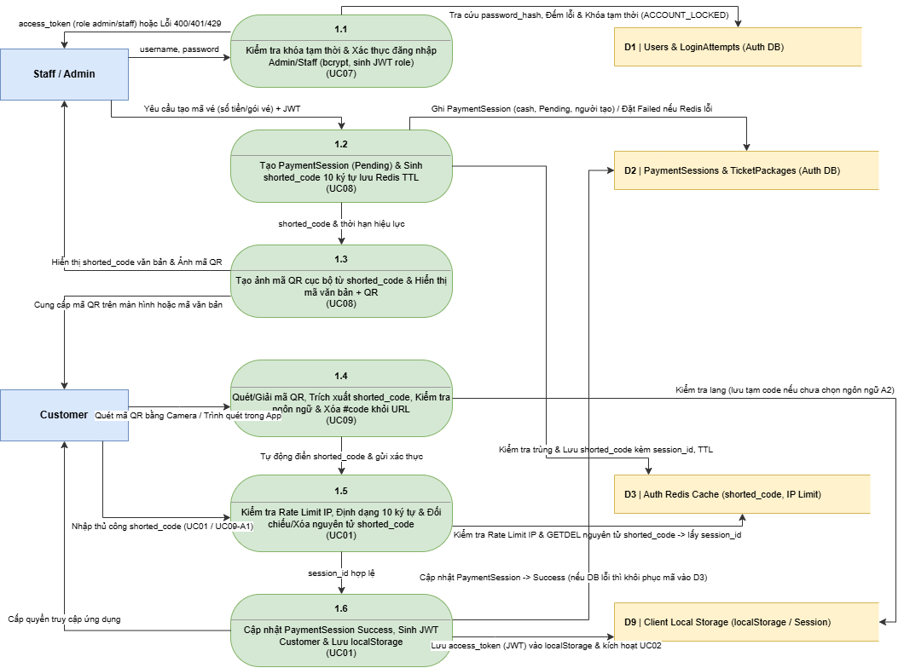

### DFD Mức 2.2

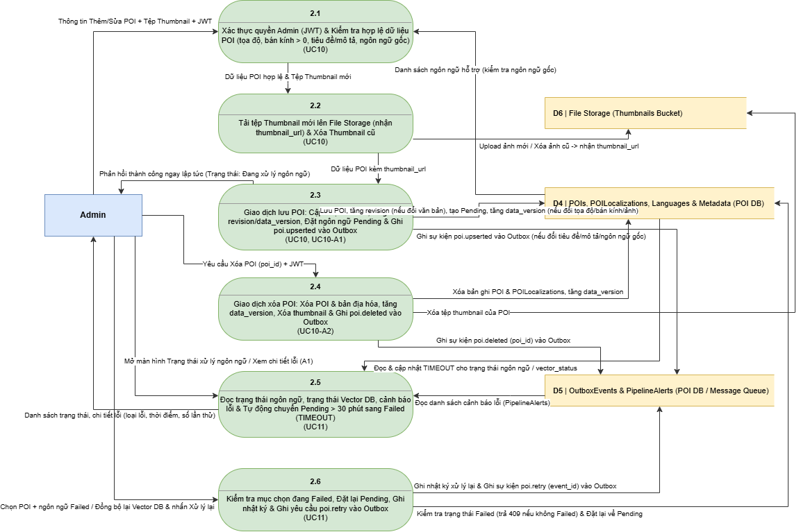

### DFD Mức 2.3

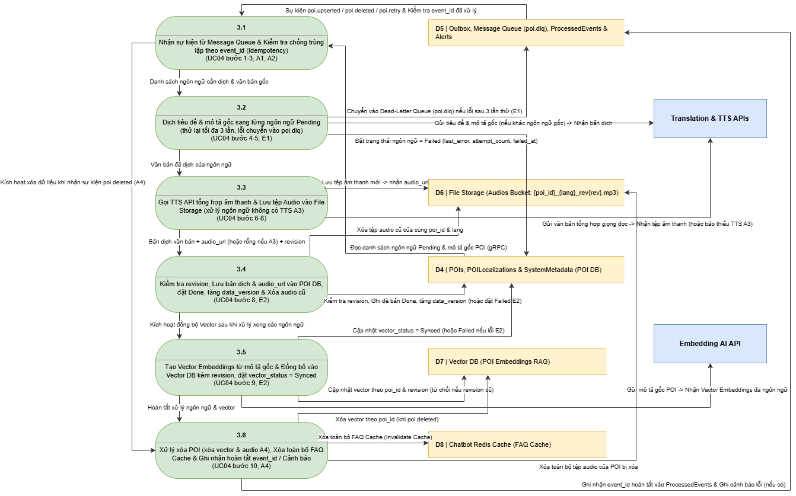

### DFD Mức 2.4

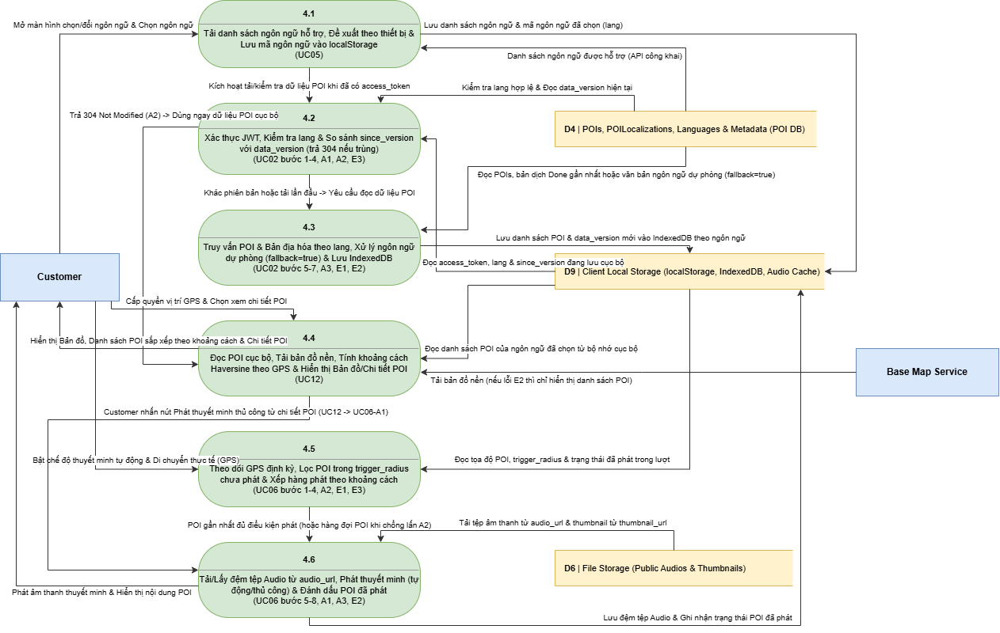

### DFD Mức 2.5

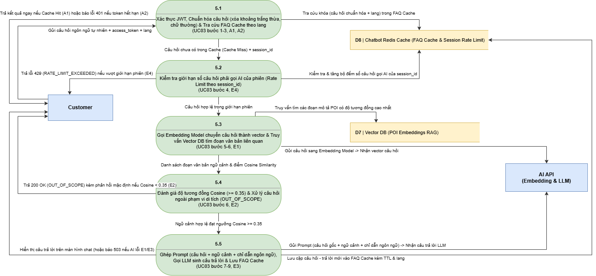
