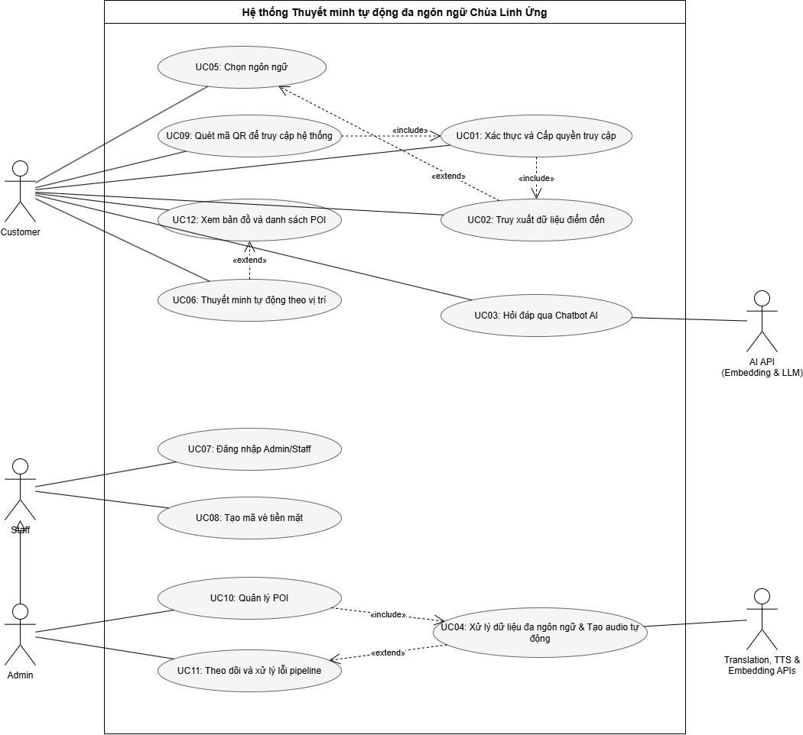

# BỐI CẢNH DỰ ÁN (PROJECT CONTEXT)

## 1. TỔNG QUAN ĐỀ TÀI
- **Tên đề tài:** Trang web ứng dụng thuyết minh tự động đa ngôn ngữ cho Chùa Linh Ứng (Frontend và Backend microservice) có CI/CD.
- **Học phần:** Công nghệ phần mềm — Khoa Công nghệ Thông tin, Trường Đại học Sài Gòn.
- **Giảng viên hướng dẫn:** ThS. Nguyễn Quốc Huy.
- **Nhóm sinh viên thực hiện:**
  1. Nguyễn Mạnh Thắng (MSSV: 3124411283) — `jasesous@gmail.com`
  2. Phạm Minh Khôi (MSSV: 3124411135) — `phamkhoi944@gmail.com`
  3. Trương Thuận Phú (MSSV: 3124411234) — `thuanphutruong1234@gmail.com`

---

## 2. BỐI CẢNH THỰC TẾ & BÀI TOÁN CẦN GIẢI QUYẾT (PROBLEM ALIGNMENT)
Chùa Linh Ứng (Bán đảo Sơn Trà, Đà Nẵng) là một trong những điểm du lịch tâm linh nổi tiếng hàng đầu miền Trung, thu hút đông đảo du khách trong nước và quốc tế từ nhiều quốc gia (Anh, Pháp, Trung Quốc, Hàn Quốc, Nhật Bản...). Tuy nhiên, hiện tại:
1. **Thiếu sự hướng dẫn đa ngôn ngữ tức thời:** Du khách nước ngoài không có hướng dẫn viên đi kèm thường gặp khó khăn trong việc hiểu lịch sử, ý nghĩa văn hóa của từng pho tượng, ngôi tháp.
2. **Hệ thống monolithic truyền thống kém mở rộng:** Khi lượng khách du lịch đổ về đột biến vào dịp lễ hội, các hệ thống đơn khối dễ bị nghẽn mạng, phản hồi chậm hoặc sập hệ thống.
3. **Tác vụ xử lý ngôn ngữ và AI nặng nề:** Việc dịch thuật hàng loạt sang 15+ ngôn ngữ và sinh giọng đọc Text-to-Speech (TTS) là các tác vụ ngốn tài nguyên, nếu xử lý đồng bộ sẽ khiến hệ thống bị treo.

---

## 3. GIẢI PHÁP ĐỀ XUẤT (HIGH-LEVEL SOLUTION)
1. **Kiến trúc Microservices độc lập:**
   - Chia tách hệ thống thành 4 backend microservice: Authorization Service, Navigation & POI Service, Chatbot AI Service, và Data Pipeline Service (Background Worker).
   - Tầng API Gateway làm trung gian điều phối và bảo vệ.
2. **Xác thực bằng vé tiền mặt kết hợp QR Code:**
   - Khách du lịch đến quầy mua vé tiền mặt, Staff tạo mã vé `shorted_code` (10 ký tự ngẫu nhiên) hiển thị dưới dạng mã QR.
   - Khách dùng camera quét QR hoặc nhập mã vào Client App để đổi lấy JWT `access_token` có thời hạn.
   - Thao tác đổi mã mang tính nguyên tử, 1 lần duy nhất trên Redis Cache (`GETDEL`).
3. **Thuyết minh tự động theo GPS (Client-side Engine):**
   - Không gửi tọa độ GPS liên tục lên server để tránh quá tải. Client tải danh sách POIs một lần về bộ nhớ cục bộ (`IndexedDB`/`Cache API`).
   - Client App sử dụng Geolocation API của thiết bị để tính khoảng cách Haversine tới các POIs. Khi du khách bước vào bán kính kích hoạt (`trigger_radius`), Client tự động phát file âm thanh thuyết minh `.mp3`.
4. **Hỏi đáp thông minh với Chatbot AI (RAG - Retrieval-Augmented Generation):**
   - Du khách có thể hỏi đáp thắc mắc bằng bất kỳ ngôn ngữ nào.
   - Hệ thống xử lý trực tiếp các intent xã giao (chào hỏi, cảm ơn, tạm biệt) và áp dụng FAQ Cache trên Redis DB 1 để trả lời tức thì các câu hỏi quen thuộc mà không tốn chi phí gọi LLM.
   - Với câu hỏi mới: Chatbot nhúng vector (`gemini-embedding-001`, 768 chiều), truy vấn Vector DB tìm ngữ cảnh từ mô tả POI và kho tri thức tổng quan về Chùa Linh Ứng (giờ mở cửa, giá vé miễn phí, trang phục, lịch sử...) rồi gửi prompt tới Google Gemini (`gemini-3.5-flash`) để tạo câu trả lời.
5. **Đường ống xử lý dữ liệu ngầm (Data Pipeline Worker):**
   - Khi Admin thêm hoặc chỉnh sửa POI, sự kiện được ghi vào Outbox và đẩy lên RabbitMQ, đồng thời gửi ping đánh thức Worker trên Render nếu đang ngủ đông.
   - Worker chạy ngầm sử dụng Gemini Batch Translation (`gemini-3.5-flash-lite`, kèm fallback GoogleTranslator / MyMemoryTranslator) tự động dịch sang 15 ngôn ngữ trong 1 request và sinh giọng đọc `edge-tts` mà không làm gián đoạn trải nghiệm của người dùng.
6. **Đường ống CI/CD tự động hóa:**
   - Toàn bộ luồng kiểm thử (Unit Tests), đóng gói Docker và triển khai đều được tự động hóa qua GitHub Actions.

---

## 4. DANH SÁCH USE CASE CẦN THỰC HIỆN (PRODUCT BACKLOG)

| Mã UC | Tên Use Case | Tác nhân chính | Service phụ trách | Ghi chú kỹ thuật |
| :---: | :--- | :--- | :--- | :--- |
| **UC01** | Xác thực và Cấp quyền truy cập | Customer (Client App) | Authorization Service | Nhận `shorted_code` -> kiểm tra Redis -> xóa mã -> đổi lấy JWT |
| **UC02** | Truy xuất dữ liệu điểm đến | Client App | Navigation & POI Service | Trả danh sách POI, tọa độ, bản dịch; hỗ trợ HTTP 304 Not Modified |
| **UC03** | Hỏi đáp qua Chatbot AI | Customer | Chatbot AI Service | Greeting intent, FAQ Cache (Redis DB 1), RAG Qdrant (`knowledge_base` + POIs), Gemini API |
| **UC04** | Xử lý dữ liệu đa ngôn ngữ & Tạo audio | Hệ thống (Event) | Data Pipeline Service | RabbitMQ consumer, Batch Translation (15 ngôn ngữ), Edge-TTS, Embeddings, HTTP internal fallback |
| **UC05** | Chọn ngôn ngữ | Customer | Client App | Lưu ngôn ngữ ưu tiên vào Client Storage, reload POI theo ngôn ngữ |
| **UC06** | Thuyết minh tự động theo vị trí | Customer | Client App (Engine) | GPS Geolocation, công thức Haversine, kích hoạt phát audio ngầm |
| **UC07** | Đăng nhập Admin/Staff | Staff / Admin | Authorization Service | Đăng nhập tài khoản, băm mật khẩu, khóa tạm thời, xem Dashboard thống kê (`/api/auth/dashboard-stats`) |
| **UC08** | Tạo mã vé tiền mặt | Staff | Authorization Service | Tạo `shorted_code` 10 ký tự, lưu Redis TTL, hiển thị QR tại quầy & lưu lịch sử localStorage |
| **UC09** | Quét mã QR để truy cập hệ thống | Customer | Client App (Camera) | Quét QR Staff cấp, tự động bóc tách `shorted_code` và kích hoạt UC01 |
| **UC10** | Quản lý POI | Admin | Navigation & POI Service | CRUD điểm tham quan, upload thumbnail, lưu Outbox Events |
| **UC11** | Theo dõi và xử lý lỗi pipeline | Admin | Navigation & POI Service | Xem trạng thái từng thứ tiếng/audio, trigger retry thủ công |
| **UC12** | Xem bản đồ và danh sách POI | Customer | Client App | Hiển thị bản đồ Leaflet/OSM, marker POIs, chi tiết điểm đến |
