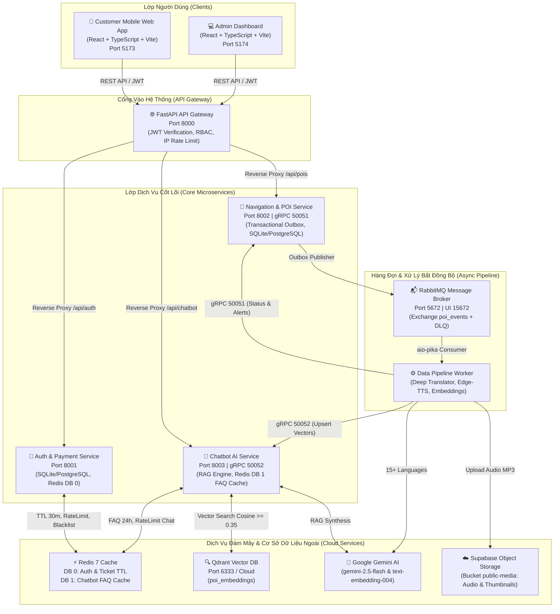

# Trang Web Ứng Dụng Thuyết Minh Tự Động Đa Ngôn Ngữ Cho Chùa Linh Ứng

[](.agents/ARCHITECTURE.md)
[](https://fastapi.tiangolo.com)
[](https://react.dev)
[](docker-compose.yml)
[](.github/workflows/)
[](LICENSE)

Đồ án môn học **Công nghệ phần mềm**: Hệ thống thuyết minh tự động đa ngôn ngữ ứng dụng tại **Chùa Linh Ứng (Bãi Bụt, Bán đảo Sơn Trà, TP. Đà Nẵng)**. Hệ thống bao gồm 2 ứng dụng Frontend (Customer Mobile Web App, Admin Dashboard) và 4 Microservices Backend kèm API Gateway, giao tiếp qua REST HTTP, gRPC nội bộ và RabbitMQ Event-Driven Message Broker, triển khai với quy trình CI/CD hoàn chỉnh.

---

## 👥 THÀNH VIÊN THỰC HIỆN (TEAM MEMBERS)

| STT | Họ và tên | MSSV | Email Git | Phân công phụ trách chính |
|:---:|:---|:---:|:---|:---|
| 1 | **Nguyễn Mạnh Thắng** | 3124411283 | `jasesous@gmail.com` | Authorization Service, Auth Client App (QR & Token), API Gateway, CI/CD |
| 2 | **Phạm Minh Khôi** | 3124411135 | `phamkhoi944@gmail.com` | Navigation & POI Service, Admin Dashboard, Redis Cache, Bản đồ GPS |
| 3 | **Trương Thuận Phú** | 3124411234 | `thuanphutruong1234@gmail.com` | Chatbot AI Service (RAG), Data Pipeline Service (Worker), Vector DB & RabbitMQ |

---

## 🏛️ TỔNG QUAN HỆ THỐNG VÀ 12 USE CASES

Hệ thống phục vụ 3 nhóm đối tượng: **Du khách (Customer)**, **Nhân viên quầy vé (Staff)**, và **Quản trị viên (Admin)**.

| Nhóm chức năng | Mã UC | Tên Use Case | Tác nhân chính |
|:---|:---:|:---|:---|
| **Xác thực & Mã vé** | **UC01** | Quét mã QR / Nhập mã nhận diện (`shorted_code`) | Du khách |
| | **UC07** | Đăng nhập hệ thống quản trị | Admin, Staff |
| | **UC08** | Bán vé tại quầy (Tạo mã vé tiền mặt & in QR) | Staff |
| **Thuyết minh & Bản đồ** | **UC02** | Xem danh sách & Bản đồ điểm tham quan (POIs) | Du khách |
| | **UC05** | Chọn ngôn ngữ thuyết minh (15+ ngôn ngữ) | Du khách |
| | **UC06** | Thuyết minh tự động theo vị trí GPS & Phát Audio (Haversine Client Engine) | Du khách |
| | **UC09** | Sử dụng ngoại tuyến (Offline mode qua IndexedDB & Cache API) | Du khách |
| **Hỏi đáp AI** | **UC03** | Hỏi đáp thông tin với Chatbot AI (Gemini Flash RAG + FAQ Cache) | Du khách |
| | **UC12** | Đánh giá câu trả lời của Chatbot | Du khách |
| **Quản trị nội dung** | **UC10** | Quản lý thông tin điểm tham quan (CRUD POI + Transactional Outbox) | Admin |
| | **UC11** | Giám sát tiến độ xử lý dịch & âm thanh (Retry Pipeline) | Admin |
| | **UC04** | Tự động xử lý dịch thuật, TTS & Vector DB (Background Worker) | Hệ thống |

---

## 📐 SƠ ĐỒ KIẾN TRÚC TỔNG THỂ (ARCHITECTURE)



---

## 🔌 MA TRẬN DỊCH VỤ VÀ CỔNG MẠNG (PORT MATRIX)

| Tên Dịch Vụ | Loại hình | Cổng REST / UI | Cổng Nội Bộ (gRPC / AMQP) | Trách nhiệm chính |
|:---|:---:|:---:|:---:|:---|
| **API Gateway** | Microservice | `8000` | - | Điểm truy cập duy nhất, xác thực JWT, RBAC, Rate Limit IP |
| **Auth Service** | Microservice | `8001` | - | Quản lý tài khoản, mã vé ngắn `shorted_code`, cấp phát token |
| **POI Service** | Microservice | `8002` | `50051` (gRPC) | Quản lý 6+ điểm POI Chùa Linh Ứng, Transactional Outbox, Versioning |
| **Chatbot Service** | Microservice | `8003` | `50052` (gRPC) | Hỏi đáp RAG thông minh, FAQ Cache, Vector search |
| **Data Pipeline Service** | Worker | - | - | Tiêu thụ message RabbitMQ, dịch thuật 15 thứ tiếng, TTS audio, Vector embeddings |
| **Customer App** | Frontend SPA | `5173` | - | Ứng dụng PWA/Mobile Web cho du khách (Bản đồ Leaflet, GPS tự động phát âm, Chat AI) |
| **Admin Dashboard** | Frontend SPA | `5174` | - | Giao diện quản trị viên (Bán vé in QR, CRUD POIs, Giám sát Pipeline) |
| **Redis Cache** | Infrastructure | - | `6379` | DB 0: Auth/Short codes; DB 1: Chatbot FAQ Cache |
| **RabbitMQ Broker**| Infrastructure | `15672` (UI) | `5672` (AMQP) | Hàng đợi sự kiện `poi_upserted_queue`, `poi_deleted_queue`, `dlq` |
| **Qdrant Vector DB**| Infrastructure | `6333` | `6334` | Cơ sở dữ liệu Vector lưu trữ Embeddings cho RAG |

---

## 🚀 HƯỚNG DẪN KHỞI CHẠY (LOCAL DEVELOPMENT)

### Yêu cầu tiên quyết:
- **Docker & Docker Compose** (v2.0+)
- **Python 3.11+**
- **Node.js 18+ & npm**

### Cách 1: Khởi chạy nhanh toàn bộ hệ thống bằng Docker Compose

```powershell
# 1. Sao chép file cấu hình môi trường
cp .env.example .env

# 2. Khởi động toàn bộ cụm dịch vụ
docker compose up -d

# 3. Kiểm tra trạng thái các container
docker compose ps
```

### Cách 2: Chạy thủ công từng dịch vụ để phát triển (Local Dev)

#### 1. Khởi động hạ tầng cơ sở (Redis, RabbitMQ, Qdrant):
```powershell
docker compose up -d redis rabbitmq qdrant
```

#### 2. Cài đặt thư viện Python chung:
```powershell
pip install -r backend/api-gateway/requirements.txt
pip install -r backend/auth-service/requirements.txt
pip install -r backend/poi-service/requirements.txt
pip install -r backend/chatbot-service/requirements.txt
pip install -r backend/data-pipeline-service/requirements.txt
```

#### 3. Khởi tạo dữ liệu mẫu (Seeding):
```powershell
# Nạp dữ liệu 15 ngôn ngữ và 6 điểm tham quan thực tế Chùa Linh Ứng
python backend/poi-service/app/seed_data.py

# Nạp tài khoản quản trị và nhân viên mặc định (admin/admin123, staff/staff123)
python backend/auth-service/seed.py
```

#### 4. Khởi chạy các Backend Microservices:
```powershell
# Terminal 1: API Gateway
uvicorn app.main:app --app-dir backend/api-gateway --port 8000 --reload

# Terminal 2: Auth Service
uvicorn app.main:app --app-dir backend/auth-service --port 8001 --reload

# Terminal 3: POI Service
uvicorn app.main:app --app-dir backend/poi-service --port 8002 --reload

# Terminal 4: Chatbot Service
uvicorn app.main:app --app-dir backend/chatbot-service --port 8003 --reload

# Terminal 5: Data Pipeline Worker
python backend/data-pipeline-service/app/main.py
```

#### 5. Khởi chạy 2 ứng dụng Frontend:
```powershell
# Terminal 6: Customer App (Du khách)
cd frontend/customer-app
npm install
npm run dev

# Terminal 7: Admin Dashboard (Quản trị viên)
cd frontend/admin-dashboard
npm install
npm run dev
```

---

## 🧪 HƯỚNG DẪN KIỂM THỬ (TESTING GUIDE)

Hệ thống được kiểm thử toàn diện từ Unit Test của từng Microservice đến Kiểm thử tích hợp E2E toàn trình.

### 1. Chạy toàn bộ Test Suites Backend:
```powershell
# Chạy toàn bộ 71+ bài kiểm thử tự động
pytest -v
```

### 2. Chạy Kiểm thử tích hợp End-to-End (E2E Integration Test):
Kiểm thử trọn vẹn luồng tương tác giữa Auth Service -> POI Service -> Chatbot Service RAG:
```powershell
pytest tests/test_e2e_integration.py -v
```

### 3. Kiểm thử TypeScript và Build Frontend:
```powershell
# Kiểm tra build Customer App
cd frontend/customer-app
npm run build

# Kiểm tra build Admin Dashboard
cd ../admin-dashboard
npm run build
```

---

## 🚢 QUY TRÌNH TRIỂN KHAI PRODUCTION (DEPLOYMENT & CI/CD)

Hệ thống được trang bị bộ quy trình CI/CD hoàn chỉnh qua **GitHub Actions**:

1. **Continuous Integration (`.github/workflows/ci.yml`):**
   - Tự động kích hoạt khi có Push hoặc Pull Request vào nhánh `main` và `develop`.
   - Chạy `flake8` lint code và `pytest` ma trận kiểm thử tự động toàn bộ microservices.
   - Chạy TypeScript compiler (`tsc`) và Vite build cho cả 2 ứng dụng Frontend.

2. **Continuous Deployment Backend (`.github/workflows/cd-backend.yml`):**
   - Đóng gói Docker Images cho từng service và đẩy lên **GitHub Container Registry (GHCR)**.
   - Tự động gọi Deploy Hook kích hoạt triển khai lên nền tảng **Render / Serverless**.

3. **Continuous Deployment Frontend (`.github/workflows/cd-frontend.yml`):**
   - Tự động build và triển khai Customer App cùng Admin Dashboard lên **Vercel**.

---

## 📄 GIẤY PHÉP (LICENSE)

Dự án được phân phối dưới giấy phép [MIT License](LICENSE).
Mọi quyền sở hữu trí tuệ thuộc về nhóm sinh viên thực hiện đồ án môn học Công nghệ phần mềm.
